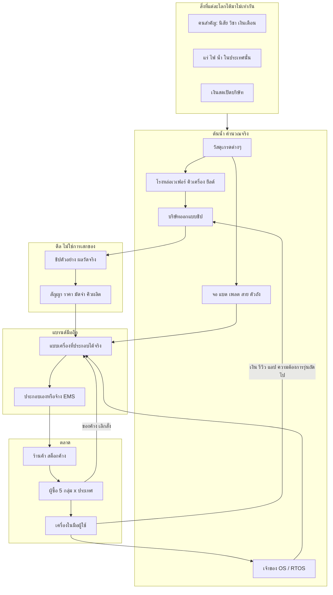

# Era 3 — แบบจำลองธุรกิจโทรศัพท์ทั้งระบบ

**ข้อเสนอสำหรับทีมใช้ตัดสินใจ · 12 พฤศจิกายน 2026 · ยังไม่ใช่โค้ด**

| | |
|---|---|
| เกม | Company Simulation / Siam Enterprise โลก NPC อัตโนมัติ |
| ฐานที่ตรวจจริง | ซอร์ส v2.9.0 ใน `Company-main` · `data.js` + `world.js` + `human-core.js` |
| สถานะ | ข้อเสนอออกแบบ ไม่มีโมดูลโทรศัพท์ในรันไทม์ |
| ใช้คู่กับ | เอกสาร Era 3 ชุดเดิม (ข้อกำหนด, พิมพ์เขียว, สูตร, ตัวเลข, วัตถุดิบ, แผนที่เชื่อมต่อ) |
| เอกสารนี้ทำอะไร | ยุบทั้งชุดให้เป็น **โมเดลธุรกิจหนึ่งระบบ** ที่ตอบโจทย์ “แต่ละโลกของต้องต่างกันเอง” และชี้ว่าควรลงมือลำดับไหน |
| เอกสารนี้ไม่ทำอะไร | ไม่ยกเลิกสูตรคำนวณเดิม ไม่สั่งให้เขียนโค้ดทันที และไม่ได้รับอนุญาตให้แก้ Human Core |

Human Core ที่ตรวจในซอร์สนี้ยังเป็น SHA-256 `fa83eaa0ef3407f26f21675161f632a4365242f67fea7b0c192e59e75b9d5c32` ห้ามแก้ `human-core.js`, `CORE_LOCK.json`, `AGENTS.md`

---

## วิธีอ่าน

- **เจ้าของโปรเจกต์** อ่านข้อ 1 ถึงข้อ 6 แล้วดูตัวอย่างสองโลกในข้อ 13 กับหน้ารายการตัดสินใจข้อ 18
- **คนลงมือเขียน** อ่านข้อ 3 (ของจริงในโค้ด), ข้อ 7 (นักแสดง), ข้อ 14–17 (ข้อมูล จังหวะ ลำดับงาน)
- สูตร yield, ความร้อน, logit และตัวเลขฟีเจอร์โฟน **ไม่เขียนซ้ำทั้งก้อน** ใช้ของเอกสารสูตรและเอกสารตัวเลขตามที่ล็อกในข้อ 16

---

## 1. คำตอบสั้น — ควรทำยังไง

อย่าทำคลังโทรศัพท์สำเร็จรูป และอย่าสุ่มสเปกให้ดูหลากหลาย

ทำ **โรงงานตัดสินใจที่ต่อกันเป็นโซ่** แล้วปล่อยให้ของในโซ่แต่ละเซฟไม่เท่ากัน โทรศัพท์เป็นผลลัพธ์ ไม่ใช่ต้นเหตุ

```text
ทรัพยากรที่มีจริง
  → บริษัทวัสดุ/ชิป/จอ/แบต ทำได้แค่ที่คน เงิน เครื่อง และของในมือเอื้อมถึง
    → ชิปและชิ้นส่วนที่ “มีอยู่จริงในโลกนั้น” มีราคา ระยะส่ง และเกรดไม่เท่ากัน
      → แบรนด์ประกอบได้เฉพาะชุดที่เข้ากัน และที่วิศวกรของตัวเองทำเป็น
        → เครื่องคนละวัสดุ คนละ OS คนละชิป
          → คนซื้อเลือกตามความต้องการของกลุ่มตัวเอง
            → เงิน รีวิว ของค้าง และข่าว ย้อนกลับไปเปลี่ยนโครงการรอบถัดไป
```

เพราะงั้น:

- โลกที่บริษัทชิปมีวิศวกรกระบวนการเก่งและแร่ไม่ขาด จะมีชิปถูก เยอะ และเสถียร โทรศัพท์ส่วนใหญ่จึงดีขึ้นได้
- โลกที่บริษัทชิปกาก หรือแร่/ไฟ/คนหลุด โทรศัพท์จะแพง ร้อน ช้า หรือออกไม่ทัน แม้แบรนด์จะอยากทำเรือธง
- โลกที่คู่แข่งมีคนเก่งและเงินพอ จะวิจัยตัดหน้ารายที่คนไม่พอ รายที่คนไม่พอจะอยู่กับฟีเจอร์โฟนหรือเจ๊ง
- ไม่มีวันที่กำหนดว่า “ถึงวันสมาร์ตโฟน” สมาร์ตโฟนเกิดเมื่อมีใครสักรายทำให้เงื่อนไขครบเอง

ผู้เล่นไม่กดสั่งบริษัท เปิดดูเหตุผล เร่งเวลา และทดลองผ่าน Edit Hub เท่านั้น

---

## 2. กฎที่ห้ามหลุด (โจทย์เจ้าของ → ข้อห้ามของระบบ)

| โจทย์ | ระบบต้องทำ | ห้ามทำ |
|---|---|---|
| แต่ละโลกโปรดักต่างกัน | ความต่างมาจากคน เงิน ของ ประเทศ และข่าวในเซฟนั้น | รายการรุ่นสำเร็จที่ทุกเซฟเหมือนกัน |
| บริษัทภายนอกต้องคำนวณด้วย | ใช้บัญชี ชั่วโมงคน สต็อก และสัญญาเดียวกับบริษัทในแคมปัส แค่รายละเอียดคนย่อได้ | ให้บริษัทภายนอกเสกของหรือได้เทคโนโลยีฟรีเพราะ “โลกไปถึงยุคนั้นแล้ว” |
| แข่งกันพัฒนา | โครงการ R&D ใช้ชั่วโมงคนจริง แย่งคน แย่งคิวโรงงาน แย่งลูกค้า | สคริปต์วันที่เท่านี้ทุกบริษัทออกรุ่นถัดไป |
| วัสดุต่างกัน | วัสดุเปลี่ยนต้นทุน ความร้อน ความทน อัตราเสีย | วัสดุเป็นแค่สีของไอคอน |
| OS ต่างกัน | OS เปลี่ยนงานไดรเวอร์ แอปที่ใช้ได้ ค่าลิขสิทธิ์ และกลุ่มลูกค้า | ป้ายชื่อ OS ที่ไม่เปลี่ยนพฤติกรรมเครื่อง |
| ซัพพลายเชนคนละแบบ | ของขาดที่ต้นน้ำต้องไปโผล่ที่วันส่งเครื่องและราคา | ทุกแบรนด์ซื้อชิ้นส่วนชุดเดียวกันจากคลังไม่จำกัด |
| ผลกระทบเป็นลูกโซ่ | ข่าว รีวิว เงิน และคนลาออกเปลี่ยนทางเลือกถัดไป | คะแนนคุณภาพก้อนเดียว |
| มีหน้าต่างตลาดและหน้าต่างธุรกิจ | อ่านอย่างเดียว อธิบายเป็นภาษาไทยว่าใครทำอะไรเพราะอะไร | ปุ่มอนุมัติชิป ราคา หรือการเปิดตัว |
| สมเหตุสมผล | เงื่อนไขแข็ง (เข้ากันไม่ได้ เงินไม่พอ คนไม่มี ของไม่มี) กีดกันได้เสมอ | นิสัย CEO หรือเงินสดล้นจะข้ามกฎฟิสิกส์/บัญชี |

เงื่อนไขแข็งกับเงื่อนไขเลือกต้องแยกในบันทึกทุกครั้ง

- **ทำไม่ได้** เพราะของไม่เข้ากัน ไม่มีคน ไม่มีสิทธิ์ หรือเงินต่ำกว่าสำรองอยู่รอด
- **ทำได้แต่ไม่ทำ** เพราะผู้บริหารคนนั้นด้วยข้อมูลที่เขารู้ มองว่าไม่คุ้ม

---

## 3. ของจริงใน v2.9.0 ที่แบบจำลองต้องต่อให้ถูก

ตรวจจาก `data.js` และ `world.js` ในซอร์สชุดนี้ ไม่ได้รันเทสต์ทั้งชุด

| สิ่งที่นับได้ | จำนวน | ความหมายต่อโทรศัพท์ |
|---|---:|---|
| วัตถุดิบ | 64 | มีต้นน้ำที่ใช้ซ้ำได้หลายตัว ยังไม่มีห่วงโซ่ชิปที่สมจริง |
| สูตรวัสดุ | 40 | สูตรชิปปัจจุบันหยาบมาก |
| สินค้าแคตตาล็อก | 42 | ไม่มีโทรศัพท์ และห้ามเพิ่มโทรศัพท์เป็นสินค้าตายตัว |
| บริษัทภายนอกที่มีชื่อ | 22 | บวกเครือข่ายทรัพยากรภูมิภาคและคลังค้าส่งกลาง ครบ 28 รายตามสถานะโปรเจกต์ |
| ประเทศ/กลุ่มเศรษฐกิจ | 12 | ใช้เป็นที่ตั้งบริษัท ภาษี ขนส่ง และกลุ่มผู้ซื้อได้ทันที |
| วิชาในแคตตาล็อกเริ่มต้น | 7 กลุ่มทักษะกว้าง | วิชาเฉพาะทางชิป/RF/OS ต้องเพิ่มทีหลัง และต้องมีผลต่องานจริง |
| Human Core | ล็อกตรงแฮช | คนใหม่ต้องใช้โครงนี้ ห้ามสุ่มความสามารถใหม่ตอนถูกจ้าง |

### 3.1 บริษัทภายนอกวันนี้ยังไม่ “คิดผลิตภัณฑ์”

ใน `world.js` บริษัทภายนอกผลิตตามสูตรวัตถุดิบ ถ้าเทคโนโลยีตัวเลขเดียวของบริษัทต่ำกว่าเกณฑ์ก็ผลิตไม่ได้ ถ้าไม่มีสูตรก็ขึ้นว่าไม่มีวงจรผลิต มันไม่มีแบบผลิตภัณฑ์ ไม่มีรุ่น ไม่มีวิศวกรชื่อคน และไม่มีตลาดผู้บริโภค

เทคโนโลยีของบริษัทเป็นตัวเลขจากซีด ไม่ใช่ผลงานของคน ดังนั้นถ้าเอาโทรศัพท์ไปแปะเป็นวัตถุดิบอีกชนิด ทุกโลกจะได้เครื่องหน้าตาเดียวกัน แค่จำนวนไม่เท่ากัน **ซึ่งไม่ใช่โจทย์**

### 3.2 ทางลัดที่ต้องปิดก่อนลงมือ

1. สูตร `microchip` รับ `silicon_wafer` 1 + `pcb` 1 แล้วออกชิป 2 ชิ้น ชิปไม่ได้เกิดจากแผงวงจร ห้ามให้แบบโทรศัพท์อ้างวัตถุดิบ `microchip` นี้
2. สูตร `silicon_wafer` คือแท่งซิลิคอนโลหะ 2 หน่วยออกเวเฟอร์ 2 แผ่น ไม่มีความสะอาด ไม่มียีลด์ ไม่มีขนาดแผ่น
3. `world_exchange` ขายได้ทุกวัตถุดิบจากสต็อกเปิดเกม โทรศัพท์และชิ้นส่วนมือถือห้ามไปโผล่ในรายการขายของคลังนี้
4. `shenzhen_semi` วันนี้ขายทั้งแร่ แท่งซิลิคอน เวเฟอร์ ชิป แผงวงจร เลนส์ และเซ็นเซอร์ในบริษัทเดียว เป็นพ่อค้าเหมารวม ไม่ใช่โรงหล่อเวเฟอร์
5. `singapore_port_3pl` ขาย `microchip` และ `silicon_wafer` ทั้งที่เป็นท่าเรือ ต้องเอาของพวกนี้ออกจากสิทธิ์ผลิตของท่าเรือ ไม่งั้นชิปงอกที่คลัง

สินค้าเดิมที่กิน `microchip` โดยตรงและห้ามพังระหว่างทำยุค 3:

`iotController`, `smartMeter`, `visionCamera`, `servoActuator`, `homeInverter`, `ai_edge_module`, `vital_signs_monitor`, `autonomous_cargo_drone`

สินค้าที่กิน `pcb` หรือ `battery` มีอีกชุด (ลำโพง โคมไฟ แพ็กแบต โดรน ตู้กักเก็บพลังงาน สายชาร์จอุตสาหกรรม ฯลฯ) ธุรกิจเดิมเหล่านี้ต้องยังผลิตได้

**นโยบายที่เสนอให้ล็อก**

- รุ่นโทรศัพท์อ้างได้เฉพาะแบบชิ้นส่วนของยุค 3 (`ChipDesign` และล็อตจริง) ห้ามอ้าง `microchip`
- สูตรอุตสาหกรรมเดิมคงไว้ในรอบแรก เพื่อไม่ให้ของเก่าพัง
- รอบถัดไปให้บริษัทชิปจริงเป็นคนผลิต “ชิปควบคุมอุตสาหกรรม” ป้อนสินค้าเก่า ราคาและความขาดจึงศึกลงไปถึงโดรน มิเตอร์ และโมดูล IoT ได้
- ระหว่างที่ยังไม่ต่อท่อนี้ ห้ามใช้ชิปอุตสาหกรรมเก่าประกอบโทรศัพท์แม้ราคาจะถูกกว่า

### 3.3 ของเดิมที่ใช้ซ้ำได้ ไม่ต้องสร้างชื่อใหม่

| มีอยู่แล้ว | ใช้ในห่วงโซ่มือถือเป็น |
|---|---|
| `silica_bauxite_ore` | ต้นทางซิลิคอน |
| `copper_iron_ore` → `copper_coil` | ทองแดง |
| `lithium_brine_ore`, `nickel_cobalt_matte`, `cathode_electrolyte` | แบต |
| `crude_petro_feedstock` → `polymer_resin` | พลาสติกตัวถัง |
| `bauxite_ore` → `alumina_billet` → `aluminum_extrusion_profile` | ตัวถังโลหะระบายความร้อน |
| `glass_bottle`, `optical_lens` | กระจก/เลนส์หยาบ ยังไม่ใช่จอโทรศัพท์ |
| `pcb`, `casing`, `wire_harness`, `heat_sink`, `driver` | ทางเลือกราคาถูกคุณภาพจำกัด ไม่ใช่ชิ้นส่วนที่ผ่านคุณสมบัติมือถือโดยอัตโนมัติ |
| ประเทศ ภาษี ขนส่ง ความขัดแย้ง บัญชีสตางค์ เอสโครว์ | ใช้ของเดิมได้เลย |
| ต้นทาง SME `cable_workshop`, `repair_service`, `metal_workshop`, `software_agency` | ทางเข้าทีหลังของบริษัทเล็ก: สาย/อะแดปเตอร์, ซ่อมและมือสอง, ชิ้นส่วนโลหะ, ไดรเวอร์ |

ยังไม่ต้องสร้างวัตถุดิบใหม่ 52 ชนิดในรอบแรก ของที่ขาดจริงๆ ให้เป็น **เกรดของล็อต** (ความบริสุทธิ์ ขนาดแผ่น ชั้น PCB) แยกชนิดใหม่เมื่อของเกรดนั้นขาดแล้วแทนกันไม่ได้และราคาคนละวัฏจักรเท่านั้น

---

## 4. ภาพระบบหนึ่งแผ่น



โทรศัพท์หนึ่งรุ่นคือบันทึกว่า **วันที่ออกแบบ บริษัทนี้ซื้อของล็อตไหน จากใคร ได้ผลทดสอบเท่าไร แล้วขายให้ใครกี่เครื่อง** ไม่ใช่แถวในตารางสินค้า

---

## 5. อะไรตรึงไว้ทุกโลก อะไรต้องเกิดเอง

### ตรึงไว้ (กฎฟิสิกส์ บัญชี และยุคเริ่ม)

- เงินเป็นสตางค์จำนวนเต็ม ผู้จ่ายผู้รับครบ มัดจำยังไม่ใช่รายได้
- ของมีเจ้าของเดียว สล็อตโรงงานจองได้ครั้งเดียว คนอยู่ได้บริษัทเดียว
- ชิ้นส่วนที่ไม่เข้ากันประกอบเป็นเครื่องที่ผ่านด่านไม่ได้ ไม่ว่า CEO จะกล้าแค่ไหน
- โลกเริ่มที่ **ฟีเจอร์โฟน** เท่านั้น: ปุ่มกด, เสียง 2G, จอเล็ก, RTOS, แบตอึดหลายวัน
- ยังไม่มีสมาร์ตโฟนสำเร็จ ไม่มีร้านแอปเต็ม ไม่มีเครือข่าย 5G รออยู่แล้ว
- สมาร์ตโฟนไม่ใช่ชื่อรุ่น เป็นคำตัดสินเมื่อเครื่องมีครบ: ระบบที่ลงแอปจากภายนอกได้, หน่วยความจำใช้งานได้อย่างน้อย 64 MB, จออย่างน้อย 240×320, และมีแอปในระบบนิเวศถึงเกณฑ์ จอสัมผัสอย่างเดียวไม่นับ
- ฟีเจอร์โฟนไม่ถูกสั่งให้ตาย กลุ่มเน้นโทรถูกและแบตอึดยังซื้อต่อ
- ไม่มีอาชีพเริ่มต้น “บริษัทโทรศัพท์” ใน v3.0 บริษัทเล็กเข้าทางซ่อม ของมือสอง อะไหล่ สายชาร์จ หรืองานซอฟต์แวร์ แล้วค่อยโตเองเมื่อทุนและคนพอ

### เกิดเอง (สิ่งที่แต่ละเซฟต้องไม่เหมือนกัน)

- ใครวิจัยชิปรุ่นไหน สำเร็จหรือต้องทำใหม่กี่รอบ
- ยีลด์และสัดส่วนเกรด A/B ของแต่ละโรง
- แบรนด์เลือกชิปแพงผูกขาด หรือชิปเก่าที่ถูก
- ตัวถังพลาสติกหรือโลหะ จอแบบไหน แบตเท่าไร
- OS ตัวไหนมีคนใช้จนนักพัฒนาแอปยอมทำต่อ
- ใครเจ๊ง ใครถูกดึงตัว ใครเลื่อนวันวางขาย
- สมาร์ตโฟนจะเกิดในปีนั้นหรือยังไม่เกิด

ชื่อรุ่นสุ่มจากคลังชื่อของแบรนด์ได้ แต่ชื่อไม่มีผลต่อความแรง

---

## 6. โครงสร้างธุรกิจ 8 ชั้น

ทุกชั้นมีรหัสคงที่ เซฟได้ และไม่มีฟังก์ชันฝังในเซฟ

| ชั้น | เก็บอะไร | ทำไมต้องแยก |
|---|---|---|
| 1. บริษัทและบทบาท | บริษัทหนึ่งทำได้หลายอย่าง แต่คน เครื่อง กำลังผลิต และบัญชีแยกต่อบทบาท | กันไม่ให้โรงงานว่างแล้วยังมีกำไรลอยจากอีกธุรกิจ |
| 2. คนและความรู้ | CEO, วิศวกรหลัก, จัดซื้อ, การตลาด — คนนอกแคมปัสเก็บแบบย่อ | ความเก่งต้องเป็นของคน ไม่งั้นทุกโลกพัฒนาเท่ากัน |
| 3. ซองเทคโนโลยี | สิ่งที่ “พอจะคิดได้” ในวันนี้ เช่น โหนด 130 nm, จอสีเล็ก, โมเด็ม 2G | กันไม่ให้ปีแรกมีชิป 4 nm ทั้งที่ไม่มีใครเคยทำ |
| 4. แบบชิ้นส่วน | ชิป จอ แบต บอร์ด ตัวถัง OS เป็นแบบมีรุ่น | แบบคนละอัน ให้ล็อตคนละคุณภาพได้ |
| 5. ของจริง | ล็อตเวเฟอร์ ล็อตชิ้นส่วน ล็อตเครื่อง เครื่องในมือผู้ใช้แบบกลุ่ม | ตัวเลขขายต้องตรงกับของที่ผลิต |
| 6. สัญญา | จองกำลังผลิต ซื้อชิป จ้างประกอบ ลิขสิทธิ์ OS ขายเข้าร้าน ประกัน | ของขาดต้องมีเจ้าทุกข์และค่าปรับ ไม่ใช่ของโผล่เพิ่ม |
| 7. ตลาดและข่าว | กลุ่มผู้ซื้อ สต็อกร้าน ข่าวที่อ้างเหตุการณ์จริง สิ่งที่แต่ละบริษัท “รู้” | ผู้เล่นรู้มากกว่า NPC ได้ แต่ต้องติดป้าย |
| 8. โครงการ | วิจัยชิป วิจัยเครื่อง เขียนไดรเวอร์ สร้างโรงงาน | ความคืบหน้ามาจากชั่วโมงคน ไม่มาจากเงินอย่างเดียว |

ชั้น 4 กับชั้น 5 ห้ามยุบรวมกัน แบบชิปมีได้แม้ยังผลิตไม่ได้ ของที่มีอยู่ต้องชี้กลับไปที่แบบและโรงที่ผลิตมัน

---

## 7. นักแสดงวันแรก — ใช้บริษัทเดิมก่อน

เอกสารก่อนหน้าเสนอบริษัทใหม่ประมาณ 14 ราย ซอร์สมีบริษัทชื่ออยู่แล้ว 22 ราย ถ้าสร้างขนานทั้งชุด โลกจะมีสองอุตสาหกรรมอิเล็กทรอนิกส์ที่ไม่รู้จักกัน และเกมจะหนักโดยไม่จำเป็น

**ข้อเสนอ:** วันแรกของห่วงโซ่มือถือมีผู้เล่นหลัก 10 ราย เป็นบริษัทเดิมที่เปลี่ยนบทบาท 6 ราย และบริษัทใหม่ 4 ราย บริษัทอาหาร ยา ท่าเรือ และเหมืองที่ไม่เกี่ยวกับห่วงโซ่นี้ไม่ต้องกลายเป็นโรงมือถือ

### บริษัทเดิม เปลี่ยนสมุดบัญชี ไม่ทิ้งประวัติ

| รหัสเดิม | บทบาทในห่วงโซ่มือถือ | สิ่งที่ต้องเลิกทำ |
|---|---|---|
| `shenzhen_semi` | โรงหล่อเวเฟอร์ 200 mm โหนด 130 nm และแผนกออกแบบชิปคนละบัญชี | เลิกขายแร่และเลิกเป็นพ่อค้าทุกอย่าง |
| `tokyo_elec` | จอเล็ก เลนส์ เซ็นเซอร์เกรดฟีเจอร์โฟน | เลิกขายชิปเหมาถ้าไม่มีโรงจริง |
| `pacific_solar` | เซลล์และแพ็กแบตลิเธียมพื้นฐาน | ไม่ใช่แบรนด์มือถือ |
| `siam_tech` | โรงประกอบ EMS และชิ้นส่วนพลาสติก/แผงวงจรหยาบ | ไม่ได้รับเครื่องไปเป็นของตัวเอง |
| `petro_chem_siam` | เม็ดพลาสติกตัวถัง | — |
| `titan_elec` | ตัวถังและงานประกอบง่าย | — |
| `pilbara_resources`, `nusantara_nickel` | ลิเธียม นิกเกิล บอกไซต์ ตามประเทศเดิม | — |
| `metro_retail` | โครงร้านค้าได้ในภายหลัง รอบแรกใช้กลุ่มร้านรวมต่อประเทศก่อน | — |

`singapore_port_3pl` เหลือแค่ขนส่ง ห้ามผลิตชิป

### บริษัทใหม่ที่มีเหตุผล เพราะวันนี้ไม่มีใครทำหน้าที่นี้

| บทบาท | ทำไมต้องมีชื่อใหม่ | จุดเริ่ม |
|---|---|---|
| แบรนด์มือถือ 4 ราย | ไม่มีใครขายเครื่องให้ผู้บริโภค | ส่วนแบ่งตั้งต้น 35 / 28 / 22 / 15 ของตลาดเกม 14 ล้านเครื่องต่อปี เป็นจุดเริ่ม ไม่ใช่โควตาถาวร |
| เจ้าของ RTOS 1 ราย | ไม่มีระบบปฏิบัติการมือถือในเกม | ขายลิขสิทธิ์ต่อเครื่อง ยังไม่มีแพลตฟอร์มสมาร์ตโฟน |
| ผู้ขายแกนชิปเล็ก 1 ราย | บริษัทชิปวันแรกควรซื้อแกนสำเร็จได้ แทนที่จะออกแบบทรานซิสเตอร์เอง | ค่าแรกเข้าบวกค่าต่อชิ้น |

ชื่อสมมติในเอกสารตัวเลขเดิม (SiamSilicon, Meridian, Sahel และเพื่อน) ใช้ได้ ถ้ายอมรับว่าเป็นบริษัทใหม่คนละชุดกับ `shenzhen_semi` หรือจะเปลี่ยน `shenzhen_semi` ให้เป็นโรงหล่อแล้วให้แบรนด์ใหม่ไปจ้างมัน ก็ได้ อย่าให้มีสองโรงหล่อที่เป็นเจ้าเดียวกันโดยไม่ตั้งใจ

แบรนด์ 4 รายควรเริ่มคนละนิสัยและคนละจุดแข็ง ไม่ใช่คนละสกิน

| แนว | ตลาดที่ถนัดวันแรก | แนวโน้มการตัดสินใจ |
|---|---|---|
| ปริมาณสูง | เมือง ราคากลาง | จองของล็อตใหญ่ ทนมาร์จินบาง |
| ดีไซน์ | วัยรุ่น มัลติมีเดีย | ยอมจ่ายแพงเพื่อของที่ดูดี เสี่ยงเลื่อนกำหนดถ้าน็อตไม่เข้า |
| สมดุลในประเทศ | ไทยและอาเซียน | ฟังช่างประกอบและร้านค้ามากกว่าข่าวต่างประเทศ |
| ทนและถูก | ชนบท แบตอึด | ปฏิเสธชิปที่ร้อนหรือแพง แม้ข่าวจะบอกว่าแรง |

ส่วนแบ่งวันแรกเป็นแค่เครื่องที่มีอยู่แล้วในมือผู้ใช้ตอนเปิดเซฟ หลังจากนั้นใครจะขายได้เท่าไรให้ตลาดตัดสิน ห้ามเติมส่วนแบ่งคืนทุกเดือน

บริษัทชิปวันที่สองและโรงจอที่เก่งขึ้นควร **เกิดทีหลัง** จากการแยกตัวของพนักงานหรือการขยายแผนก ไม่ควรเนรมิตครบทุกบทบาทในแพตช์แรก

---

## 8. แต่ละธุรกิจหาเงินและแพ้ได้ยังไง

ตัวเลขขนาดเป็นค่าเกมจากเอกสารตัวเลข ไม่ใช่ราคาโลกจริง

| ธุรกิจ | รายได้ | ต้นทุนที่ห้ามลืม | แพ้ได้อย่างไร | สิ่งที่ NPC ตัดสินเอง |
|---|---|---|---|---|
| เจ้าของแกนชิป | ค่าแรกเข้า + ค่าต่อชิ้นที่ขายได้ | เงินเดือนวิศวกร | ไม่มีใครใช้แกน | จะทำแกนประหยัดไฟหรือแกนถูก |
| บริษัทออกแบบชิป | ราคาชิป × จำนวนที่ส่งได้ | ลิขสิทธิ์ ค่าหน้ากาก ค่าเวเฟอร์ ค่าแพ็ก เงินเดือน | ทำชิปแล้วไม่มีลูกค้า หรือยีลด์พัง | จะทำชิปรุ่นไหน จองแผ่นเวเฟอร์เท่าไร ขายผูกขาดไหม |
| โรงหล่อ | ค่าแผ่น + ค่าเปิดไลน์ | ค่าเสื่อม คน ไฟ น้ำ เคมี แม้โรงจะว่าง | เดินเครื่องต่ำกว่าจุดคุ้มทุนนานๆ | รับงานใครก่อน จะลดราคาเติมไลน์หรือเก็บราคา |
| โรงแพ็กและทดสอบ | ค่าต่อชิ้น | เครื่อง วัสดุแพ็ก คน | งานไม่สม่ำเสมอ | รับล็อตไหน |
| จอ / แบต / ตัวถัง | ขายโมดูล | วัตถุดิบ เครื่อง วิจัย | ลูกค้าหนีไปวัสดุอื่น | จะทำเกรดถูกหรือเกรดทน |
| EMS | ค่าประกอบต่อเครื่อง | คน เครื่องวางชิ้นส่วน ตัวจับยึด | ลูกค้ารายใหญ่ยกเลิก | รับสายใคร ราคาเท่าไร |
| เจ้าของ OS | ค่าลิขสิทธิ์ต่อเครื่อง หรือไม่มีค่าต่อเครื่องแต่มีค่าคน | วิศวกรระบบและแพตช์ต่อเนื่อง | ไม่มีแอป ไม่มีคนใช้ | เปิดให้ใครใช้ รองรับชิปใด |
| แบรนด์มือถือ | ขายเข้าช่องทาง ไม่ใช่เงินจากผู้ซื้อปลายทางทั้งก้อน | ชิ้นส่วน ประกอบ วิจัย การตลาด ลิขสิทธิ์ สำรองประกัน ภาษีขนส่ง | ของค้าง เคลมพุ่ง ชิปไม่มา รีวิวต่ำกว่าโฆษณา | รุ่นไหน ชิ้นส่วนใคร ราคาเท่าไร ผลิตกี่เครื่อง ทำเองหรือจ้าง |
| ร้าน | ส่วนต่างราคา | ดอกเบี้ยของที่กอง | ของเก่าค้างจนราคาตก | จะสั่งรุ่นไหนซ้ำหรือหยุดสั่ง |
| ผู้ซื้อ | ไม่ได้หากำไร | — | — | เลือกเครื่องที่คุ้มกับงานของตัวเอง |

กลไกที่ทำให้มันเป็นธุรกิจ ไม่ใช่สูตรผสมของ

1. **ค่าเปิดชิปแพง แต่ค่าต่อชิ้นถูก** ต้องมีลูกค้าก่อนจึงกล้าผลิตเยอะ จึงเกิดดีลจองของ
2. **โรงหล่อจ่ายค่าเสื่อมแม้ไม่มีลูกค้า** ว่างจะยอมลดราคา เต็มจะเลือกงานและดันคิว
3. **ของใช้เวลาเป็นเดือน** พยากรณ์ผิดแล้วของขาดหรือกอง
4. **ทำยิ่งเก่ง ยีลด์ยิ่งดี** คนมาก่อนได้เปรียบ คนมาทีหลังได้ของที่เสถียรและถูกกว่า
5. **OS มีคนใช้มาก จะมีแอปมากขึ้น** แล้วคนยิ่งอยากซื้อเครื่องระบบนั้น
6. **รุ่นใหม่กินยอดรุ่นตัวเอง** ต้องจัดการสต็อกรุ่นเก่า
7. **ขายเข้าร้านไม่เท่าคนซื้อ** ร้านหยุดสั่งทั้งที่แบรนด์ยังคิดว่ายอดดี
8. **ประกันและแพตช์ตามหลังอีกนาน** แม้เลิกผลิตแล้ว
9. **ทำชิปเองไม่ฟรี** แบรนด์เล็กทำแนวตั้งไม่คุ้ม จนกว่ายอดจะใหญ่พอเฉลี่ยค่าหน้ากาก

จุดคุ้มทุนโดยสังเขปจากตัวอย่างฟีเจอร์โฟนที่ตรวจสูตรไว้แล้ว ใช้เป็นค่าตั้งต้นให้จูน ไม่ใช่คำตอบสุดท้าย

- ต้นทุนชิปผันแปรประมาณ 43 บาท ราคาขายเกรด A ประมาณ 70 บาท
- ต้นทุนเครื่องดีประมาณ 364 บาท ขายเข้าร้านประมาณ 566 บาท กำไรส่วนเกินประมาณ 179 บาทต่อเครื่อง
- โรงหล่อ 1,500 แผ่นต่อเดือน คุ้มทุนที่ประมาณ 1,000 แผ่น ตลาดวันแรกดึงไปใช้ราว 70% กำไรบางมากโดยตั้งใจ เพื่อให้โรงต้องแย่งลูกค้า
- บริษัทชิปที่จ้างวิศวกรชุดใหญ่ต้องขายได้หลายล้านชิ้นต่อปีถึงจะอยู่ ถ้าแบรนด์หนีหมด เจ๊งได้จริง
- บริษัทเล็กที่อยากมีแบรนด์เองต้องมีทุนราว 5–6 ล้านบาทถึงจะไม่ฆ่าตัวตายด้วยล็อตแรก จึงไม่ใส่เป็นอาชีพเริ่มต้นทุนแสน

---

## 9. โทรศัพท์หนึ่งรุ่นเกิดขึ้นได้อย่างไร

ไม่มีฟังก์ชัน “สร้างโทรศัพท์สุ่ม” มีวงจรนี้

### 9.1 โจทย์จากตลาด ไม่ใช่จากตารางรุ่น

ทุกเดือน ฝ่ายผลิตภัณฑ์ของแบรนด์ดูของที่ตัวเองรู้เท่านั้น เช่น กลุ่มไหนยังไม่มีเครื่องที่ถูกใจ ร้านค้าหยุดสั่งรุ่นไหน คู่แข่งเปิดตัวอะไร ชิปตัวใหม่ที่ตัวเองได้ข่าวหรือได้ของตัวอย่าง

จากนั้นตั้งโจทย์สั้นๆ อย่างใดอย่างหนึ่ง เช่น “เครื่องโทรถูก แบตเกิน 5 วัน ขายในชนบท” หรือ “เครื่องเล่นเพลงและจอสวยในงบเมือง” โจทย์เป็นเป้าหมาย ไม่การันตีว่าทำสำเร็จ

### 9.2 ชุดชิ้นส่วนที่ “ทำได้จริง” เท่านั้น

ตัวเลือกหนึ่งชุดต้องผ่านทุกข้อ ขาดข้อใดข้อหนึ่งทิ้งทั้งชุด

- มีล็อตหรือมีสัญญาที่จะส่งทันหน้าต่างผลิต
- เงินมัดจำและเงินหมุนเวียนไม่กินสำรองอยู่รอด
- วิศวกรที่มีชั่วโมงว่างครอบคลุมงานบอร์ด ไดรเวอร์ RF และทดสอบ
- ชิป หน่วยความจำ จอ กล้อง แบต PCB และ OS เข้ากันตามกฎข้อ 10
- สิทธิ์ใช้ OS และแกนชิปยังไม่หมด
- โรงประกอบมีคิว หรือ EMS รับและของที่ส่งไปประกอบยังเป็นกรรมสิทธิ์แบรนด์

จำกัดการค้นไม่เกินประมาณ 40 ชุดต่อการทบทวน อย่าลองทุกการจับคู่ในโลก ชุดที่ถูกตัดทิ้งต้องบันทึกเหตุผลภาษาไทยอย่างน้อยเหตุผลหลัก เช่น “จอละเอียดเกินกว่าชิปขับได้” หรือ “มัดจำกินเงินเดือนช่างสามเดือน”

### 9.3 คะแนนที่ผู้บริหารใช้ไม่ใช่ความจริงทั้งก้อน

ผู้บริหารให้คะแนนจากประมาณการของตัวเอง ซึ่งผิดได้

```text
คะแนน = เงินที่คาดว่าจะได้ลดด้วยความเสี่ยง − ความกลัวความเสี่ยง + แรงอยากเป็นผู้นำ
```

ความกลัวสูงเมื่อคนนั้นไม่ชอบเสี่ยง เป็นคนละเอียด และเงินสดเหลือไม่กี่เดือน แรงอยากเป็นผู้นำสูงเมื่อทะเยอทะยานและเปิดรับของใหม่ ทั้งสองอย่างเปลี่ยนทางเลือกได้ แต่ข้ามเงื่อนไขแข็งไม่ได้

ทางที่ทำให้เงินสดต่ำกว่าสำรองอยู่รอดถูกทิ้งเสมอ แม้จะเป็นเรือธงที่ข่าวชอบ

### 9.4 ด่านวิศวกรรม

| ด่าน | ผ่านเมื่อ | ไม่ผ่านแล้วเกิดอะไร |
|---|---|---|
| แนวคิด | โจทย์ชัด และมีทางจัดซื้อที่ไม่ขัดกับของที่มี | เก็บเข้าแฟ้ม หรือยกเลิก |
| ต้นแบบ | วัดไฟ ความร้อน วิทยุ และไดรเวอร์จากของจริง ไม่ใช้ตัวเลขโบรชัวร์ | เปลี่ยนชิ้นส่วน แล้วเป็นรุ่นแก้ |
| ตรวจแบบ | เครื่องตัวอย่างซ้ำผลได้ในอุณหภูมิและประเทศเป้าหมาย | เลื่อนเปิดตัว หรือตัดสเปกลง |
| ตรวจสายผลิต | ไลน์จริงทำได้ตามยีลด์ขั้นต่ำ มีตัวจับยึดและขั้นตอนแฟลช | ยังขายไม่ได้ แม้การตลาดจะประกาศไปแล้ว |
| ขาย | ของอยู่ในล็อตเครื่องที่ดี พร้อมประกัน | โฆษณาอย่างเดียวไม่สร้างสต็อก |

ผลที่บริษัทประกาศกับผลที่วัดได้เป็นคนละช่อง รีวิวดูส่วนต่างนี้ จึงมีข่าว “อวดเกินจริง” ได้โดยไม่ต้องเขียนบท

### 9.5 ผลิตและหลังการขาย

ผลิตแล้วได้ล็อตเครื่องของแบรนด์ ไม่ใช่หักวัตถุดิบแล้วถือว่าขาย ร้านสั่งรายสัปดาห์จากยอดขายจริงกับของค้าง ผู้ซื้อค่อยซื้อจากร้าน เครื่องที่ถึงมือคนใช้ไปอยู่กลุ่ม installed base เคลมใช้สำรองประกันเมื่อจ่ายจริง ไม่ใช่หักกำไรซ้ำสอง

เลิกผลิตแล้ว ความรับผิดประกันและแพตช์ที่สัญญาไว้ไม่หาย

---

## 10. วัสดุ ชิป และ OS ทำให้เครื่องต่างกันอย่างไร

### 10.1 ชิป

วันแรกมีซองเดียวที่วิจัยจบแล้ว คือเบสแบนด์ฟีเจอร์โฟนราว 130 nm บนเวเฟอร์ 200 mm กินไฟต่ำ ไม่มี GPU แยก รองรับจอเล็กและ RTOS

บริษัทชิปจะออกชิปใหม่ได้ก็ต่อเมื่อมีคนครบสาขา ออกแบบ ตรวจสอบ ลายวงจร จ่ายค่าหน้ากากได้ และโรงหล่อรับงาน ชิปใหม่ไม่ได้โผล่เพราะวันที่เกมเดินถึง

สิ่งที่คำนวณจริงตามเอกสารสูตร และให้ใช้หน่วยพื้นที่ตารางเซนติเมตรก่อนเข้าสูตร Murphy

- จำนวนชิปดิบต่อแผ่นจากขนาดได
- ยีลด์จากความสกปรก ซึ่งเริ่มแย่แล้วนิ่งขึ้นตามจำนวนแผ่นที่โรงนั้นเคยทำ สำนักสะอาด เครื่อง และทีมเป็นตัวคูณ
- เกรด A กับเกรด B ที่ลดความเร็ว เกรด B ไม่ใช่ของทิ้ง เป็นวัตถุดิบของเครื่องถูก
- คิวโรงเมื่อใช้งานเกินจุดสบาย ดันวันส่ง

โลกที่โรงสกปรกหรือวิศวกรกระบวนการลาออก จะได้ชิปดีต่อแผ่นน้อย ราคาขึ้น แบรนด์บางรายเลื่อนรุ่น บางรายยอมใช้เกรด B ทำเครื่องเน้นแบต โทรศัพท์ “กากทั้งตลาด” เกิดแบบนี้ ไม่ได้เกิดจากสวิตช์

### 10.2 วัสดุตัวถังและความร้อน

ตัวอย่างทางเลือกวันที่ทำได้ด้วยของที่มีอยู่แล้ว

| ทางเลือก | ของที่กิน | ผลในเครื่อง |
|---|---|---|
| พลาสติก | `polymer_resin` | ถูก เบา ระบายความร้อนแย่ ตกแล้วไม่บุบง่ายเท่าโลหะบางเกรด แต่ประกอบง่าย |
| อะลูมิเนียม | `aluminum_extrusion_profile` หรือแผ่นที่ต่อจากบ็อกไซต์ | แพงกว่า ระบายความร้อนดี งานโลหะต้องการคนและเครื่อง |
| กระจก/เลนส์หยาบ | `glass_bottle` → `optical_lens` | ใช้กับเลนส์กล้องเกรดต่ำได้ ยังไม่ใช่กระจกจอสัมผัสยุคหลัง |

ฟีเจอร์โฟนวันแรกส่วนใหญ่ไม่ชนเพดานความร้อนอยู่แล้ว ตามตัวอย่าง 34.5°C ต่ำกว่า 43°C นี่เป็นเรื่องดี ไม่ใช่ระบบความร้อนไร้ประโยชน์ พอชิปและจอรุ่นถัดไปกินไฟเกินที่ตัวถังระบายได้ เครื่องจะลดความเร็ว และอัตราเสียในประเทศอากาศร้อนจะสูงกว่า แบรนด์ที่รู้ตัวอาจจ่ายเพิ่มเพื่อเปลี่ยนวัสดุ แบรนด์ที่รีบเปิดตัวตามข่าวจะโดนรีวิว

สูตรที่ล็อก: ประสิทธิภาพต่อเนื่อง = สูงสุด × (ความร้อนที่ระบายได้ / ความร้อนพีค) ยกกำลัง 0.8 ไม่ใช้เส้นตรง

### 10.3 จอ แบต บอร์ด

วันแรกไม่ต้องมี OLED หรือเซ็นเซอร์กล้องแยกชนิด ใช้โมดูลจอสีเล็ก แบตลิเธียมแพ็กพื้นฐาน แผงวงจรไม่กี่ชั้น และชุดชิ้นส่วนจิ๋วแบบยกชุด (ตัวต้านทาน ขั้วต่อ ปุ่ม กดลำโพงไมค์) เพื่อไม่ให้บริษัทบวม

ของยกชุดแยกเป็นล็อตเมื่อขาดแล้วหาของแทนไม่ได้ เช่น เพสต์บัดกรีคนละเกรด หรือเซลล์แบตคนละเคมี

ชั่วโมงใช้งานคิดจากพลังงานแบตที่ใช้ได้จริง หารด้วยวัตต์เฉลี่ยตามพฤติกรรมกลุ่มนั้น ไม่ใช้วัตต์พีคมาหารทั้งวัน ฟีเจอร์โฟนตัวอย่างอยู่ที่ประมาณ 6.6 วัน ถ้าใส่จอใหญ่หรือชิปที่สแตนด์บายสูง ตัวเลขนี้ต้องตกเอง

### 10.4 OS สองสายที่ต้องไม่เหมือนกัน

| | RTOS ฟีเจอร์โฟน | แพลตฟอร์มสมาร์ตโฟน |
|---|---|---|
| มีวันแรกไหม | มี หนึ่งเจ้า ลิขสิทธิ์ต่อเครื่องเป็นเงินไม่กี่บาทถึงสิบบาท | ไม่มี ต้องมีคนทำหรือซื้อกิจการหรือร่วมมือ |
| ลงแอปภายนอก | ไม่ได้ | ได้ เมื่อ SDK และตัวกลางแอปเกิดแล้ว |
| งานของแบรนด์ | ปรับเฟิร์มแวร์และไดรเวอร์เล็กน้อย | ไดรเวอร์ต้องครบก่อนผ่านด่านผลิต จำนวนแอปกลายเป็นเหตุผลซื้อ |
| รายได้เจ้าของ | ต่อเครื่อง | อาจต่อเครื่อง หรือฟรีต่อเครื่องแต่แพงที่ค่าคน และมีส่วนแบ่งบริการทีหลัง |
| แพ้ได้ | ถูกแทนที่เมื่อแพลตฟอร์มใหม่เสถียรพอ | ไม่มีแอปเพราะฐานผู้ใช้น้อย แล้วแพลตฟอร์มตายทั้งที่วิศวกรรมดี |

โอเพนซอร์สไม่ได้แปลว่าไม่มีต้นทุน แปลว่าไม่มีค่าลิขสิทธิ์ต่อเครื่อง งานปรับ ทดสอบ และแพตช์ยังต้องใช้คน

ความเข้ากันได้เป็นตารางความสามารถ ไม่ใช่ชื่อระบบ เปลี่ยนชิปแล้วยังใช้ไดรเวอร์เก่าไม่ได้ก็ต้องกลับไปทำใหม่

นักพัฒนาแอปในรอบหลังเป็นกลุ่มรวม ไม่ต้องจำลองบริษัทแอปเป็นรายตัวในแพตช์แรก พวกเขาดูฐานเครื่องที่ลงได้จริง ความนิ่งของ SDK และโอกาสได้เงิน ฐานเครื่องเป็นศูนย์ แอปใหม่ไม่เกิด

---

## 11. ตลาด การแข่งขัน และข่าว

### กลุ่มผู้ซื้อ

ประเทศ × 5 กลุ่มพอสำหรับรอบแรก

| กลุ่ม | สนใจอะไรเป็นพิเศษ | ทำไมฟีเจอร์โฟนไม่ตาย |
|---|---|---|
| โทรพื้นฐาน | ราคา เสียงชัด ซ่อมง่าย | ยังซื้อหลังมีสมาร์ตโฟน |
| แบตและความทน | อายุการใช้งาน ตกกระแทก ฝุ่น | สเปกแรงแต่แบตหนึ่งวันคือของแย่สำหรับกลุ่มนี้ |
| วัยรุ่นมัลติมีเดีย | เพลง กล้อง หน้าตา | พร้อมจ่ายเพิ่มแต่ไม่ซื้อเครื่องทนอย่างเดียว |
| สมาร์ตกระแสหลัก | แอป จอ ราคาที่รับได้ | เกิดเมื่อแพลตฟอร์มพร้อมเท่านั้น |
| เรือธง | ความแรง กล้อง สถานะ | ตลาดเล็ก โกรธเมื่อเครื่องร้อนหรือโฆษณาเกินจริง |

ก่อนเลือก ทุกค่าต้องสเกลเป็น 0–1 แล้วค่อยคูณน้ำหนัก ราคาใช้ส่วนต่างจากราคากลางของกลุ่มนั้น ไม่ใช้ลอการิทึมของตัวเงินดิบ ไม่งั้นเปลี่ยนหน่วยเงินแล้วพฤติกรรมพัง

### ช่องทาง

```text
ร้านสั่งสัปดาห์นี้ = max(0, ยอดขายเฉลี่ย 4 สัปดาห์ × สัปดาห์สต็อกเป้า − ของในร้าน − ของที่สั่งแล้วยังไม่มา)
```

ยอดสั่งจึงแกว่งแรงกว่ายอดซื้อจริงได้เอง แบรนด์ที่ดูแต่ใบสั่งจะผลิตเกิน

แยก 4 ตัวเลขในหน้าตลาดเสมอ: ความต้องการ, ของในร้าน, ขายเข้าช่องทาง, ขายถึงมือคน, ฐานเครื่องที่ยังใช้ ห้ามนับเครื่องเดียวสองครั้งเพราะมันเดินทางผ่านร้าน

### การแข่งขันที่ควรเห็นโดยไม่เขียนบท

- สองแบรนด์แย่งคิวเวเฟอร์เดียวกัน ของไม่พอสัญญาผูกขาดได้ก่อน ที่เหลือแบ่งตามสัดส่วน สปอตได้ทีหลัง ห้ามผลิตเพิ่มให้ครบสัญญา
- แบรนด์หนึ่งลดราคาเคลียร์ของ อีกแบรนด์ที่เงินสดสั้นต้องเลือกระหว่างลดตามหรือยอมเสียส่วนแบ่ง
- ชิปรุ่นใหม่ส่งตัวอย่างได้ไม่พร้อมกัน ใครมีสัมพันธ์และมีวิศวกรว่างถึงจะทดสอบก่อน
- ข่าวผูกขาดเรือธงทำให้ความคาดหวังขึ้น คู่แข่งที่อ่านข่าวนั้นอาจเลื่อนรุ่นหรือซื้อชิปเกรดรอง
- บริษัทที่คนหลักถูกดึงตัว โครงการช้าลงจริง เพราะชั่วโมงคนหาย เอกสารบริษัทไม่หายตามคน

### ข่าว

ทุกข่าวมีรหัสเหตุการณ์จริง ขนาดข่าวมาจากมูลค่าดีล ชื่อเสียง คนเกี่ยวข้อง และความใหม่ของของ ข่าวที่ไม่มีเหตุการณ์ห้ามเกิด พาดหัวสุ่มใช้ไม่ได้

ผู้บริหารอ่านข่าวไม่ครบและไม่พร้อมกัน หน้าผู้เล่นเห็นได้มากกว่า และต้องมีป้ายว่า “บริษัทนี้ยังไม่รู้”

---

## 12. คน — ต้องมีชื่อตั้งแต่วันแรก

ถ้ารอระบบดึงตัวคนเสร็จก่อนค่อยใส่คน โลกจะยังไม่ต่างกันในสิ่งที่เจ้าของขอ เพราะวันนี้บริษัทภายนอกมีแค่ตัวเลขเทคโนโลยีก้อนเดียว

รอบแรกให้บริษัทในห่วงโซ่มือถือมีคนชื่ออย่างน้อยเท่านี้ แม้ยังเดินในแมพไม่ได้

- ผู้บริหารที่ตัดสินใจได้ 1 คน
- วิศวกรที่เป็นคอขวดของธุรกิจนั้น 2 ถึง 4 คน เช่น กระบวนการผลิต, ออกแบบชิป, บอร์ด, RF, ไดรเวอร์
- จัดซื้อหรือขาย 1 คน

ที่เหลือเป็นจำนวนหัวรวม เพื่อไม่ให้เกมหนัก คนพวกนี้มีโปรไฟล์ Human Core แบบแฝงที่สุ่มจากซีดครั้งเดียวตอนสร้างโลก วิชาเพิ่มได้จากการทำงาน เงินเดือนและความพอใจมีผลต่อโอกาสย้ายในรอบหลัง

ตอนถูกจ้างเข้าแคมปัส ค่อยกางเป็น NPC เต็มตัว ใช้โปรไฟล์เดิม ห้ามสุ่มใหม่ ห้ามอยู่สองบริษัท บริษัทเก่าต้องปรับแผน เพราะคนหายไปจริง

ความรู้ในเอกสารของบริษัทไม่ย้ายตามตัวคน ความรู้ในหัวคนย้ายตามตัวคน

---

## 13. ตัวอย่างสองโลก กฎเดียวกัน

ใช้ตรวจว่าแบบจำลองถูกทาง ยังไม่ได้รันเป็นซิม

**โลก A** วิศวกรกระบวนการของโรงหล่อเก่ง ลิเธียมไหลสะดวก CEO แบรนด์ใหญ่กล้าจองของ แต่ยังมีเงินสำรองพอ วิศวกรไดรเวอร์ของเจ้าของแพลตฟอร์มเริ่มสะสมชั่วโมง

- ยีลด์นิ่งเร็ว ชิปเกรด A พอขาย
- แบรนด์ใหญ่ทำดีลล็อตแรก ข่าวเกิดเพราะเซ็นสัญญาจริง
- อีกแบรนด์หนึ่งคำนวณแล้วว่ามัดจำแพงไป เลือกชิปรุ่นเก่าทำเครื่องแบตอึด และบันทึกเหตุผลนี้
- อีกหลายเดือนต่อมา แพลตฟอร์มลงแอปภายนอกได้ จอและแรมถึงเกณฑ์ เครื่องกลุ่มนั้นเริ่มถูกเรียกว่าสมาร์ตโฟน เพราะความสามารถ ไม่ใช่เพราะถึงวันที่กำหนด
- ฟีเจอร์โฟนแบตอึดยังขายในกลุ่มชนบท

**โลก B** วิศวกรตรวจสอบของบริษัทชิปลาออกกลางโครงการ ทองแดงติดความขัดแย้ง แบรนด์ส่วนใหญ่เงินสั้นและผู้บริหารกลัวเสี่ยง ไม่มีใครยอมทุมคนทำ OS ใหม่

- ชิปออกช้าและเกรด B เยอะ
- แบบเรือธงถูกปัดเพราะทดสอบความร้อนไม่ผ่านและไม่มีเงินเปลี่ยนตัวถัง
- ตลาดเต็มไปด้วยฟีเจอร์โฟนคนละราคา คนละความทน บางแบรนด์เจ๊งเพราะของค้างและจ่ายโรงประกอบไม่ไหว
- สมาร์ตโฟนยังไม่เกิด
- ร้านซ่อมและเครื่องมือสองคึกกว่าโลก A

ถ้าสองโลกนี้เดินแล้วได้เครื่องชุดเดียวกัน ระบบผิด แม้กราฟจะสวย

---

## 14. หน้าต่างที่ผู้เล่นเห็น

หลักเดียวกันหมด อ่านอย่างเดียว ภาษาไทย ตัวหนังสืออ่านบนจอมือถือได้ แตะได้ถนัด ไม่มีปุ่มสั่งซื้อ อนุมัติราคา หรือเปิดตัว มีได้แค่เลื่อน กรอง ติดดาวเร่งดู และปุ่มเร่งเวลาถึงเหตุการณ์ถัดไปซึ่งยังคิดเงินเดือนกับข่าวครบ Edit Hub แยกป้าย “ทดลอง” และบันทึกว่าไปยุ่งอะไร

ปุ่มประจำทุกหน้า: **ทำไมถึงเป็นแบบนี้** เปิดการ์ดเหตุผล

การ์ดเหตุผลหนึ่งใบควรอ่านจบเร็วๆ

```text
เกิดอะไรขึ้น     โรงหล่อส่งชิปเกรด A ได้ 60% ของที่จอง
บริษัทรู้อะไร    รู้จากใบส่งของของตัวเอง ยังไม่รู้ว่าอีกโรงกำลังจะเปิดไลน์
ทางที่ตัดทิ้ง     เลื่อนเปิดตัว 40 วัน — เงินร้านและค่าการตลาดที่ล็อกไว้ไม่ไหว
ทางที่เลือก      ใช้เกรด B ในรุ่นรอง รุ่นหลักเลื่อน 12 วัน
ผลที่ตามมา      กำไรต่อเครื่องรุ่นรองลด หน้าร้านยังมีของ
สิ่งที่ยังไม่รู้   รีวิวจริงหลังผู้ใช้ได้เครื่องครบสัปดาห์
```

ห้ามโชว์ JSON หรือรหัสภายในในหน้าปกติ รหัสไว้ชั้นที่ทีมดีบัก

### ห้าแท็บของหน้าต่างอุตสาหกรรมมือถือ

| แท็บ | คำถามที่ต้องตอบได้ในสิบวินาที | ของหลักบนจอ |
|---|---|---|
| ภาพรวม | วงการวันนี้ใครกำลังล้น ใครกำลังจม | การใช้กำลังโรงหล่อ ส่วนแบ่ง บริษัทที่เงินสดเหลือไม่ถึงหนึ่งไตรมาส ข่าว 5 ข้อที่กดดูเหตุผลได้ |
| บริษัท | บริษัทนี้ทำอะไร มีอะไร ติดอะไร | เงินสดและอายุเงินสด คนสำคัญ โครงการ สัญญา เหตุผลล่าสุด ป้ายถ้าผู้เล่นเห็นสิ่งที่บริษัทไม่รู้ |
| ผลิตภัณฑ์ | รุ่นนี้ประกอบจากอะไร ดีจริงหรือแค่โฆษณา | ต้นไม้ชิ้นส่วน สถานะเข้ากันได้ แบตเทียบคำโฆษณา ความร้อน กำไรต่อเครื่อง |
| สายผลิต | ของมาจากไหน และติดตรงไหน | โซ่จากแร่ถึงเครื่อง เฉพาะจุดที่ตึง น้ำตกเวเฟอร์จากแผ่นดิบถึงเกรด A/B/ทิ้ง คิวเครื่อง สถานะสายประกอบ ของที่ส่งไป EMS แต่ยังเป็นของแบรนด์ |
| ตลาด | ใครซื้อ ทำไม | กรวยสั่งเข้า → ขายจริง → เครื่องในมือ แยกกลุ่มผู้ซื้อ รีวิวเทียบคำโฆษณา |

หน้าผลิตภัณฑ์ตัวอย่างที่ควรอ่านรู้เรื่องโดยไม่ใช่วิศวกร

```text
ทะเลทราย S1   รุ่นที่ 2   กำลังขาย
ชิปผ่าน   จอผ่าน   แบตผ่าน   ระบบผ่าน
แบตที่วัดได้ประมาณ 6.6 วัน   ที่โฆษณาไว้ 7 วัน
ความร้อน 34.5 องศา   ยังปกติ
กำไรต่อเครื่องประมาณ 179 บาท
[ทำไมถึงเป็นแบบนี้]
```

หน้าสายผลิตไม่ต้องวาดโรงงานทั้งโรงในรอบแรก วาดจุดที่ติด และให้น้ำตกตัวเลขบวกกลับเท่าของที่เข้าไลน์

ข้อมูลอุตสาหกรรมอัปเดตตอนปิดวัน ไม่ใช่ทุกทิกเกม หน้าจอต้องบอกว่าข้อมูลนี้เป็นของวันไหน เปิดแท็บแล้วโลกห้ามเปลี่ยน ห้ามสุ่มใหม่

---

## 15. โครงสร้างข้อมูลและจังหวะเวลา (สำหรับคนเขียน)

โมดูลใหม่เป็นฟังก์ชันที่รับสถานะโลก ห้ามเรียกข้ามกันตอนไฟล์ถูกโหลด `sim.js` มีแค่ตะขอบางๆ รายวัน รายสัปดาห์ รายเดือน และตอนเกิดเหตุการณ์ อย่าเทตรรกะมือถือลงไปทั้งก้อน

วางของใหม่ในก้อนเดียวที่เซฟได้ เช่น `w.phoneIndustry` ไม่ยัดแบบโทรศัพท์ลง `data.js`

สิ่งที่ต้องมีอย่างน้อย

- `firms` ชี้ไปบริษัทภายนอกเดิมได้ แต่มีสมุดบทบาทแยก
- `people` คนนอกแคมปัส
- `designs` ชิป จอ แบต ตัวถัง OS เครื่อง พร้อมรุ่นแก้
- `lots` เวเฟอร์ ชิ้นส่วน เครื่อง และกลุ่มผู้ใช้
- `contracts` รวมเงินมัดจำที่อยู่ในเอสโครว์ของระบบเดิม
- `projects` ชั่วโมงที่ต้องการ ชั่วโมงที่ได้ ผู้ทำ
- `intel` สิ่งที่แต่ละบริษัทรู้
- `news` ผูก `sourceEventId`
- `chronicle` เหตุผลการตัดสินใจ

หน่วยล็อตของบริษัทภายนอก제안ไว้ที่ 1,000 ชิ้นต่อล็อตบัญชี เพื่อไม่ให้เก็บรายชิ้น ส่วนบริษัทในแคมปัสยังนับรายชิ้นได้ ตัวตรวจต้องพิสูจน์ว่าแปลงไปมาลงตัว

### จังหวะ

| เมื่อไร | ทำอะไร |
|---|---|
| ทุกทิก 5 นาที | เฉพาะคนในแคมปัสที่กำลังทำบอร์ด ไดรเวอร์ ประกอบ |
| ปิดวัน | คนนอกแคมปัสลงชั่วโมง, ล็อตเดิน, ส่งของ, ตัดเงิน, คนซื้อจากร้าน, สร้างข่าว |
| รายสัปดาห์ | ร้านสั่งของ แบรนด์สั่งชิ้นส่วน โรงจัดคิวเมื่อของขาด ทบทวนราคา |
| รายเดือน | เปิด หยุด หรือยกเลิกโครงการ ตัดสินใจลงทุน ปิดสำรองประกัน |
| ทันทีที่มีเหตุ | ด่านผ่านหรือพัง ชิปตัวอย่างมาถึง คนหลักลาออก คู่แข่งเปิดตัว |

เร่งเวลาได้ แต่ห้ามข้ามค่าแรง ของเสีย และข่าว

### ตัวตรวจที่ต้องคืนรายการว่าง

- ของและเงินไม่งอก มัดจำไม่กลายเป็นรายได้ก่อนส่งของ
- เวเฟอร์ ชิปดี เกรด B และของทิ้ง บวกกลับเท่าชิปดิบ
- เครื่องที่ผลิต ขายเข้าร้าน ถึงมือคน และยังใช้งาน ไปด้วยกัน
- สัญญาไม่จองสล็อตเกินกำลัง
- ข่าวทุกข้อมีเหตุการณ์จริง
- เปิดทุกแท็บแล้วสถานะโลก เวลา และตัวสุ่มไม่เปลี่ยน
- เซฟกลางทางแล้วโหลด ผลเดินต่อเหมือนไม่เซฟ

บริษัทภายนอกไม่มีสิทธิ์ได้เงินหรือของเติมลับเพื่อให้เรื่องดำเนินต่อ เจ๊งได้

---

## 16. ตัวเลขและสูตรที่ให้ถือเป็นค่าตั้งต้นเดียว

ถ้าเอกสารพิมพ์เขียวกับเอกสารสูตรขัดกัน ให้ใช้มตินี้ ซึ่งมาตรงกับเอกสารตัวเลขแล้ว

| ประเด็น | ให้ใช้ |
|---|---|
| พื้นที่ไดในสูตรยีลด์ | ตารางมิลลิเมตรหาร 100 ก่อน เพราะค่าความสกปรกเป็นต่อตารางเซนติเมตร |
| ความร้อนลดความเร็ว | สูตรยกกำลัง 0.8 |
| ชั่วโมงแบต | ใช้วัตต์เฉลี่ยตามการใช้งาน ไม่ใช้วัตต์ตอนโหลดเต็ม |
| ตัวคูณความสกปรก | บวกส่วนการเรียนรู้ก่อน แล้วคูณความสะอาด เครื่อง และทีม |
| ยุคแรก | เวเฟอร์ 200 mm โหนด 130 nm ฟีเจอร์โฟน ไม่ใช้ตัวอย่าง 28 nm เป็นโค้ดแรก |
| ตลาดเกมวันแรก | 14 ล้านเครื่องต่อปี |
| เงิน | สตางค์จำนวนเต็ม |
| ตำแหน่งกล้องในโครงสร้างชิป | ความละเอียดภาพอยู่กับชิปประมวลผลภาพ ไม่ใช่ก้อนโมเด็ม |

ตัวอย่างชิปเรือธงในพิมพ์เขียวเดิมเป็นตัวอย่างยุคหลัง ห้ามให้คนเขียนก๊อปปี้เป็นข้อมูลวันแรก

ปริมาณวัตถุดิบต่อชิ้นที่ยังไม่วิจัยเคมี ห้ามแต่งเป็นตัวเลขหลอกว่าเที่ยงตรงในแพตช์แรก ใช้เป็น “ต้องมีของเกรดนี้” ก่อน แล้วค่อยใส่ปริมาณเมื่อมีผลทดสอบสมดุล

---

## 17. ลำดับลงมือที่ตรวจได้ทีละชิ้น

อย่าสร้างโรงงานละเอียด 9 สถานี พร้อมคนนอกแคมปัสทั้งอุตสาหกรรม พร้อมแท็บว่าง แล้วเรียกว่าระบบโทรศัพท์ ของแต่ละขั้นต้องมีข้อมูล การคำนวณ และหน้าจอที่กดดูของจริงได้

| ขั้น | ส่งมอบ | ถือว่าผ่านเมื่อ |
|---|---|---|
| 0 | นโยบาย `microchip` และกันคลังกลางไม่ให้ขายชิ้นส่วนมือถือ | สินค้าเก่า 42 รายการยังมีทางผลิต โทรศัพท์อ้างชิปเก่าไม่ได้ |
| 1 | ฟีเจอร์โฟนครบวงจรบาง | แบรนด์ภายนอกเลือกของที่มี ตรวจความเข้ากัน ประกอบ จ่ายเงิน ขายเข้าร้าน คนซื้อ เปิดแท็บสายผลิตกับแท็บตลาดได้ โดยผู้เล่นไม่กดสั่ง |
| 2 | บริษัทชิปออกของใหม่ | มีโครงการ ชั่วโมงคน ค่าหน้ากาก ยีลด์ เกรด A/B ชิปตัวอย่าง และข่าวที่อ้างล็อตจริง |
| 3 | แบรนด์ตอบไม่เหมือนกัน | เซฟเดียวกันเปลี่ยนนิสัยผู้บริหารแล้วอย่างน้อยบางกรณี การเลือกดีลหรือการเลื่อนรุ่นต่างกัน พร้อมเหตุผล |
| 4 | คนชื่อมีผล | ย้ายวิศวกรหลักแล้วโครงการช้า วิชาไม่ถูกสุ่มใหม่ บริษัทเก่าปรับแผน |
| 5 | การ์ดเหตุผลครบทุกแท็บ | ผู้ใช้ที่ไม่ใช่โปรแกรมเมอร์อ่านรู้ว่าทำไมเครื่องนี้ใช้ชิปนี้ |
| 6 | ปล่อย 180 วัน | มีอย่างน้อยหนึ่งชิปใหม่ หนึ่งแบรนด์ที่ใช้ หนึ่งแบรนด์ที่ไม่ใช้พร้อมเหตุผล ตัวตรวจว่าง และไม่มีสคริปต์บังคับให้ใครเจ๊ง แต่โลกต้องเจ๊งได้ |
| 7 | สมาร์ตโฟนเกิดเอง | มีบางเซฟที่เงื่อนไขครบแล้วเครื่องถูกจัดเป็นสมาร์ตโฟน และบางเซฟที่ยังไม่เกิด ทั้งที่กฎเดียวกัน |
| หลังจากนี้ | ค่อยแยกสถานีประกอบ, ผู้ให้บริการเครือข่าย, กล้องจริง, เวเฟอร์ 300 mm, แอปเป็นกลุ่ม, ซื้อกิจการ | ทำเมื่อข้อ 6 ผ่านแล้วเท่านั้น |

สายประกอบในรอบแรกยุบได้เป็นสามก้อน คือ วางชิ้นส่วนและอบ, ประกอบจอแบตตัวถังพร้อมแฟลช, ทดสอบและบรรจุ ความจุวันแรกให้สัมพันธ์กับตัวอย่างที่ตรวจไว้แล้ว: สายวางชิ้นส่วนหนึ่งสายที่ประสิทธิภาพรวมราวเจ็ดส่วนสิบ ทำบอร์ดฟีเจอร์โฟนได้ราวสามแสนเครื่องต่อปี จึงต้องกระจายหลายโรงถ้าตลาดทั้งเกมคือสิบสี่ล้าน การประกอบมือและทดสอบเป็นทางที่บริษัทเล็กพอจะทำเองได้โดยยังไม่ซื้อสายวางชิ้นส่วน

---

## 18. รายการให้ทีมติ๊ก

ข้อเสนอของผู้เขียนเอกสารนี้ใส่ไว้แล้ว ทีมเปลี่ยนได้ แต่ควรเปลี่ยนทั้งแถว จะได้ไม่ให้คนละตัวเขียนคนละแบบ

| # | ประเด็น | ข้อเสนอให้ล็อก |
|---|---|---|
| 1 | นักแสดงวันแรก | เปลี่ยนบทบริษัทอิเล็กทรอนิกส์เดิม แล้วเพิ่มแบรนด์ 4, RTOS 1, เจ้าของแกนชิป 1 ไม่สร้างอุตสาหกรรมใหม่ 14 รายทับของเก่า |
| 2 | `microchip` เก่า | โทรศัพท์ห้ามใช้ ของอุตสาหกรรมเก่ายังใช้ได้ใน v3.0 แล้วค่อยให้บริษัทชิปจริงมาป้อนทีหลัง |
| 3 | คลังค้าส่งกลาง | ห้ามถือสต็อกชิ้นส่วนมือถือตั้งต้น |
| 4 | ยุคเริ่ม | ฟีเจอร์โฟน 130 nm / 200 mm เท่านั้น |
| 5 | สมาร์ตโฟน | เกิดเมื่อความสามารถครบ ไม่ล็อกวัน |
| 6 | ฟีเจอร์โฟนหลังสมาร์ตโฟนเกิด | ยังขายในกลุ่มพื้นฐานและกลุ่มแบตทน |
| 7 | อาชีพเริ่มต้นผู้เล่น | ไม่เพิ่มบริษัทโทรศัพท์ทุนแสน |
| 8 | คนนอกแคมปัส | มีชื่อเฉพาะคนสำคัญตั้งแต่วันแรก แผ่เป็น NPC เต็มเมื่อเข้าแคมปัส |
| 9 | วัตถุดิบใหม่ | รอบแรกใช้ของเดิมบวกเกรดล็อต ยังไม่แตก 52 ชนิด |
| 10 | OS | มี RTOS วันแรก แพลตฟอร์มสมาร์ตโฟนต้องวิจัย |
| 11 | เครือข่ายมือถือ | รอบแรกแค่ “ประเทศนี้มีบริการ 2G” ยังไม่จำลองผู้ให้บริการทั้งบริษัท |
| 12 | หน้าจอ | ห้าแท็บอ่านอย่างเดียวบวกการ์ดเหตุผล ไม่มีปุ่มบริหาร |
| 13 | เงินและเซฟ | สตางค์จำนวนเต็ม เพิ่มฟิลด์แบบไม่ทำเซฟเกมปัจจุบันพัง ทั้งเกมเก่าไม่จำเป็นต้องเห็นอุตสาหกรรมใหม่ |
| 14 | ตัวเลขตลาดและต้นทุน | ใช้ตารางฟีเจอร์โฟนในเอกสารตัวเลขเป็นค่าจูนรอบแรก |
| 15 | สูตรที่เคยขัดกัน | ใช้ตารางข้อ 16 ของเอกสารนี้ |

ยังไม่ล็อก และไม่ควรแกล้งล็อกในโค้ดแรก

- ปริมาณกรัมต่อชิ้นของเคมีแต่ละตัว
- ปีปฏิทินสมมติจะเรียกปีที่ 1 หรือปีคริสต์ศักราชไหน ขอแค่ห้ามให้ปีแรกมีของยุค 5G ครบ
- จำนวนบริษัทสูงสุดที่ยังปิดวันทันบนมือถือ ต้องวัดจากของจริงหลังขั้นที่ 1
- จะแยกโรงจอและโรงหน่วยความจำเป็นบริษัทใหม่วันไหน

---

## 19. สิ่งที่เอกสารชุดเดิมควรปรับก่อนคนนำไปเขียน

เอกสารชุดเดิมใช้เป็นคลังรายละเอียดได้ และหลายจุดถูกล็อกไว้ดีแล้ว โดยเฉพาะตัวเลขฟีเจอร์โฟน กฎผู้สังเกตการณ์ และสูตรที่แก้หน่วยพื้นที่แล้ว จุดที่ควรเปลี่ยนวิธีใช้มีดังนี้

1. **ตัวอย่างในพิมพ์เขียวเป็นสมาร์ตโฟน** โครง JSON ชิปเรือธง 28 nm แรม 3 GB ไม่ใช่ของวันแรก กันคนเขียนลอกตัวอย่างเป็นข้อมูลเริ่มเกม
2. **บริษัทใหม่ 14 รายไม่มองบริษัทเดิม 22 ราย** เอกสารนั้นยังไม่ได้เปิดซอร์ส ข้อ 7 ของเอกสารนี้แทนข้อนั้นสำหรับวันแรก
3. **วัตถุดิบใหม่ 52 ชนิดยังเร็วไป** ใช้เมื่อเกรดล็อตอธิบายความขาดไม่พอ
4. **เก้าสถานีประกอบและระบบดึงตัวคนไม่ควรนำหน้าเครื่องแรกที่ขายได้** คนชื่อต้องมีวันแรก แต่หน้าจอซื้อตัวและสถานีละเอียดไปอยู่หลังวงจรบางวิ่งได้
5. **อย่าทำผู้ให้บริการเครือข่ายเต็มรูปในแพตช์แรก** มันคนละธุรกิจใหญ่ และยังไม่จำเป็นต่อการเห็นซัพพลายเชนคนละแบบ
6. **แผงสุขภาพโลกกับการ์ดเหตุผลควรมีพร้อมเครื่องแรก** ไม่งั้นผู้ใช้ตรวจไม่ออกว่าโลกสมเหตุสมผลหรือแค่ตัวเลขขยับ

---

## 20. เกณฑ์รับทั้งระบบ

ถือว่าโมเดลธุรกิจโทรศัพท์ “ทั้งระบบ” พอให้ขยายต่อ เมื่อสาธิตได้ครบนี้โดยผู้เล่นไม่สั่งงาน

- บริษัทผู้เล่นไม่เข้าวงการเลย อุตสาหกรรมภายนอกยังเดิน มีรุ่นเกิดและรุ่นตาย
- สองซีดให้แคตตาล็อกเครื่องคนละชุด ด้วยเหตุจากคน เงิน หรือแร่ ไม่ใช่เพราะตารางคนละใบ
- ปิดเหมืองหรือเส้นทางทองแดง แล้วราคาบอร์ด วันส่ง และรุ่นที่ทำได้เปลี่ยนตาม
- ชิปกับจอหรือแรมไม่เข้ากัน ถูกกันที่ด่านวิศวกรรม พร้อมประโยคไทย
- เงินอย่างเดียวไม่ทำให้บริษัทที่ไม่มีวิศวกรชิปออกแบบชิปได้
- โฆษณาดีกว่าของจริงแล้วรีวิวตก
- ขายเข้าร้านไม่เท่าคนซื้อ ของค้างทำให้ร้านหยุดสั่ง
- ฟีเจอร์โฟนยังมีคนซื้อหลังมีเครื่องที่ฉลาดกว่าในบางกลุ่ม
- มีโลกที่สมาร์ตโฟนเกิด และโลกที่ยังไม่เกิด
- บัญชี ของ คน และคิวผลิต ตรวจแล้วไม่มีของงอก
- เซฟแล้วโหลดได้ผลเดิม เปิดหน้าจอแล้วโลกไม่เดินเอง

---

## บันทึก

- **2026-11-12:** เขียนจากโจทย์เจ้าของรอบนี้และเอกสาร Era 3 ทั้งชุด ตรวจซอร์ส v2.9.0 จริงเฉพาะ `data.js`, `world.js` และแฮช `human-core.js` ไม่ได้รันชุดเทสต์ 203 รายการ และยังไม่ได้จำลอง 180 วัน ตัวเลขเศรษฐกิจเป็นค่าเกมที่เอกสารตัวเลขตรวจด้วยมือไว้แล้ว ต้องจูนด้วยหลายเซฟก่อนเรียกว่าสมดุล
