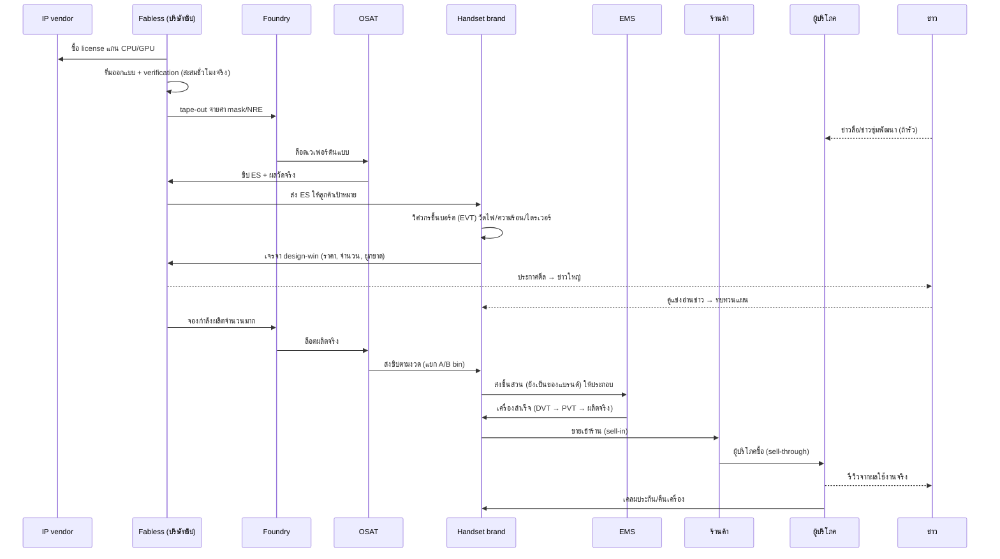

# Era 3 — องค์ประกอบ กลไกธุรกิจ การทำงานของระบบ และแนวทางการคำนวณ (Business Mechanics & Calculation Guide)

- **สถานะ:** เอกสารออกแบบ (proposal) — **ยังไม่ได้เขียนโค้ด** runtime ยังเป็น v2.9.0
- **ใช้คู่กับ:** [ERA_3_FEATURE_AND_SMART_PHONES.md](ERA_3_FEATURE_AND_SMART_PHONES.md) (ข้อกำหนด), [ERA_3_COEVOLUTION_ARCHITECTURE_AND_AI_BLUEPRINT.md](ERA_3_COEVOLUTION_ARCHITECTURE_AND_AI_BLUEPRINT.md) (สถาปัตยกรรม/ดีล/โมดูล), [project_status_and_ai_onboarding.md](project_status_and_ai_onboarding.md) (สถานะจริง)
- **ตัวเลขทุกตัวในเอกสารนี้เป็นค่าตั้งต้นสำหรับเกม (game-scale defaults)** ใช้แสดงวิธีคิดและลำดับขนาด ไม่ใช่ราคา/สเปกจริงของบริษัทใดในโลกจริง ต้องปรับจูน (calibrate) ด้วยการทดสอบหลายเซฟก่อนล็อก
- **กฎที่ไม่เปลี่ยน:** NPC ตัดสินใจทุกอย่างเอง ผู้เล่นดูและทดลองผ่าน Edit Hub เท่านั้น; เงินเป็นสตางค์จำนวนเต็ม; ห้ามแก้ `human-core.js`, `CORE_LOCK.json`, `AGENTS.md`

---

## สารบัญ

1. [องค์ประกอบของระบบ (Components)](#1-องค์ประกอบของระบบ-components)
2. [กลไกธุรกิจของแต่ละบทบาท (Business Mechanics)](#2-กลไกธุรกิจของแต่ละบทบาท-business-mechanics)
3. [การทำงานของระบบตามจังหวะเวลา (System Loops)](#3-การทำงานของระบบตามจังหวะเวลา-system-loops)
4. [แนวทางการคำนวณ (Calculation Models)](#4-แนวทางการคำนวณ-calculation-models)
5. [ตัวอย่างคำนวณครบวงจรหนึ่งรอบ (Worked Example)](#5-ตัวอย่างคำนวณครบวงจรหนึ่งรอบ-worked-example)
6. [การตัดสินใจของ NPC (Decision Models)](#6-การตัดสินใจของ-npc-decision-models)
7. [กฎอนุรักษ์ บัญชี และสิ่งที่ห้ามเกิด](#7-กฎอนุรักษ์-บัญชี-และสิ่งที่ห้ามเกิด)
8. [ประสิทธิภาพและขอบเขตข้อมูล](#8-ประสิทธิภาพและขอบเขตข้อมูล)
9. [ลำดับสร้างแบบชิ้นบางครบวงจร (Thin Slice)](#9-ลำดับสร้างแบบชิ้นบางครบวงจร-thin-slice)
10. [ชุดทดสอบที่ควรมี](#10-ชุดทดสอบที่ควรมี)

---

## 1. องค์ประกอบของระบบ (Components)

แบ่งเป็น 7 กลุ่ม ทุกตัวต้องมี ID คงที่ บันทึกลงเซฟได้ และอ้างอิงกันได้โดยไม่มีฟังก์ชัน/pointer

### 1.1 ผู้เล่นในอุตสาหกรรม (Industry Roles)

บริษัทหนึ่งแห่งถือได้หลายบทบาท แต่ **ต้องมีคน เครื่อง กำลังผลิต และบัญชีแยกของแต่ละฝ่ายจริง**

| บทบาท | ทำอะไร | ขายอะไร | ตัวอย่างชื่อสมมติ |
|---|---|---|---|
| **IP / EDA vendor** | พัฒนาแกน CPU/GPU/โมเด็มเป็นทรัพย์สินทางปัญญา และเครื่องมือออกแบบชิป | สิทธิ์ใช้ IP (ค่าแรกเข้า + ค่าต่อชิ้น), license เครื่องมือ | `CoreArch Licensing` |
| **Fabless chip designer** | ออกแบบ SoC แต่ไม่มีโรงงาน จ้าง foundry ผลิต | ชิปที่แพ็กแล้ว | `SiamSilicon` |
| **Foundry** | รับจ้างผลิตเวเฟอร์ตาม process node ที่ตนมี | กำลังผลิตเวเฟอร์ (wafer starts) | `Taiwan Wafer Fab` |
| **IDM** | ออกแบบ + ผลิตเองในโรงงานตัวเอง | ชิป และอาจรับจ้างผลิตด้วย | `Tokyo Semi` |
| **OSAT** | ตัดเวเฟอร์ แพ็กเกจ ทดสอบ คัดเกรด | บริการแพ็ก/ทดสอบต่อชิ้น | `Penang Pack&Test` |
| **Memory maker** | ผลิต DRAM / NAND | ชิปหน่วยความจำตามรุ่น/ความจุ | `Korea MemTech` |
| **Display maker** | ผลิตจอ STN/TFT/IPS/OLED + ทัช | โมดูลจอ | `Lumina Panel` |
| **Battery / PMIC maker** | ผลิตเซลล์ลิเธียม และชิปจัดการไฟ | แพ็กแบต, PMIC | `VoltCell Asia` |
| **Camera module maker** | เซนเซอร์ CMOS + เลนส์ + ประกอบโมดูล | โมดูลกล้อง | `OptiView` |
| **PCB / EMS / ODM** | ทำแผ่น PCB, รับประกอบบอร์ด/เครื่อง (EMS) หรือออกแบบ+ประกอบให้แบรนด์ (ODM) | บริการประกอบ / reference design | `Delta EMS` |
| **OS / platform owner** | พัฒนาระบบปฏิบัติการ SDK และดูแลแพตช์ | license OS / ส่วนแบ่งบริการ | `OpenMobile Foundation`, `SiamOS` |
| **Handset brand (OEM)** | กำหนดตลาดเป้าหมาย ออกแบบเครื่อง เลือกชิ้นส่วน ทำการตลาด รับประกัน | โทรศัพท์ | บริษัทผู้เล่น / คู่แข่ง |
| **Distributor / retailer** | ซื้อเครื่องเข้าสต็อกแล้วขายต่อผู้บริโภค | เครื่องปลีก | `MobileMart` |
| **Telecom operator** | ลงทุนเสาสัญญาณ 2G→5G ตามประเทศ | บริการเครือข่าย, ขายเครื่องพ่วงสัญญา | `ThaiNet Mobile` |
| **Tech media** | รายงานข่าว/รีวิวจากเหตุการณ์จริงเท่านั้น | (ไม่ใช่ธุรกิจหลัก ใช้สร้างข่าว) | `ไอทีวันนี้` |
| **Consumer cohorts** | กลุ่มผู้ซื้อตามประเทศ/รายได้/ความต้องการ | (ผู้ซื้อ) | — |

> **ข้อเสนอขอบเขตตั้งต้น:** ไม่ต้องสร้างครบทุกบทบาทในเฟสแรก เริ่มจาก fabless 2, foundry 1, memory 1, display 1, battery 1, EMS 1, OS 2 (RTOS + open platform), handset brand 3–4, distributor รวมต่อประเทศ 1 — แล้วค่อยเพิ่ม

### 1.2 ชิ้นส่วนและสเปก (Component Specs)

แยก **"แบบ/สเปก"** (ออกแบบครั้งเดียว) ออกจาก **"ของจริง/ล็อต"** (ผลิตออกมาเป็นจำนวน)

| ประเภท | ฟิลด์สำคัญ (หน่วย) | ใช้ตรวจอะไร |
|---|---|---|
| `soc` | ISA, cores, clock (GHz), IPC index, GPU GFLOPS, memory types รองรับ, max RAM (GB), bandwidth (GB/s), max display res/Hz, max ISP MP, modem gen, idle/typ/peak W, die area (mm²), node (nm) | ความแรง, ความเข้ากันได้, พลังงาน, ต้นทุนเวเฟอร์ |
| `dram` | type (SRAM/PSRAM/LPDDR1–5), capacity (Gbit/GB — ระบุชัด), bandwidth, active W | ต้องอยู่ในรายการที่ SoC รองรับ |
| `storage` | type (NOR/NAND/eMMC/UFS), capacity (GB), read/write MB/s | เวลาโหลด, พื้นที่แอป |
| `display` | tech, inch, resolution, Hz, nits, W ต่อความสว่าง, touch type | ไม่เกินขีด SoC, กินไฟ |
| `battery` | chemistry, V, mAh → Wh, max charge W, cycle life | ชั่วโมงใช้งาน, ความปลอดภัย |
| `camera` | sensor size, MP, pixel pitch, OIS, ต้องการ ISP MP | ไม่เกิน ISP ของ SoC |
| `rf` | generations, bands, ประเทศที่ใช้ได้ | ขายได้ในประเทศไหน |
| `pcb` | layers, min pitch | รองรับ package SoC ไหม |
| `enclosure` | วัสดุ, ระบายความร้อนได้ (W), น้ำหนัก, IP rating | ความร้อน, ความทน |
| `os` | ประเภท, ISA รองรับ, RAM ขั้นต่ำ, ค่า license, แอปที่มี | ต้องมีไดรเวอร์ครบ |

### 1.3 ของจริงและล็อต (Physical Lots)

- `waferLot` (เวเฟอร์ที่กำลังผลิต: เจ้าของ, chipId, จำนวนแผ่น, ขั้นตอน, วันที่เริ่ม)
- `componentLot` (ชิปที่แพ็กแล้วหรือชิ้นส่วนอื่น: เจ้าของ, specId, **binGrade**, จำนวน, ต้นทุน/ชิ้น, ที่มา)
- `phoneLot` (เครื่องสำเร็จ: designId, revision, จำนวน, คุณภาพ, ต้นทุน, ตำแหน่ง: โรงงาน/ระหว่างส่ง/ร้านค้า)
- `installedCohort` (เครื่องที่อยู่ในมือผู้ใช้: designId, ประเทศ, จำนวน, อายุเฉลี่ย, สุขภาพแบต) — ใช้แบบรวมกลุ่ม ไม่ต้องเก็บรายเครื่อง

### 1.4 สัญญาและภาระผูกพัน (Contracts & Obligations)

`ipLicense`, `foundryCapacityContract`, `siliconSupplyContract`, `componentSupplyContract`, `emsAssemblyContract`, `osLicense`, `channelSellInContract`, `operatorPartnership`, `warrantyObligation`, `softwareSupportObligation`, `employmentOffer`, `acquisitionDeal`

### 1.5 โครงการ (Projects)

`chipDesignProject`, `processQualificationProject`, `componentDevProject`, `phoneDesignProject`, `osPlatformProject`, `driverIntegrationTask`, `fabConstructionProject`, `operatorNetworkRollout`

### 1.6 คน (People)

- คนในแคมปัส: ระบบ NPC เดิมเต็มรูปแบบ
- คนนอกแคมปัส (`ExternalProfessional`): โปรไฟล์ย่อจาก seed แบบ deterministic + วิชาความรู้ + ประวัติงาน + เงินเดือน + ความพอใจ (ดูข้อ 4.12)
- บทบาทเทคนิคที่ต้องมี: chip architect, verification engineer, physical design, process engineer, cleanroom technician, RF engineer, hardware/board engineer, thermal/mechanical engineer, OS/kernel engineer, driver engineer, QA/test engineer, procurement, product manager, sales (B2B), marketing

### 1.7 ข้อมูลและข่าว (Information)

- `newsItem` (เกิดจากเหตุการณ์จริงเท่านั้น: ประเภท, ผู้เกี่ยวข้อง, ความสำคัญ, วัน)
- `marketIntel` ต่อบริษัท (สิ่งที่ผู้บริหาร **รู้** — อาจผิด/ล้าสมัย ต่างจากที่ผู้เล่นเห็น)
- `reviewRecord` (คะแนนรีวิวหลังเปิดขาย คำนวณจากผลวัดจริงเทียบความคาดหวัง)

---

## 2. กลไกธุรกิจของแต่ละบทบาท (Business Mechanics)

### 2.1 ตารางรายได้ ต้นทุน ความเสี่ยง และการตัดสินใจหลัก

| บทบาท | รายได้ | ต้นทุนหลัก | ความเสี่ยงหลัก | การตัดสินใจของ NPC |
|---|---|---|---|---|
| IP vendor | ค่าแรกเข้า + ค่าต่อชิ้นที่ลูกค้าขายได้ | เงินเดือนวิศวกร R&D | ลูกค้าน้อย, IP ล้าสมัย | ทำแกนใหม่แบบไหน, ตั้งราคา license |
| Fabless | ขายชิป (ราคา × จำนวน) | IP license, EDA, mask/NRE, ค่าเวเฟอร์, แพ็ก/ทดสอบ, เงินเดือน | respin, yield ต่ำ, ไม่มีลูกค้า design-win | ออกแบบชิปตลาดไหน, จองกำลัง foundry เท่าไร, ราคา/ดีลกับใคร |
| Foundry | ค่าเวเฟอร์ต่อแผ่น + NRE | ค่าเสื่อมโรงงาน (สูงมาก), ไฟ/น้ำ/เคมี, ช่าง, ซ่อม | โรงงานว่าง (utilization ต่ำ = ขาดทุน), ปนเปื้อน | ลงทุน node ใหม่ไหม, รับลูกค้าใครก่อน, ราคาต่อแผ่น |
| OSAT | ค่าบริการต่อชิ้น | เครื่องทดสอบ, วัสดุแพ็ก, แรงงาน | ปริมาณงานผันผวน | รับงานไหน, ขยายกำลัง |
| Memory | ขาย DRAM/NAND | เหมือน foundry + R&D | **ราคาเป็นวัฏจักร** (ล้นตลาดราคาดิ่ง) | ผลิตเท่าไร, เก็บสต็อกหรือเทขาย |
| Display/Battery/Camera | ขายโมดูล | วัสดุ, เครื่อง, R&D | เทคโนโลยีใหม่แทนที่ | พัฒนารุ่นใหม่, เลือกลูกค้า |
| EMS/ODM | ค่าประกอบต่อเครื่อง / ค่าออกแบบ | แรงงาน, เครื่อง SMT, jig | ลูกค้ารายใหญ่ถอนตัว | รับแบรนด์ไหน, ลงทุนไลน์ |
| OS owner | license ต่อเครื่อง / ส่วนแบ่งแอป | วิศวกรซอฟต์แวร์, server | ไม่มีนักพัฒนาแอป → ไม่มีคนใช้ | เปิด/ปิด, ราคา, รองรับชิปไหน |
| Handset brand | ขายเครื่องเข้าช่องทาง (sell-in) | BOM, ประกอบ, R&D, การตลาด, license, ประกัน, ค่าขนส่ง/ภาษี | สต็อกค้าง, เคลม, ชิปขาด, รีวิวแย่ | ทำรุ่นอะไร, ใช้ชิ้นส่วนใคร, ราคา, ผลิตเท่าไร, ทำเองหรือจ้าง |
| Distributor | ส่วนต่างราคา | ต้นทุนสต็อก, ดอกเบี้ย | ของค้าง ราคาตก | สั่งรุ่นไหนเท่าไร |
| Operator | ค่าบริการรายเดือน × ผู้ใช้ | ลงทุนเสา, ค่าดำเนินการ | ลงทุนเร็วเกินผู้ใช้ | ขยายเครือข่ายรุ่นไหนเมื่อไร |

### 2.2 กลไกที่ทำให้ธุรกิจ "เป็นธุรกิจจริง" ไม่ใช่สูตรผสมของ

1. **ต้นทุนคงที่สูง + ต้นทุนผันแปรต่ำ (ชิป/OS):** ชิปต้องขายได้มากพอจึงคุ้มค่า mask/NRE → บริษัทชิปต้อง **หาลูกค้าก่อนผลิตจำนวนมาก** → เกิดแรงจูงใจทำดีล design-win จริง
2. **Utilization ของโรงงาน:** foundry ที่ว่าง 40% ยังต้องจ่ายค่าเสื่อม → ยอมลดราคาให้ลูกค้ารายเล็ก; foundry ที่เต็มจะขึ้นราคาและเลือกลูกค้า → เกิดการแย่งคิว
3. **Lead time ยาว:** ชิปใหม่ใช้เวลาหลายเดือนเกม, ล็อตเวเฟอร์หลายสัปดาห์ → แบรนด์ต้อง **พยากรณ์และจองล่วงหน้า** พยากรณ์ผิด = สต็อกค้างหรือของขาด
4. **Learning curve:** ผลิตยิ่งมาก yield ยิ่งดี ต้นทุนยิ่งต่ำ → ผู้มาก่อนได้เปรียบ แต่ผู้มาทีหลังได้ใช้ชิปที่ถูกและเสถียรกว่า
5. **Ecosystem network effect:** OS ที่มีผู้ใช้มาก → นักพัฒนาแอปมาก → คนอยากซื้อเครื่อง OS นั้นมากขึ้น
6. **Cannibalization:** แบรนด์ออกรุ่นใหม่ กินยอดรุ่นเก่าของตัวเอง → ต้องเคลียร์สต็อกรุ่นเก่าก่อน
7. **ช่องทางจัดจำหน่ายเป็นตัวกลาง:** ขายเข้าร้าน (sell-in) ≠ ผู้บริโภคซื้อจริง (sell-through) → ร้านที่ของค้างจะหยุดสั่ง → แบรนด์เห็นสัญญาณช้ากว่าความจริง
8. **ภาระหลังการขาย:** ประกันและแพตช์ความปลอดภัยเป็นต้นทุนที่ตามมาเป็นปี แม้เลิกผลิตแล้ว
9. **ทำเองหรือซื้อ (make-or-buy):** แบรนด์ใหญ่อาจออกแบบชิปเอง (vertical integration) แต่ต้องมีคน เงิน และปริมาณขายพอ ไม่งั้นแพงกว่าซื้อ

---

## 3. การทำงานของระบบตามจังหวะเวลา (System Loops)

เกมปัจจุบันใช้ tick 5 นาที แต่ธุรกิจชิป/มือถือกินเวลาเป็นเดือน จึงแยกจังหวะดังนี้:

| จังหวะ | ใคร | ทำอะไร |
|---|---|---|
| **ทุก tick (5 นาที)** | คนในแคมปัสเท่านั้น | ทำงานจริงที่สถานี สะสมชั่วโมงเข้าโครงการ (ทดสอบบอร์ด, เขียนไดรเวอร์, ประกอบ) — ใช้ระบบงานเดิม |
| **รายวัน (ตอนปิดวัน)** | ทุกบริษัท (นอกแคมปัสใช้แบบรวม) | • คนนอกแคมปัสสะสมชั่วโมงทำงานเข้าโครงการ<br/>• ล็อตเวเฟอร์เดินขั้นตอน, ล็อตที่ครบเวลาออกผล yield/bin<br/>• ส่งของตามสัญญา, โอนกรรมสิทธิ์, จ่ายเงินตามงวด<br/>• ผู้บริโภคซื้อเครื่อง (sell-through) ร้านค้าตัดสต็อก<br/>• สร้างข่าวจากเหตุการณ์ของวัน, NPC อ่านข่าว |
| **รายสัปดาห์** | ฝ่ายจัดซื้อ/ขาย/วางแผน | • ร้านค้าสั่งของ (sell-in) ตามยอดขายจริง + สต็อก<br/>• แบรนด์ปรับแผนผลิต, สั่งชิ้นส่วน (MRP)<br/>• foundry จัดสรรกำลังผลิตเมื่อของขาด<br/>• ทบทวนราคา (ลดราคารุ่นเก่า)<br/>• ตลาดหางาน: ข้อเสนอดึงตัว, ลาออก |
| **รายเดือน** | บอร์ด/CEO | • ทบทวน roadmap: เปิด/หยุด/ยกเลิกโครงการ<br/>• ตัดสินใจลงทุน (โรงงาน, node ใหม่, ซื้อกิจการ)<br/>• ประเมินซัพพลายเออร์, ต่อสัญญา<br/>• ปิดงบ: กำไร/ขาดทุน, สำรองประกัน |
| **ตามเหตุการณ์ (event-driven)** | ทุกฝ่าย | ด่านโครงการผ่าน/ไม่ผ่าน, ชิป ES มาถึง, คู่แข่งเปิดตัว, วิกฤตซัพพลาย, คนสำคัญลาออก → ปลุกการตัดสินใจทันทีไม่ต้องรอรอบ |

### 3.1 ลำดับเหตุการณ์ตั้งแต่ชิปใหม่ถึงมือถือขายได้



### 3.2 ด่านโครงการมือถือ (Phone Project Gates)

| ด่าน | ต้องมีอะไรถึงผ่าน | ถ้าไม่ผ่าน |
|---|---|---|
| **Concept** | ตลาดเป้าหมาย, ราคาเป้า, ชิ้นส่วนที่หาได้จริง (ผ่านตัวตรวจความเข้ากันได้เบื้องต้น) | เปลี่ยนสเปก / ยกเลิก |
| **EVT** (ทดสอบวิศวกรรม) | ชิ้นส่วนตัวอย่างครบ, ชั่วโมงวิศวกรฮาร์ดแวร์ครบ, บอร์ดเปิดติด | แก้บอร์ด (rev ใหม่) — เสียเวลาและเงิน |
| **DVT** (ยืนยันการออกแบบ) | ผลวัดไฟ/ความร้อน/RF/ตกกระแทกผ่านเกณฑ์, ไดรเวอร์ ≥ 90% | ปรับตัวถัง/ลดสเปก/เปลี่ยนชิ้นส่วน |
| **PVT** (ยืนยันการผลิต) | ไลน์ประกอบพร้อม, assembly yield ≥ เกณฑ์, ไดรเวอร์ 100%, ใบรับรองตามประเทศ | ปรับไลน์ / เลื่อนเปิดตัว |
| **Mass production** | สัญญาชิ้นส่วนครบ, เงินทุนหมุนเวียนพอ | ผลิตน้อยลง |
| **EOL** | ยอดขายต่ำกว่าเกณฑ์ หรือชิ้นส่วนเลิกผลิต | ยังต้องรับประกัน/แพตช์ต่อตามสัญญา |

> CEO **ข้ามด่านไม่ได้** แต่ **เลือกรับความเสี่ยงได้** เช่น ยอมผ่าน DVT ทั้งที่ความร้อนเกินเล็กน้อยเพื่อทันเปิดตัว → ผลคืออัตราเคลมสูงขึ้นตามสูตร (ข้อ 4.9) ไม่ใช่ผ่านฟรี

---

## 4. แนวทางการคำนวณ (Calculation Models)

หลักการ: **ทุกค่าต้องมีหน่วย, มาจากสเปก/ผลวัด/สถานะจริง, และอธิบายได้ว่าทำไม** ห้ามมี "คะแนนรวม" ที่บวกค่าต่างหน่วยกัน

### 4.1 ประสิทธิภาพตามงาน (Task-Based Performance)

ไม่ใช้ "คะแนนความแรง" ตัวเดียว แต่คำนวณเวลาที่ใช้ทำงานแต่ละประเภท แล้วดูว่าอะไรเป็นคอขวด

```
เวลาทำงาน(task) = max(
    task.compute   / (cores_used × clockGHz × ipc),       // CPU
    task.graphics  / gpuGflops,                          // GPU
    task.dataMB    / min(ramBandwidth, socBandwidth),     // หน่วยความจำ
    task.loadMB    / storageReadMBps                     // พื้นที่เก็บ
) + task.osOverhead[os]

ถ้า task.workingSetMB > ramMB − osReservedMB → เกิด swap/ปิดแอป: เวลา × 1.5–3 และ "multitask fail"
```

ตัวอย่างงาน (workload profile) ที่ผู้บริโภคแต่ละกลุ่มให้น้ำหนักต่างกัน: `call`, `sms`, `music`, `web`, `social`, `video`, `photo`, `game3d`, `multitask`

ผลลัพธ์ที่ได้: **"ความลื่นไหลต่องาน"** = เวลาเป้าหมาย / เวลาจริง (จำกัด 0–1.2) → ใช้ในข้อ 4.10

### 4.2 พลังงานและแบตเตอรี่

```
Wh_ความจุ    = V × mAh / 1000
Wh_ใช้ได้     = Wh_ความจุ × 0.92 × สุขภาพแบต(อายุ, รอบชาร์จ)
P_เฉลี่ย (W)  = Σ (สัดส่วนเวลาในแต่ละโหมด × กำลังของโหมดนั้น)
กำลังโหมด    = P_soc(โหมด) + P_display(ความสว่าง, ขนาด, เทคโนโลยี) + P_radio(รุ่นเครือข่าย, สัญญาณ) + P_อื่น
ชั่วโมงใช้งาน  = Wh_ใช้ได้ / P_เฉลี่ย
```

- สุขภาพแบต: ลดลง ~ `0.02% ต่อรอบชาร์จ` (ปรับตาม chemistry) → เครื่องในตลาดเก่าลงจริง ทำให้เกิดความต้องการเปลี่ยนเครื่อง
- สัญญาณอ่อน (ประเทศที่ operator ยังลงทุนน้อย) → `P_radio` สูงขึ้น → แบตหมดไวกว่าในประเทศอื่น

### 4.3 ความร้อนและการลดความเร็ว (Thermal)

ใช้แบบจำลองความต้านทานความร้อนชั้นเดียว (พอสำหรับเกม):

```
T_ผิวเครื่อง = T_สภาพแวดล้อม + P_รวม × R_th(ตัวถัง)        // R_th หน่วย °C/W
P_ระบายได้   = (T_ผิวสูงสุด − T_สภาพแวดล้อม) / R_th         // T_ผิวสูงสุด ≈ 43°C
ถ้า P_peak > P_ระบายได้:
    ประสิทธิภาพต่อเนื่อง = ประสิทธิภาพสูงสุด × (P_ระบายได้ / P_peak)^0.8
```

- `R_th` ขึ้นกับวัสดุและขนาด: พลาสติกเล็ก ~5.0, พลาสติก+กราไฟต์ ~4.0, อะลูมิเนียม+กราไฟต์ ~3.3, + vapor chamber ~2.8 (ค่าเกม)
- ประเทศร้อน (T_สภาพแวดล้อม 33°C) ลดเพดานลงจริง → เครื่องเดียวกันรีวิวแย่กว่าในประเทศอากาศเย็น

### 4.4 การตรวจความเข้ากันได้ (Compatibility Gate)

เป็น **กฎแข็ง** — ไม่ผ่าน = ประกอบไม่ได้ ไม่ใช่แค่หักคะแนน

```
rules = [
  dram.type ∈ soc.memoryTypes                         // ชนิด RAM
  dram.capacityGB ≤ soc.maxRamGB
  display.res ≤ soc.maxDisplayRes && display.hz ≤ soc.maxHz
  camera.requiredIspMP ≤ soc.maxIspMP
  rf.generation ≤ soc.modemGen (หรือมีโมเด็มแยก)
  pcb.layers ≥ soc.package.minLayers
  battery.maxDischargeW ≥ P_peak × 1.2                 // เผื่อความปลอดภัย
  os.supportsIsa(soc.isa) && ramMB ≥ os.minRamMB
  มีไดรเวอร์ครบทุกชิ้นส่วน (driverIntegrationPct = 100 ก่อน PVT)
]
ผล = { compatible, ข้อที่ไม่ผ่าน[], ข้อจำกัดที่ยอมรับได้[] }
```

ทุกข้อที่ไม่ผ่านต้องมีข้อความภาษาไทยให้ผู้เล่นอ่าน เช่น *"จอ FHD 90Hz เกินขีดตัวควบคุมจอของชิป (สูงสุด HD 60Hz)"*

### 4.5 เวเฟอร์ yield และการคัดเกรด (Wafer, Yield, Binning)

```
GrossDies  = floor( π·(d/2)² / A  −  π·d / √(2A) )             // d = เส้นผ่านศูนย์กลางเวเฟอร์ mm, A = พื้นที่ die mm²
Yield      = ( (1 − e^(−A·D0)) / (A·D0) )²                     // Murphy; A เป็น cm², D0 = จุดบกพร่องต่อ cm²
GoodDies   = round(GrossDies × Yield)                           // ทำเป็นจำนวนเต็มด้วย RNG ของซิม (binomial)
```

**D0 ไม่คงที่** — ขึ้นกับสถานะจริง:

```
D0 = D0_เป้าหมาย(node)
     + (D0_เริ่มต้น − D0_เป้าหมาย) × e^(−เวเฟอร์สะสม / k_learning)     // ยิ่งผลิตมาก ยิ่งดี
     × ตัวคูณห้องคลีนรูม(ความสะอาด)
     × ตัวคูณเครื่อง(สภาพ lithography/etch)
     × ตัวคูณทีม(ความรู้ process_integration ของวิศวกรที่ดูแล)
```

**การคัดเกรด (binning):** die ที่ดีแต่ละตัวมีความถี่สูงสุดที่ทำได้ สุ่มจากการแจกแจงปกติ

```
fmax ~ Normal(μ = clockเป้า × ความสุกของ process, σ = clockเป้า × 0.06)
A-bin: fmax ≥ clockเป้า           → ขายเต็มสเปก
B-bin: clockเป้า×0.85 ≤ fmax < clockเป้า → ลดคล็อก/ปิดคอร์ ขายถูกลง
scrap: ต่ำกว่านั้น
```

→ ช่วงแรกของ node ใหม่ A-bin น้อย ของขาด ราคาสูง; ผ่านไปหลายเดือน A-bin มากขึ้น ราคาลดลง **ไม่ต้องเขียนสคริปต์ราคาตก**

### 4.6 ต้นทุนชิปต่อชิ้น

```
ต้นทุนชิป = ค่าเวเฟอร์ / GoodDies
          + ค่าแพ็กเกจและทดสอบต่อชิ้น / yield การแพ็ก
          + ค่า IP royalty ต่อชิ้น
          + (mask/NRE + R&D ที่ลงไป) / จำนวนที่คาดว่าจะขายตลอดอายุ      // amortization
```

ส่วน amortization เป็น **การปันส่วนทางบัญชี** เพื่อตั้งราคา ห้ามหักเงินสดซ้ำ (เงิน NRE หักไปแล้วตอน tape-out)

### 4.7 กำลังผลิตโรงงาน (Fab Capacity)

```
waferStartsPerWeek  = min( กำลังของกลุ่มเครื่องที่เป็นคอขวด, คนที่มีคุณสมบัติ × ชั่วโมง / ชั่วโมงต่อแผ่น )
cycleTime (วัน)      = จำนวนขั้นตอน × เวลาต่อขั้น × ตัวคูณคิว(utilization)
ตัวคูณคิว            = 1 / (1 − utilization)   (จำกัดไม่เกิน ~4)      // โรงงานเต็มมาก คิวยาวมาก
WIP                 = throughput × cycleTime                       // Little's law ใช้ตรวจความสมเหตุสมผล
ต้นทุนคงที่ต่อวัน     = ค่าเสื่อมโรงงาน + เงินเดือน + ค่าบำรุงรักษา   // จ่ายทุกวันแม้ไม่มีงาน
```

→ ดีลที่ foundry ให้ส่วนลดเมื่อ utilization ต่ำ เกิดจากสูตรนี้เอง: แค่ราคาสูงกว่าต้นทุนผันแปรก็ช่วยจ่ายต้นทุนคงที่ได้

### 4.8 ต้นทุนเครื่องและราคา (Handset Unit Economics)

```
BOM          = Σ ราคาชิ้นส่วนตามสัญญา (ล็อตที่ใช้จริง)
ต้นทุนถึงโรงงาน = BOM × (1 + ค่าขนส่ง% + ภาษีนำเข้าตามประเทศต้นทาง%) × อัตราแลกเปลี่ยน
ต้นทุนประกอบ   = ค่าจ้าง EMS ต่อเครื่อง  หรือ  (ชั่วโมงคน × ค่าแรง + ค่าเครื่อง) ถ้าประกอบเอง
assemblyYield = Π yield ของแต่ละขั้น (SMT, ทดสอบ RF, ทดสอบการทำงาน)
ต้นทุนต่อเครื่องดี = (ต้นทุนถึงโรงงาน + ต้นทุนประกอบ) / assemblyYield + ค่า license OS + royalty
ราคาขายเข้าร้าน = ราคาปลีก × (1 − ส่วนต่างร้านค้า%)
กำไรต่อเครื่อง   = ราคาขายเข้าร้าน − ต้นทุนต่อเครื่องดี − สำรองประกันต่อเครื่อง − ค่าการตลาดต่อเครื่อง
```

### 4.9 ความน่าเชื่อถือและเคลมประกัน

```
อัตราเสียต่อเดือน = base(คลาสเครื่อง)
                  × (1 + 0.04 × max(0, T_ผิวจริง − 43))        // ร้อนเกิน = เสียมากขึ้น
                  × (1 + ข้อบกพร่องที่รู้แต่ยอมปล่อย)
                  × (2 − คุณภาพการประกอบ)
                  × ตัวคูณล็อตชิ้นส่วน (ล็อตที่มีปัญหา)
เคลมจริง          = binomial(เครื่องในประกัน, อัตราเสีย)       // ใช้ RNG ของซิม
สำรองประกัน        = ตั้งตอนขาย จากอัตราที่ "คาดการณ์"; จ่ายจริงตามเคลมจริง → ส่วนต่างเป็นกำไร/ขาดทุน
```

### 4.10 ความต้องการของผู้บริโภค (Demand)

**ขนาดตลาด** มาจากเครื่องในมือคนจริง ไม่ใช่ตัวเลขสุ่ม:

```
ผู้ซื้อในเดือนนี้ (ต่อกลุ่ม) = ผู้ยังไม่มีเครื่อง × อัตราซื้อครั้งแรก(รายได้, ราคาต่ำสุดในตลาด, เครือข่าย)
                       + Σ เครื่องในมือ × โอกาสเปลี่ยนเครื่อง(อายุ, สุขภาพแบต, ช่องว่างกับรุ่นใหม่, แอปที่ใช้ไม่ได้)
```

**ส่วนแบ่ง** ใช้ multinomial logit (มาตรฐานของการเลือกสินค้า):

```
U(รุ่น, กลุ่ม) = Σ_k w_k(กลุ่ม) × คุณลักษณะ_k(รุ่น)          // ความลื่นไหลต่องาน, ชั่วโมงแบต, กล้อง, ความทน, จำนวนแอป
               − α(กลุ่ม) × ln(ราคาปลีก)
               + ความเชื่อมั่นแบรนด์ + กระแส(hype) + ความหาซื้อได้(มีของในร้าน)
               − ∞ ถ้าเครือข่ายในประเทศไม่รองรับ / ราคาเกินงบสูงสุดของกลุ่ม
ส่วนแบ่ง(รุ่น) = e^U / (e^U_ไม่ซื้อ + Σ e^U ทุกรุ่น)
```

ตัวอย่างน้ำหนักกลุ่ม (ค่าเกม):

| กลุ่ม | ลื่นไหล | แบต | กล้อง | ทน | แอป | อ่อนไหวราคา α |
|---|---:|---:|---:|---:|---:|---:|
| `basic_voice` (โทรอย่างเดียว ชนบท) | 0.2 | 1.5 | 0.1 | 1.2 | 0.0 | 3.0 |
| `youth_multimedia` | 1.0 | 0.6 | 1.0 | 0.4 | 0.8 | 1.8 |
| `mainstream_smart` | 1.0 | 0.8 | 0.8 | 0.6 | 1.2 | 1.5 |
| `flagship_enthusiast` | 1.8 | 0.6 | 1.4 | 0.4 | 1.2 | 0.7 |
| `enterprise` | 0.8 | 1.0 | 0.3 | 1.0 | 0.6 (ความปลอดภัย 1.5) | 1.0 |

→ ฟีเจอร์โฟนแบตอึดยังขายดีในกลุ่ม `basic_voice` แม้สมาร์ตโฟนเปิดตัวแล้ว **โดยไม่ต้องเขียนสคริปต์**

**ช่องทางจัดจำหน่าย:**

```
ร้านสั่งของรายสัปดาห์ = max(0, ยอดขายเฉลี่ย 4 สัปดาห์ × สัปดาห์สต็อกเป้า − สต็อกปัจจุบัน − ของที่สั่งแล้วยังไม่มา)
```

→ ปรากฏการณ์ "bullwhip" (ยอดสั่งแกว่งแรงกว่ายอดขายจริง) เกิดเอง

### 4.11 ข่าว กระแส และรีวิว

```
ความสำคัญข่าว = ขนาดดีล(บาท) × ชื่อเสียงผู้เกี่ยวข้อง × ความใหม่ของเทคโนโลยี × (2 ถ้าผูกขาดเรือธง)
กระแสรุ่น(วัน t) = กระแส(t−1) × e^(−1/τ) + Σ ข่าวใหม่ที่เกี่ยวข้อง            // τ ≈ 20 วันเกม
ความคาดหวัง     = ค่าที่สัญญาไว้/ข่าวบอก (เช่น "แรงขึ้น 40%")
คะแนนรีวิว       = f(ผลวัดจริง − ความคาดหวัง)                                  // ทำได้ต่ำกว่าคำโฆษณา = รีวิวแย่ แม้สเปกดี
```

ข่าวต้องอ้างอิง ID ของเหตุการณ์จริงเสมอ (`sourceEventId`) เพื่อให้ผู้เล่นกดดูย้อนกลับได้ ห้ามสุ่มพาดหัว

### 4.12 ความคืบหน้าโครงการ R&D

```
ความคืบหน้าต่อวัน (ต่อสาขา) = Σ_คน ชั่วโมง × ประสิทธิภาพวิชา(คน, สาขา) × ความพร้อม(พลังงาน, เครียด)
                            × ตัวคูณทีม(ขนาด)                       // ขนาดทีม n: n^0.75 ไม่ใช่เส้นตรง
                            × ตัวคูณเครื่องมือ(มี EDA/แล็บ/เครื่องทดสอบ?)
โอกาสพบข้อบกพร่องที่ด่าน    = ความซับซ้อน × (1 − คุณภาพการตรวจสอบ) × (1 − ความคุ้นเคยกับแพลตฟอร์ม)
ถ้าพบ:  ชิป → respin (ค่า mask ใหม่ + เวลา); บอร์ด → rev ใหม่; ซอฟต์แวร์ → งานแก้บั๊ก
```

- ความรู้ที่ได้ระหว่างทาง **ไม่หายแม้โครงการล้มเหลว** (บันทึกเป็นความรู้บริษัท + วิชาของคนที่ทำ)
- ซื้อ license/reference design ลดชั่วโมงที่ต้องใช้ แต่ยังต้องมีคนทำ integration

### 4.13 การเจรจาดีล (Negotiation)

ราคาตกลงอยู่ระหว่าง **ราคาต่ำสุดที่ผู้ขายยอม** กับ **ราคาสูงสุดที่ผู้ซื้อยอม** — ถ้าต่ำสุด > สูงสุด = ไม่เกิดดีล

```
ต่ำสุดผู้ขาย = ต้นทุนผันแปร × (1 + margin ขั้นต่ำ) − ส่วนลดเมื่อโรงงานว่าง
สูงสุดผู้ซื้อ = มูลค่าที่ชิ้นส่วนนี้เพิ่มให้รุ่น (จากการคำนวณ demand ข้อ 4.10 ของผู้ซื้อเอง)
              หรือ ราคาของทางเลือกที่ดีที่สุดรองลงมา + ต้นทุนเปลี่ยน
อำนาจต่อรอง(ฝ่าย) = f(ทางเลือกอื่น, ปริมาณสั่ง, ความเชื่อใจ, ความเร่งด่วน, ทักษะ sales_negotiation, นิสัยผู้เจรจา)
ราคาตกลง    = ต่ำสุด + (สูงสุด − ต่ำสุด) × อำนาจผู้ขาย / (อำนาจผู้ขาย + อำนาจผู้ซื้อ)
ค่าผูกขาด    = ราคา × (1 + เบี้ยผูกขาด)  เบี้ย = ยอดขายที่ผู้ขายเสียโอกาสในช่วงผูกขาด / จำนวนสั่ง
```

การเจรจาใช้เวลาหลายวันเกม (มีรอบยื่นข้อเสนอ–สวนกลับ) และบันทึกเหตุผลทุกรอบไว้ให้ผู้เล่นอ่าน

### 4.14 การจัดสรรเมื่อของขาด (Allocation)

```
1. ส่งตามสัญญาผูกขาด/สิทธิ์ก่อน (exclusive, priority) ตามจำนวนที่ระบุ
2. ที่เหลือแบ่งตามสัดส่วนคำสั่งซื้อ (pro-rata)
3. merchant spot ได้ทีหลังสุด และราคาตามตลาด
4. ส่งไม่ครบ → บันทึกยอดค้างส่ง (backlog) + ค่าปรับตามสัญญา ห้ามสร้างของเพิ่ม
```

### 4.15 การดึงตัวคน (Talent)

```
โอกาสรับข้อเสนอ = sigmoid( a × (เงินใหม่/เงินเดิม − 1)
                         + b × ความเหมาะของงานใหม่กับเป้าหมายชีวิต
                         − c × ความภักดี(ความพอใจ, ความสัมพันธ์ในทีม, อายุงาน)
                         − d × ต้นทุนย้าย(ประเทศ, ครอบครัว)
                         + e × ชื่อเสียงบริษัทใหม่ )
บริษัทเดิมรู้ตัว → ยื่นข้อเสนอสู้ (ใช้ระบบ retention v2.8)
ย้ายสำเร็จ → ระยะแจ้งล่วงหน้า N วัน → เข้าแคมปัส: ขยายโปรไฟล์เต็มจาก seed เดิม (วิชาไม่ลด/ไม่เพิ่ม)
ความรู้ที่เป็นเอกสารของบริษัทเดิม ไม่ย้ายตามคน
```

---

## 5. ตัวอย่างคำนวณครบวงจรหนึ่งรอบ (Worked Example)

ค่าทั้งหมดเป็นค่าเกมสมมติ

### 5.1 บริษัทชิป `SiamSilicon` ผลิตชิป "Krait X1"

- die 80 mm² (0.80 cm²), เวเฟอร์ 300 mm, node 28nm ที่เพิ่งเริ่ม: D0 = 0.30 /cm²
- GrossDies = π·150²/80 − π·300/√160 = 883.6 − 74.5 ≈ **809**
- Yield = ((1 − e^(−0.24)) / 0.24)² = (0.2134/0.24)² = 0.889² ≈ **79%** → GoodDies ≈ **640**
- Binning ช่วงแรก: A 55% (352), B 35% (224), scrap 10% (64)
- ค่าเวเฟอร์ ฿150,000/แผ่น → ฿234/die ดี; แพ็ก+ทดสอบ ฿40 (yield แพ็ก 98%) → ฿41; IP royalty ฿15
- NRE + R&D ฿5,000,000 ÷ คาดขาย 200,000 ชิ้น = ฿25 (ปันส่วนบัญชี)
- **ต้นทุนรวม ≈ ฿315/ชิ้น** → ตั้งราคา A-bin ฿520, B-bin ฿360

หลังผลิตสะสม 2,000 แผ่น: D0 ลดเหลือ 0.15 → Yield ≈ 89% → GoodDies ≈ 720 → ต้นทุนเวเฟอร์ต่อ die เหลือ ฿208 → บริษัทชิป **ลดราคาได้เอง** หรือเก็บกำไรเพิ่ม (CEO ตัดสิน)

### 5.2 แบรนด์มือถือ `SiamMobile` ทำรุ่น "Ayutthaya X1"

| ชิ้นส่วน | ราคา (฿) |
|---|---:|
| Krait X1 A-bin (ดีลผูกขาด +8%) | 562 |
| LPDDR3 3GB | 260 |
| eMMC 32GB | 180 |
| จอ IPS 5.2" FHD + ทัช | 480 |
| แบต 3.85V 4,000 mAh | 120 |
| กล้อง 13MP OIS | 210 |
| RF 4G + PCB 8 ชั้น + PMIC | 290 |
| ตัวถังอะลูมิเนียม + กราไฟต์ | 260 |
| **BOM** | **2,362** |

- ขนส่ง+ภาษี 6% → 2,504; ค่าประกอบ EMS ฿150; assembly yield 95% → (2,504+150)/0.95 = **฿2,794**
- license OS open platform ฿0/เครื่อง (แต่จ่ายวิศวกรไดรเวอร์เป็นเงินเดือนแล้ว); สำรองประกัน ฿60; การตลาด ฿120
- ราคาปลีก ฿5,990 ร้านเอาส่วนต่าง 18% → ขายเข้าร้าน ฿4,912
- **กำไรต่อเครื่อง ≈ 4,912 − 2,794 − 60 − 120 = ฿1,938**

**พลังงาน:** Wh = 3.85 × 4.0 = 15.4 → ใช้ได้ 14.2 Wh; ใช้งานเฉลี่ย 0.92 W → **≈ 15.4 ชั่วโมง**

**ความร้อน:** P_peak 4.9 W, R_th 3.3 °C/W, อากาศ 30°C → T_ผิว = 30 + 16.2 = 46.2°C > 43
→ P_ระบายได้ = 13/3.3 = 3.94 W → ประสิทธิภาพต่อเนื่อง = (3.94/4.9)^0.8 ≈ **84%** (เล่นเกมนานแล้วลดลง 16%)
ถ้าไปขายในประเทศอากาศ 34°C → P_ระบายได้ 2.73 W → **63%** → รีวิวในประเทศนั้นแย่กว่า

**การตัดสินใจ:** ทีมวิศวกรเสนอเปลี่ยนเป็น vapor chamber (+฿90, R_th 2.8 → 4.64 W → 95%)
- CEO สายรอบคอบ: ยอมจ่าย เลื่อนเปิดตัว 10 วัน
- CEO สายบุก: ไม่เปลี่ยน เปิดตัวตามข่าวที่ประกาศไว้ → อัตราเสีย × (1 + 0.04×3.2) ≈ +13% และรีวิวเกมมิ่งต่ำ
ทั้งสองทางบันทึกเหตุผลลงประวัติและข่าวตามผลจริง

---

## 6. การตัดสินใจของ NPC (Decision Models)

### 6.1 โครงสร้างการตัดสินใจทั่วไป

```
1. รวบรวมทางเลือกที่ "ทำได้จริง" (ผ่านเงื่อนไขแข็ง: เงิน, คน, ความรู้, สิทธิ์, ความเข้ากันได้)
2. ประเมินแต่ละทางจาก "ข้อมูลที่ผู้บริหารคนนั้นรู้" (marketIntel ของบริษัท ไม่ใช่ความจริงทั้งหมด)
     ค่าคาดหวัง  E = Σ กระแสเงินสดคาดการณ์ / (1 + r)^t − เงินลงทุน      // NPV แบบย่อ
     ความเสี่ยง   σ = ความไม่แน่นอนของการประมาณ (ลดลงตามความเชี่ยวชาญของผู้ประเมิน)
3. คะแนน = E − λ × σ  + โบนัสกลยุทธ์
     λ (ความกลัวเสี่ยง) = f(riskTaking ต่ำ, conscientiousness สูง, runway สั้น)
     โบนัสกลยุทธ์ = f(ambition: อยากเป็นผู้นำ, openness: ลองของใหม่, เป้าหมายชีวิตของ CEO)
4. ห้ามเลือกทางที่ทำให้เงินสดต่ำกว่าเงินสำรองอยู่รอด (survival reserve)
5. บันทึก: ทางเลือกทั้งหมด, คะแนน, เหตุผลภาษาไทย, วันทบทวนถัดไป
```

### 6.2 การตัดสินใจหลักและปัจจัยที่ใช้

| ใคร | ตัดสินใจ | ปัจจัยหลัก |
|---|---|---|
| บริษัทชิป | ออกแบบชิปรุ่นใหม่ระดับไหน | ช่องว่างในตลาด (มีจอ/RAM ใหม่ที่ชิปเก่ารองรับไม่ได้ไหม), ลูกค้าที่ถามหา, คนที่มี, เงิน |
| บริษัทชิป | จอง foundry เท่าไร | จำนวน design-win ที่เซ็นแล้ว + พยากรณ์ + นิสัย CEO |
| Foundry | ลงทุน node ใหม่ | utilization ปัจจุบัน, ลูกค้าที่ขอ, ทุน, เวลาคืนทุน |
| แบรนด์มือถือ | ทำรุ่นใหม่สำหรับกลุ่มไหน | ส่วนแบ่ง/ยอดขายจริง, ช่องว่างที่คู่แข่งยังไม่ทำ, ข่าวที่อ่าน |
| แบรนด์มือถือ | เลือกชิป/ชิ้นส่วน | ผลวัด ES จริง, ราคาเจรจา, ความน่าเชื่อถือซัพพลายเออร์, ความเสี่ยงประเทศต้นทาง |
| แบรนด์มือถือ | ทำดีลผูกขาดไหม | ค่า hype ที่คาดว่าจะได้ vs เบี้ยผูกขาด + มัดจำ; riskTaking/ambition |
| แบรนด์มือถือ | ผลิตเท่าไร | ยอดสั่งร้านค้า + พยากรณ์ − สต็อก, เงินทุนหมุนเวียน, ราคาชิ้นส่วนที่ล็อกไว้ |
| แบรนด์มือถือ | ลดราคา/เลิกผลิต | สัปดาห์สต็อกในร้าน, รุ่นใหม่ของตัวเองใกล้ออก, คู่แข่งตัดราคา |
| แบรนด์มือถือ | ออกแบบชิปเอง (vertical) | ยอดขายต่อปีพอ amortize ไหม, มีวิศวกรชิปไหม, ทุน — ส่วนใหญ่ควร "ไม่คุ้ม" จนกว่าจะใหญ่จริง |
| ทุกบริษัท | ดึงตัวคนจากคู่แข่ง | คอขวดที่ขาดวิชาไหน, ใครในโลกภายนอกมีวิชานั้น (ที่บริษัทรู้), งบเงินเดือน |

### 6.3 ข้อมูลไม่สมบูรณ์ (Bounded Rationality)

- บริษัทรู้ **ข่าวสาธารณะ** + **ข้อมูลจากคู่ค้าตัวเอง** + **สิ่งที่พนักงานที่ย้ายมาเล่าได้ (ไม่ใช่เอกสารลับ)**
- พยากรณ์ยอดขาย = ยอดขายจริงที่ผ่านมา + ความคลาดเคลื่อนที่ลดลงตามวิชา `demand_forecasting`/`market_analysis` ของผู้วางแผน
- หน้าจอผู้เล่นเห็นมากกว่า NPC และควรมีป้ายบอกว่า "บริษัทนี้ยังไม่รู้ข้อมูลนี้"

---

## 7. กฎอนุรักษ์ บัญชี และสิ่งที่ห้ามเกิด

1. **เงิน:** ทุกการจ่ายมีผู้จ่ายและผู้รับในบัญชี (บริษัทผู้เล่นใช้ ledger เดิม, บริษัทภายนอกใช้บัญชีใน `world.js`) มัดจำเข้า escrow ไม่นับเป็นรายได้จนส่งของ
2. **ของ:** ทุกชิ้นมีเจ้าของเดียว; ของที่ส่งไปให้ EMS ประกอบ **ยังเป็นของแบรนด์** (customer-owned WIP); ไม่มีล็อตงอกเอง
3. **กำลังผลิต:** สล็อตเวเฟอร์/ไลน์ประกอบจองได้ครั้งเดียว ห้ามขายซ้ำ
4. **คน:** คนหนึ่งอยู่บริษัทเดียว ทำโครงการได้ตามชั่วโมงจริง ห้ามนับซ้ำสองโครงการ
5. **ความรู้:** เงินไม่แปลงเป็นความรู้ทันที ต้องผ่านคน + เวลา + (ถ้าซื้อ license) งาน integration
6. **BOM:** SoC ที่แพ็กแล้วมี CPU/GPU อยู่ข้างใน ห้ามหัก CPU/GPU แยกซ้ำ; ไม่มี BOM วนลูป
7. **การรีไซเคิล:** ได้คืนน้อยกว่าเดิมเสมอ มีต้นทุนและเวลา
8. **ห้ามเติมเงิน/ของให้บริษัทภายนอกแบบลับๆ** เพื่อให้เรื่องเดินต่อ บริษัทล้มละลายได้จริง
9. **Determinism:** ใช้ RNG ของซิมเท่านั้น seed เดียวกัน + คำสั่งเดียวกัน = ผลเดียวกัน; หน้าจอห้ามเรียก RNG
10. **ตัวตรวจ (audit) ใหม่ที่ต้องเพิ่ม:** `semiconductorAudit` (ล็อตเวเฟอร์ ↔ die ↔ bin ↔ สต็อกรวมกันลงตัว), `handsetAudit` (ชิ้นส่วนที่ใช้ ↔ เครื่องที่ผลิต ↔ ขาย ↔ installed base), `contractAudit` (สัญญา ↔ escrow ↔ ของที่ส่ง) — ทั้งหมดต้องคืน `[]`

---

## 8. ประสิทธิภาพและขอบเขตข้อมูล

| สิ่ง | ขอบเขตแนะนำเริ่มต้น | เหตุผล |
|---|---|---|
| บริษัทในอุตสาหกรรมมือถือ/ชิป | 12–20 | พอให้แข่งขันและมีทางเลือก |
| คนนอกแคมปัสที่มีชื่อ | 8–25 ต่อบริษัท (เฉพาะคนสำคัญ) ที่เหลือเป็นจำนวนรวม | ประหยัดหน่วยความจำ |
| สเปกชิ้นส่วนที่ใช้งานอยู่ | ≤ 150 (เก่าย้ายเข้าประวัติ) | จำกัดการค้นหา |
| รุ่นมือถือที่ขายอยู่ | ≤ 60 | logit คำนวณเร็ว |
| กลุ่มผู้บริโภค | ประเทศ × 5 กลุ่ม ≈ 60 | |
| ทางเลือกออกแบบที่สุ่มประเมินต่อครั้ง | ≤ 40 ชุด | แทนการลองทุก combination |

- งานของบริษัทนอกแคมปัสคำนวณ **วันละครั้ง** ไม่ใช่ทุก tick
- ต้องวัด benchmark แยก: (ก) เวลาต่อ tick ในแคมปัส (ข) เวลาปิดวันของอุตสาหกรรม — ไม่เอามาปนกัน
- เวลาเกม: ชิปรุ่นใหม่ ~90–180 วันเกม, มือถือรุ่นใหม่ ~45–120 วัน, รุ่นย่อย ~15–30 วัน, โรงงานใหม่ ~300+ วัน → ควรมีปุ่ม **เร่งเวลาถึงเหตุการณ์ถัดไป** ที่ยังคิดค่าแรง/ข่าว/เหตุการณ์ครบ

---

## 9. ลำดับสร้างแบบชิ้นบางครบวงจร (Thin Slice)

สร้างให้ "ครบวงจรแบบบาง" ก่อน แล้วค่อยเพิ่มความลึก:

1. **ข้อมูลตั้งต้น:** ฟีเจอร์โฟนยุคแรก — ชิป baseband 2 รุ่น (จาก 2 บริษัท), จอ STN/TFT 2 แบบ, แบต 2 แบบ, RTOS 1 ตัว, EMS 1 ราย, แบรนด์ 3 ราย, ตลาด 3 ประเทศ × 3 กลุ่ม
2. **แบรนด์ภายนอกออกรุ่นเองได้:** เลือกชิ้นส่วน → ผ่านตัวตรวจความเข้ากันได้ → คำนวณไฟ/แบต/ต้นทุน → จ้าง EMS → ขายเข้าร้าน → ผู้บริโภคซื้อด้วย logit
3. **บริษัทชิปออกรุ่นใหม่ได้:** โครงการออกแบบ → tape-out → yield/bin → ส่ง ES → ดีล → ข่าว
4. **แบรนด์ตอบสนองต่อชิปใหม่:** ทดสอบ ES → ตัดสินใจใช้/ไม่ใช้ → ออกรุ่นใหม่ → รีวิว
5. **บริษัทผู้เล่น:** ใช้ระบบเดียวกันทั้งหมด (ไม่มีทางลัด) + หน้าจอสังเกตการณ์
6. จากนั้นค่อยเพิ่ม: สมาร์ตโฟน/OS ecosystem, operator, คนนอกแคมปัสที่ดึงตัวได้, ซื้อกิจการ, โรงงานของตัวเอง

**เกณฑ์ว่า thin slice สำเร็จ:** ปล่อยโลกเดินเอง 180 วันเกม โดยผู้เล่นไม่แตะอะไร แล้วเห็นว่า (ก) มีชิปรุ่นใหม่เกิดขึ้นอย่างน้อย 1 รุ่น (ข) มีแบรนด์ใช้ชิปนั้นในรุ่นใหม่พร้อมข่าว (ค) มีแบรนด์ที่ไม่ใช้และให้เหตุผลได้ (ง) audit ทุกตัวคืน `[]`

---

## 10. ชุดทดสอบที่ควรมี

| ทดสอบ | สิ่งที่พิสูจน์ |
|---|---|
| ความเข้ากันได้ | RAM ผิดชนิด / จอเกินขีด / กล้องเกิน ISP → ถูกบล็อกพร้อมเหตุผล แม้ CEO มีเงินมาก |
| Yield/bin | เวเฟอร์ → die ดี + B-bin + scrap รวมกันเท่า GrossDies; D0 ลดเมื่อผลิตสะสม |
| พลังงาน/ความร้อน | ใส่แบตใหญ่ขึ้น → ชั่วโมงเพิ่มตามสัดส่วน; อากาศร้อนขึ้น → ประสิทธิภาพต่อเนื่องลด |
| ดีลและการจัดสรร | ของขาด → สัญญาผูกขาดได้ก่อน; สล็อตไม่ถูกขายซ้ำ; escrow ลงตัว |
| ตลาด | ฟีเจอร์โฟนยังขายได้ในกลุ่ม basic หลังสมาร์ตโฟนเปิดตัว; ขายเข้าร้าน ≠ ผู้บริโภคซื้อ |
| ข่าว | ทุกข่าวมี `sourceEventId` ที่มีอยู่จริง; ไม่มีข่าวโดยไม่มีเหตุการณ์ |
| นิสัย CEO | โลกเดียวกัน เปลี่ยนนิสัย CEO แบรนด์ → ตัดสินใจเรื่องดีลผูกขาด/ระบายความร้อนต่างกันอย่างน้อยในบางสถานการณ์ |
| เงินอย่างเดียวไม่พอ | เสกเงินให้บริษัทที่ไม่มีวิศวกรชิป → ยังออกแบบชิปไม่ได้ ต้องจ้างคน/ซื้อ license ก่อน |
| ดึงตัวคน | คนย้ายบริษัทแล้ววิชาเท่าเดิม, ไม่อยู่สองที่, บริษัทเดิมปรับแผน |
| โลกเดินเองได้ | บริษัทผู้เล่นไม่เข้าธุรกิจมือถือเลย อุตสาหกรรมยังพัฒนาต่อ |
| Determinism/เซฟ | เซฟกลางโครงการแล้วโหลด → ผลเหมือนไม่เซฟทุกประการ |

---

## บันทึกการร่วมงาน

- **2026-11-12, Agy:** เขียนเอกสารนี้ตามคำขอเจ้าของโปรเจกต์ ("ควรมีองค์ประกอบอะไร กลไกธุรกิจ การทำงานของระบบ แนวทางการคำนวณ") — เป็นข้อเสนอการออกแบบ ไม่ใช่โค้ดที่ทำงานแล้ว ไม่ได้รันเทสต์ใดๆ สำหรับเอกสารนี้ สูตร Murphy yield, gross-die และ multinomial logit เป็นแบบจำลองมาตรฐานที่ใช้กันทั่วไป ส่วนตัวเลขทุกตัวเป็นค่าเกมที่ต้องปรับจูน
