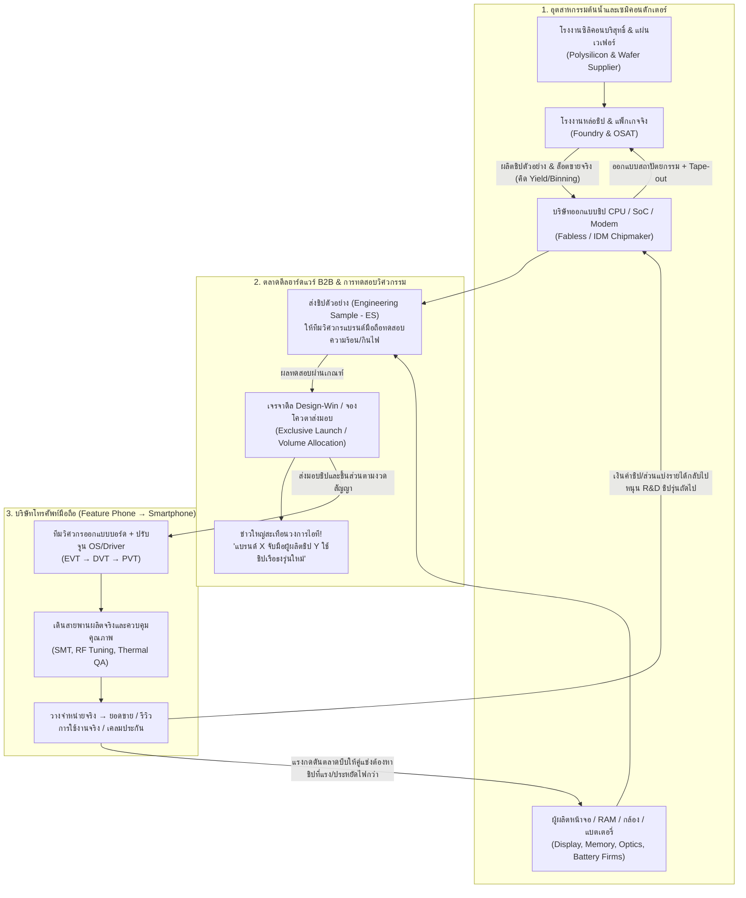

# Era 3 (v3.0.0) — แผนแม่บทสถาปัตยกรรมระบบนิเวศฮาร์ดแวร์ ชิปประมวลผล และสมาร์ตโฟนที่วิวัฒนาการร่วมกัน (Co-Evolving Semiconductor, Component & Handset Ecosystem Blueprint)

- **โครงการ:** Company Simulation / Siam Enterprise (`COMPANY_SOURCE/`)
- **ฐานซอร์สปัจจุบัน:** `v2.9.0` (สาขา `main` ของ `pyopasakserpiros-prog/Company`)
- **เป้าหมายเอกสารนี้:** เอกสารออกแบบเชิงลึกและใบสั่งงานสถาปัตยกรรม (System Architecture & AI Implementation Blueprint) สำหรับ **Era 3 (v3.0.0)** เพื่อให้เจ้าของโปรเจกต์อ่านเข้าใจภาพรวมทั้งหมดเป็นภาษาไทย และสามารถส่งต่อให้ AI ตัวอื่น (Codex, Gemini, ChatGPT, Claude) ใช้เป็นพิมพ์เขียวเขียนโค้ดจริงได้ทันที
- **ใช้คู่กับ:** [`era3/ERA_3_FEATURE_AND_SMART_PHONES.md`](ERA_3_FEATURE_AND_SMART_PHONES.md) และ [`era3/project_status_and_ai_onboarding.md`](project_status_and_ai_onboarding.md)

---

## กฎเหล็กสูงสุดของ Era 3 (ห้ามละเมิดเด็ดขาด)

1. **NPC ตัดสินใจและดำเนินธุรกิจเอง 100% (Autonomous World Only):**
   - ไม่ว่าจะเป็นบริษัทผลิตชิป (CPU/SoC), โรงงานรับจ้างผลิตเวเฟอร์ (Foundry), บริษัทจอภาพ/แบตเตอรี่/กล้อง หรือบริษัทมือถือ (ทั้งบริษัทที่ผู้เล่นเฝ้าดูและบริษัทคู่แข่งในโลกภายนอก) **ผู้บริหาร วิศวกร ฝ่ายจัดซื้อ และฝ่ายขายที่เป็น NPC จะเป็นคนคิด ตัดสินใจ เจรจาดีล ออกแบบรุ่นใหม่ และแก้ปัญหาเองทั้งหมด**
   - **ห้ามมีปุ่มบังคับให้ผู้เล่นกดสั่งการบริหารปกติ** (เช่น ห้ามมีปุ่มกดเลือกชิ้นส่วนมือถือเอง, ห้ามมีปุ่มกดอนุมัติดีลซื้อชิป, ห้ามมีปุ่มกดตั้งราคาขายหรือกดเปิดตัวรุ่นเรือธง)
   - ผู้เล่นทำหน้าที่เป็น **ผู้สังเกตการณ์ (Observer)** ที่เปิดดูเบื้องหลังการตัดสินใจ ข่าวสาร และห่วงโซ่สาเหตุ–ผลลัพธ์ หรือใช้ **Edit Hub** เพื่อทดลองเปลี่ยนเงื่อนไข (เช่น เปลี่ยนนิสัย CEO, เพิ่มความรู้วิศวกร, เติมเงินทุน, หรือจำลองวิกฤตเครื่องจักร/ซัพพลายเชน) แล้วเฝ้าดูว่าโลกเปลี่ยนไปอย่างไร
2. **ห้ามแก้ไขไฟล์แกนมนุษย์และกฎเหล็ก:**
   - ห้ามแก้ไข `COMPANY_SOURCE/js/human-core.js`, `CORE_LOCK.json` (`SHA-256: fa83eaa0ef3407f26f21675161f632a4365242f67fea7b0c192e59e75b9d5c32`) และ `AGENTS.md`

---

## ส่วนที่ 1: แนวคิดหลัก — ทำไมธุรกิจชิป ฮาร์ดแวร์ และโทรศัพท์ต้อง "วิวัฒนาการคู่ขนานกัน" (Co-Evolution Loop)

ในโลกความจริง บริษัทโทรศัพท์มือถือไม่ได้เสกสมาร์ตโฟนรุ่นเรือธงขึ้นมาจากอากาศ และไม่ได้พัฒนาอยู่ฝ่ายเดียว แต่เกิดจาก **"ห่วงโซ่วิวัฒนาการร่วมกัน (Co-Evolutionary Value Chain)"** ระหว่างผู้ผลิตชิ้นส่วนต้นน้ำ–กลางน้ำ กับแบรนด์มือถือปลายน้ำ:



### หัวใจสำคัญที่ทำให้เกมสมจริงและสนุกเวลาเฝ้าดู:
1. **ไม่มีโทรศัพท์รุ่นสำเร็จรูปตายตัวในคลังข้อมูล (`data.js`):**
   - โทรศัพท์ทุกรุ่นในโลกของเกมถูกสร้างขึ้นแบบไดนามิก (`Dynamic ProductDesign`) จากชิ้นส่วนที่มีอยู่จริงในตลาดโลกขณะนั้น หรือชิ้นส่วนที่บริษัทวิจัยเอง
2. **บริษัทชิปมีชีวิตและแข่งกันออกสถาปัตยกรรมใหม่:**
   - บริษัทชิป (เช่น `SiamSilicon`, `Shenzhen MicroLogic`, `Taiwan Foundry Corp`, `Tokyo Semi`) มีทีมวิศวกรของตัวเอง คิดค้น CPU/SoC รุ่นใหม่ (เช่น เพิ่มความเร็วสัญญาณนาฬิกา, ลดขนาดสถาปัตยกรรม nm, เพิ่มหน่วยประมวลผลกราฟิก GPU หรือชิปประมวลผลภาพ ISP)
   - เมื่อบริษัทชิปพัฒนาชิปรุ่นใหม่เสร็จ จะไม่ได้ขายเป็นตัวเลขลอยๆ แต่จะส่ง **ชิปตัวอย่าง (Engineering Sample - ES)** ให้บริษัทมือถือทดลองประกอบลงบอร์ดต้นแบบ
3. **การตัดสินใจของ CEO แบรนด์มือถือและฝ่ายจัดซื้อ:**
   - เมื่อเห็นชิปรุ่นใหม่จากบริษัทชิป วิศวกรและ CEO ของแบรนด์มือถือจะประเมินว่า:
     - ชิปรุ่นใหม่แรงขึ้นแค่ไหน? กินไฟกี่วัตต์ (W)? ร้อนเกินกว่าที่บอดี้มือถือจะระบายไหวไหม?
     - ต้องใช้คู่กับ RAM ชนิดไหน (เช่น LPDDR2 หรือ LPDDR4)? หน้าจอความละเอียดเท่าไรถึงจะไม่กระตุก?
     - ราคาต่อชิ้นและจำนวนสั่งซื้อขั้นต่ำ (MOQ) คุ้มกับงบการเงินของบริษัทไหม?
   - **CEO ที่ชอบความเสี่ยงและมุ่งความเป็นผู้นำ (`riskTaking` และ `ambition` สูง):** อาจตัดสินใจทุ่มเงินทำ **"ดีลผูกขาดเปิดตัวเจ้าแรก (Exclusive First-Wave Launch Deal)"** กับบริษัทชิป เพื่อให้ได้ชิปตัวท็อปมาใส่ในรุ่นเรือธง (Flagship) ก่อนคู่แข่ง!
   - **CEO ที่สุขุมรอบคอบ (`conscientiousness` สูง, `riskTaking` ต่ำ):** อาจรอดูผลล็อตแรกก่อน หรือเลือกซื้อ **"ชิปรุ่นปีก่อนที่เสถียรและราคาถูกลง (Proven Mature SoC)"** หรือเลือก **"ชิปเกรดรอง (B-Bin)"** มาทำมือถือรุ่นคุ้มค่าแบตอึดแทน!
4. **ระบบข่าววงการไอทีที่เกิดจากเหตุการณ์จริง (Causal Tech Media & Hype Engine):**
   - ทุกข่าวในเกมต้องเกิดจากธุรกรรมหรือผลทดสอบจริงในซิมูเลชัน ไม่ใช่ข้อความสุ่ม:
     - **ข่าวการเปิดตัวชิปใหม่ (Chip Unveil):** *"บมจ. ไทเป เซมิคอนดักเตอร์ เปิดตัวชิปประมวลผลรุ่นใหม่ 'NovaCore G4' ชูประสิทธิภาพกราฟิกพุ่ง 40% กินไฟลดลง 22% เตรียมส่งชิปตัวอย่างให้ผู้ผลิตสมาร์ตโฟนชั้นนำ"*
     - **ข่าวดีลยักษ์ใหญ่ / เรือธงรุ่นใหม่ (Flagship Design-Win Announcement):** *"สะเทือนวงการสมาร์ตโฟน! แบรนด์ [ชื่อบริษัทมือถือ] บรรลุข้อตกลงสั่งซื้อชิปเรือธง 'NovaCore G4' ล็อตแรก 50,000 ชิ้น เตรียมเปิดตัวมือถือเรือธงซีรีส์ใหม่เดือนหน้า!"*
     - **ข่าวดราม่า/วิกฤตของจริง (Real Engineering Scandal / Supply Shortage):**
       - หากชิปรุ่นใหม่มีปัญหาความร้อนสะสมสูง (`Thermal Throttling`) แล้วบริษัทมือถือเร่งเปิดตัวโดยไม่ยอมลงทุนระบบระบายความร้อนที่ดีพอ เมื่อวางขายจริงจะเกิดข่าว: *"ผู้ใช้งานโวย! มือถือเรือธงรุ่น [ชื่อรุ่น] เครื่องร้อนจัดและเฟรมเรตตกหลังใช้งานต่อเนื่อง 15 นาที ส่งผลให้ยอดเคลมประกันพุ่งและหุ้นผู้ผลิตชิปร่วง"*
       - หากโรงงานผลิตเวเฟอร์ (Foundry) เจอปัญหาอัตราส่วนผลิตผ่านเกณฑ์ต่ำ (`Low Wafer Yield`) จะเกิดข่าว: *"วิกฤตชิปขาดตลาด! โรงงานหล่อเวเฟอร์ประสบปัญหา Yield ตกต่ำในล็อตชิป 'NovaCore G4' ทำเอาแบรนด์มือถือคู่ค้าต้องเลื่อนวันวางจำหน่ายออกไป"*

---

## ส่วนที่ 2: วงจรการทำดีลธุรกิจชิปและชิ้นส่วนฮาร์ดแวร์ 6 ขั้นตอน (The 6-Stage B2B Silicon & Component Deal Pipeline)

เพื่อให้ระบบการค้าขายระหว่าง **บริษัทผลิตชิป/ชิ้นส่วน** กับ **บริษัทมือถือ** มีความลึกและคำนวณจริงทุกขั้นตอน ระบบใน Era 3 จะแบ่งวงจรดีลออกเป็น 6 ขั้นตอนดังนี้:

| ขั้นตอน | ชื่อสถานะในโค้ด (`dealStage`) | สิ่งที่เกิดขึ้นจริงในระบบจำลอง (Simulation Mechanics) | ผลต่อบัญชี สต็อก และข่าวสาร |
|---|---|---|---|
| **1. เปิดตัวสถาปัตยกรรมและส่ง Tape-Out** | `chip_architecture_taped_out` | บริษัทชิป (Fabless/IDM) ใช้ชั่วโมงทำงานวิศวกรออกแบบสถาปัตยกรรม (`computer_architecture`, `digital_logic`, `ic_verification`, `physical_design`) จนครบเกณฑ์ แล้วจ่ายเงินค่า Mask/NRE ให้โรงงาน Foundry เพื่อทำต้นแบบซิลิคอน | หักเงินสดค่า Mask/NRE จริง; ลงข่าว Tech News เรื่องการซุ่มพัฒนาชิปรุ่นใหม่ |
| **2. ส่งมอบชิปตัวอย่าง (Engineering Sample - ES)** | `es_sampling_and_eval` | เมื่อ Foundry ผลิตเวเฟอร์ล็อตต้นแบบเสร็จ บริษัทชิปจะส่งชิปตัวอย่าง (`ES Lot` จำนวน 10–50 ชิ้น) ให้บริษัทมือถือที่มีความสัมพันธ์หรือยื่นความจำนง วิศวกรของบริษัทมือถือจะนำชิป ES มาขึ้นบอร์ดทดสอบจริง (`EVT Bring-up`) | ตัดสต็อกชิปตัวอย่างจริง; วิศวกรบริษัทมือถือได้ค่าความจริงของชิป (ค่ากินไฟจริง W, ความร้อน °C, ความเสถียรของไดรเวอร์) ซึ่งอาจดีกว่าหรือแย่กว่าโบรชัวร์โฆษณา! |
| **3. เจรจาดีล Design-Win และจองโควตาการผลิต** | `design_win_negotiation` | ฝ่ายขายของบริษัทชิปและฝ่ายจัดซื้อ/CEO ของบริษัทมือถือเจรจาสัญญา `SiliconSupplyContract` โดยเลือกประเภทดีล:<br/>• **`exclusive_flagship`** (ผูกขาดเปิดตัวเจ้าแรก 30–60 วัน ต้องวางมัดจำสูง/สั่งขั้นต่ำสูง)<br/>• **`priority_allocation`** (จองคิวส่งมอบรายสัปดาห์)<br/>• **`merchant_spot`** (ซื้อจากสต็อกตลาดทั่วไปตามจำนวนที่มี) | ล็อกวงเงินมัดจำใน `World.commercialEscrows` (หรือบัญชีเงินรับล่วงหน้าของบริษัทชิป); จองกำลังการผลิตเวเฟอร์ (`reservedWaferStarts`) ไม่ให้ขายซ้ำซ้อนเกินกำลังผลิตจริง |
| **4. ประกาศดีลสู่สาธารณะและสร้างกระแสตลาด** | `public_design_win_announced` | เมื่อเซ็นสัญญา `exclusive_flagship` หรือ `priority_allocation` สำหรับรุ่นเรือธง ระบบจะออกข่าวใหญ่ใน `worldChronicle` และ `industryNewsFeed` ทันที | เพิ่มค่าความคาดหวังของตลาด (`modelHypeScore`) ให้มือถือรุ่นที่กำลังพัฒนา; กระตุ้นให้ CEO คู่แข่งต้องประชุมบอร์ดเพื่อหาทางรับมือ |
| **5. ผลิตเวเฟอร์ คัดเกรดชิป (Binning) และส่งมอบเป็นงวด** | `wafer_fab_and_binned_delivery` | โรงงาน Foundry เดินเครื่องผลิตเวเฟอร์ตามเวลาจริง คำนวณจำนวนชิปต่อแผ่น (`grossDiesPerWafer`) และหักอัตราของเสีย (`waferYieldPct`) และคัดเกรดความเร็ว/การกินไฟออกเป็น:<br/>• **เกรด A (`Prime / Flagship Bin`)** ส่งให้ลูกค้าดีลเรือธง<br/>• **เกรด B (`Value / Underclocked Bin`)** ที่ปิดบางคอร์หรือลดคล็อก ขายราคาประหยัดให้มือถือรุ่นกลาง! | โอนกรรมสิทธิ์สต็อกชิปตามงวดจริง (`lotId`, `binGrade`, `unitCostSatang`); หาก Yield ตกต่ำจะส่งของล่าช้าและเกิดคอขวดในหน้าต่างติดตามสดทันที |
| **6. ประกอบลงมือถือ วางขายจริง และประเมินผลระยะยาว** | `commercial_mass_production` | บริษัทมือถือเบิกชิปจากคลังมาประกอบบนบอร์ด PCB ร่วมกับจอ/RAM/แบต/กล้อง ผ่านการลง OS และตรวจ QC ก่อนส่งขายเข้าช่องทางจัดจำหน่าย (`Sell-in` → `Sell-through` → `Installed Base`) | รับรู้รายได้ จ่ายค่าชิปส่วนที่เหลือ ตั้งสำรองประกัน (`warrantyProvisionSatang`) และอัปเดตความน่าเชื่อถือ (`trustScore`) ระหว่างแบรนด์มือถือกับบริษัทชิป |

---

## ส่วนที่ 3: สายวิวัฒนาการฮาร์ดแวร์และซอฟต์แวร์ 6 แขนงที่พัฒนาคู่ขนานกัน (Co-Evolving Tech Trees)

เพื่อให้ทุกบริษัทเริ่มต้นในยุค **ฟีเจอร์โฟน (Feature Phone)** แล้วค่อยๆ พัฒนาไปสู่ยุค **สมาร์ตโฟนระดับเริ่มต้น → สมาร์ตโฟนจอสัมผัส → สมาร์ตโฟนเรือธงยุคใหม่** อย่างเป็นธรรมชาติโดยไม่มีการล็อกสคริปต์ตายตัว เราออกแบบให้ชิ้นส่วนทั้ง 6 แขนงมี **"ระดับเทคโนโลยี (Generation Envelope)"** ที่บริษัทต้นน้ำวิจัยและปลดล็อกขึ้นมาเอง:

### 3.1 ชิปประมวลผลและโมเด็ม (CPU / SoC & Cellular Baseband)
| ยุคเทคโนโลยี | สถาปัตยกรรมและการผลิต | คุณลักษณะทางวิศวกรรม (คำนวณจริง) | รูปแบบการนำไปใช้ในโทรศัพท์ |
|---|---|---|---|
| **Gen 1: Feature Baseband MCU** | 130nm–90nm • Single-Core 100–260 MHz • ไม่มี GPU แยก • โมเด็ม 2G/2.5G (GSM/EDGE) ในตัว | กินไฟต่ำมาก (0.15–0.35 W) • ความร้อนต่ำ • รองรับเฉพาะจอความละเอียดต่ำและ RTOS ขนาดเล็ก | ฟีเจอร์โฟนปุ่มกด เน้นโทรชัด แบตอึดอยู่ได้ 5–10 วัน |
| **Gen 2: Multimedia & Early Smart SoC** | 65nm–45nm • Single/Dual-Core 600 MHz–1.2 GHz • เริ่มมี GPU 2D/3D พื้นฐาน • โมเด็ม 3G HSPA | กินไฟปานกลาง (0.8–1.8 W) • รองรับกล้อง 2–5 MP, เล่นเพลง/วิดีโอ และระบบปฏิบัติการสมาร์ตโฟนยุคแรก | ฟีเจอร์โฟนระดับพรีเมียม / สมาร์ตโฟนยุคบุกเบิก (ทั้งแบบมีปุ่ม QWERTY และจอสัมผัสยุคแรก) |
| **Gen 3: Mainstream Multi-Core Smartphone SoC** | 28nm–14nm • Quad/Octa-Core (big.LITTLE) 1.8–2.4 GHz • GPU 3D เต็มรูปแบบ • โมเด็ม 4G LTE | กินไฟ 2.2–4.5 W ขณะโหลดหนัก • ต้องมีแผ่นกระจายความร้อน (Graphite/Copper) • รองรับจอ HD/FHD และแอปยุคใหม่ | สมาร์ตโฟนกระแสหลักและเรือธงยุค 4G |
| **Gen 4: Advanced Flagship & AI NPU SoC** | 7nm–4nm • Octa-Core ประสิทธิภาพสูง + NPU ประมวลผล AI + ISP กล้องคู่/กลางคืน • โมเด็ม 5G | พุ่งสูงสุด 5.5–8.5 W (เกิด Thermal Throttling ได้ง่ายถ้าบอดี้ระบายความร้อนไม่ทัน!) • ต้นทุนแผ่นเวเฟอร์และค่า Mask สูงมาก | สมาร์ตโฟนเรือธง (Flagship) / เกมมิ่งโฟน / มือถือกล้องโปร |

### 3.2 หน้าจอและการรับสัมผัส (Display & Input Subsystem)
- **ยุคที่ 1:** จอขาวดำ/สี STN หรือ CSTN ขนาด 1.5"–2.2" (128×128 ถึง 176×220) + ปุ่มกด T9 Physical Keypad (ทนทาน กินไฟน้อยมาก ไม่ต้องใช้ไดรเวอร์ทัชสกรีน)
- **ยุคที่ 2:** จอสี TFT LCD ขนาด 2.4"–3.2" (QVGA 240×320) + ปุ่มกด QWERTY หรือจอสัมผัสแบบ Resistive (ต้องมีคอนโทรลเลอร์ทัชพื้นฐาน)
- **ยุคที่ 3:** จอ IPS LCD มุมมองกว้าง ขนาด 4.0"–5.5" (HD 720p / FHD 1080p) + จอสัมผัส Capacitive Multi-Touch + กระจกนิรภัยทนรอยขีดข่วน
- **ยุคที่ 4:** จอ AMOLED / LTPO OLED ความสว่างสูง ขนาด 6.1"–6.8" (FHD+ / QHD+ รีเฟรชเรต 90Hz–120Hz) — ใช้พลังงานตามความสว่างและกินแบนด์วิดท์ GPU สูง ต้องใช้ชิป SoC ที่มี Display Controller รองรับมิฉะนั้นจะไม่ผ่านการตรวจความเข้ากันได้ (`Compatibility Gate`)

### 3.3 หน่วยความจำและพื้นที่เก็บข้อมูล (DRAM & Non-Volatile Storage)
- **แยกชัดเจนระหว่าง RAM (หน่วยความจำทำงานชั่วคราว) และ Storage (พื้นที่เก็บระบบปฏิบัติการและแอป):**
  - ฟีเจอร์โฟนใช้ **SRAM / Pseudo-SRAM คู่กับ NOR Flash** (ไม่กี่ MB)
  - สมาร์ตโฟนต้องใช้ **Mobile DRAM (`LPDDR1` → `LPDDR2` → `LPDDR3` → `LPDDR4X` → `LPDDR5`)** ที่ตรงกับ Memory Controller ของชิป CPU/SoC! (เช่น ถ้าเอาชิปที่รองรับแค่ LPDDR3 ไปจับคู่กับแรม LPDDR5 วิศวกรจะแจ้งเตือนว่าอินเทอร์เฟซไม่ตรงกันและประกอบบอร์ดไม่ผ่าน)
  - พื้นที่เก็บข้อมูลพัฒนาจาก **NAND / eMMC** ไปสู่ **UFS ความเร็วสูง** ซึ่งส่งผลต่อเวลาเปิดเครื่อง ความเร็วในการโหลดแอป และต้นทุน BOM โดยตรง

### 3.4 แบตเตอรี่ ระบบจัดการพลังงาน และการชาร์จ (Battery, PMIC & Thermal)
- คำนวณความจุเป็น **วัตต์-ชั่วโมง (`Wh`)** จากแรงดัน (`V`) และความจุ (`mAh`) จริง เช่น `3.7V × 1,000 mAh = 3.7 Wh`
- **ระยะเวลาใช้งานจริง (Battery Runtime Hours)** คำนวณจาก:
  $$\text{Runtime (ชั่วโมง)} = \frac{\text{Usable Wh}}{\text{Average Workload Power (W)}}$$
- หากบริษัทมือถือเลือกใส่ชิป CPU ตัวแรงและจอใหญ่ความสว่างสูง แต่ลดต้นทุนด้วยการใส่แบตเตอรี่ความจุต่ำและตัวถังพลาสติกทึบความร้อน:
  - ผลลัพธ์คือ **แบตหมดไวมาก** และ **เครื่องร้อนจัดจนชิปลดความเร็วตัวเอง (`Thermal Throttling`)** ทำให้คะแนนรีวิวจากผู้ซื้อจริงตกต่ำ แม้สเปกบนกระดาษจะดูสูงก็ตาม!

### 3.5 ระบบกล้องและเซ็นเซอร์ (Camera Optics, CMOS Sensor & ISP)
- คุณภาพของภาพถ่ายไม่ได้ดูแค่จำนวนเมกะพิกเซล (`MP`) อย่างเดียว แต่คำนวณร่วมกันจาก 4 ปัจจัย:
  1. **ขนาดเซ็นเซอร์รับภาพ (`CMOS Sensor Size` & คุณภาพพิกเซล)** จากบริษัทผู้ผลิตเซ็นเซอร์
  2. **ชุดเลนส์และระบบกันสั่น (`Optics & OIS`)**
  3. **ชิปประมวลผลภาพ (`ISP`) ที่อยู่ใน CPU/SoC** (ถ้าชิป CPU รองรับ ISP แค่ 8MP แต่ฝ่ายการตลาดสั่งเอาเซ็นเซอร์ 48MP มาใส่ จะใช้งานไม่ได้หรือต้องลดความละเอียดลง!)
  4. **อัลกอริทึมซอฟต์แวร์กล้อง (`Camera Tuning Firmware`)** จากทักษะวิศวกรซอฟต์แวร์ของบริษัทมือถือเอง

### 3.6 ระบบปฏิบัติการ ไดรเวอร์ และระบบนิเวศแอป (OS, Kernel/HAL Drivers & App Ecosystem)
- **ยุคเริ่มต้น:** ทุกบริษัทมือถือเริ่มด้วย **`Embedded Feature RTOS`** (ระบบปฏิบัติการฟีเจอร์โฟนขนาดเล็ก ใช้หน่วยความจำน้อย เสถียร ไม่ต้องพึ่งพาคลังแอปขนาดใหญ่)
- **เมื่อก้าวสู่สมาร์ตโฟน บริษัทมือถือมีทางเลือกเชิงกลยุทธ์ที่ตัดสินใจโดย CEO:**
  1. **พัฒนา OS ของตัวเอง (`Proprietary In-House OS`):** สร้างเอกลักษณ์และไม่ต้องง้อคนอื่น แต่ใช้ชั่วโมงวิศวกรซอฟต์แวร์มหาศาล และต้องจูงใจให้นักพัฒนาภายนอกทำแอปมาลง (`Installed Base` ต้องมากพอไม่งั้นผู้ใช้บ่นว่าไม่มีแอปฮิต)
  2. **นำ Open-Source Platform มาพัฒนาต่อยอด (`Open Platform Fork + Custom UI/HAL`):** ไม่เสียค่าลิขสิทธิ์รายเครื่อง แต่ต้องมีทีมวิศวกรเขียนไดรเวอร์ (`Kernel/HAL Drivers`) ให้เข้ากับชิป CPU, จอ, กล้อง และโมเด็มทุกรุ่นที่ออก และต้องทำแพตช์ความปลอดภัย
  3. **ซื้อลิขสิทธิ์ OS เชิงพาณิชย์พร้อมชุดบริการ (`Licensed Commercial OS / Turnkey Platform`):** จ่ายค่าลิขสิทธิ์ต่อเครื่อง (`Royalty Satang per Unit`) หรือค่าแรกเข้า (`NRE`) ช่วยให้บริษัทขนาดเล็ก (SME) ออกสมาร์ตโฟนได้เร็วขึ้นแต่กำไรต่อเครื่องบางลง

---

## ส่วนที่ 4: โครงสร้างระบบและโมดูลโค้ดที่เสนอสำหรับ `COMPANY_SOURCE/` (Concrete Module Architecture & Schemas)

เพื่อไม่ให้ไฟล์ `COMPANY_SOURCE/js/sim.js` บวมจนดูแลยาก เราเสนอให้แยกโค้ดของ Era 3 ออกเป็น **3 โมดูลใหม่ที่ทำงานร่วมกับ `world.js`, `plant.js`, และ `sim.js`** (รองรับทั้ง Browser UMD และ Node CommonJS เหมือน `civics.js` และ `startup.js` ใน v2.9.0):

### 4.1 ผังโมดูลใหม่ใน `COMPANY_SOURCE/js/`
| ชื่อไฟล์โมดูล | หน้าที่รับผิดชอบหลัก | ตำแหน่งการโหลดใน `index.html` |
|---|---|---|
| **`js/semiconductor.js`** (`CompanySemiconductor`) | • โมเดลการออกแบบชิป (`ChipDesign`), สถาปัตยกรรม CPU/GPU/ISP/Modem, และ PDK Node (130nm → 4nm)<br/>• ระบบโรงงานเวเฟอร์ (`FoundryFab`) และโรงงานแพ็กเกจ/ทดสอบ (`OSAT`)<br/>• การคำนวณจำนวนชิปต่อแผ่นเวเฟอร์ (`grossDies`), อัตราผลิตผ่าน (`waferYieldPct`), และการคัดเกรดชิป (`Binning: A-bin / B-bin / Scrap`)<br/>• ระบบสัญญาซื้อขายชิป B2B 6 ขั้นตอน (`es_sampling` → `design_win` → `mass_delivery`) | โหลดหลัง `plant.js` และก่อน `world.js` |
| **`js/handset.js`** (`CompanyHandset`) | • โครงสร้างการออกแบบโทรศัพท์แบบไดนามิก (`PhoneModelDesign`) และการตั้งชื่อรุ่น/ซีรีส์อัตโนมัติตามแบรนด์<br/>• ตัวตรวจความเข้ากันได้ของฮาร์ดแวร์และซอฟต์แวร์ (`evaluatePhoneCompatibility`)<br/>• โมเดลคำนวณพลังงาน แบตเตอรี่ ความร้อน (`Thermal Throttling`) และคะแนนประสบการณ์ใช้งานจริงตามกลุ่มลูกค้า<br/>• วงจรการพัฒนา `Concept → EVT → DVT → PVT → Mass Production → After-Sales/Warranty/EOL`<br/>• ตลาดผู้บริโภค ช่องทางจัดจำหน่าย (`Sell-in` / `Sell-through`), `Installed Base`, และระบบข่าวเปิดตัว/รีวิวไอที | โหลดหลัง `semiconductor.js` และก่อน `world.js` |
| **`js/talent.js`** (`CompanyTalent`) | • ระบบบุคลากรวิชาชีพที่มีตัวตนจริงในบริษัทภายนอก (`ExternalProfessional`: นักออกแบบชิป, วิศวกร RF, นักพัฒนา OS, ช่างเทคนิค Cleanroom)<br/>• การทำงานและพัฒนาทักษะรายวันของวิศวกรในบริษัทภายนอก<br/>• ระบบการดึงตัว/ซื้อตัว (`Headhunting / Poaching`), การยื่นข้อเสนอสู้ (`Counter-Offer`), ระยะเวลาแจ้งล่วงหน้า (`Notice Period`), และการแปลงข้อมูลเข้าสู่ระบบ NPC ในแคมปัส (`promoteExternalTalentToCampus`) โดยใช้ `human-core.js` เดิม 100% | โหลดหลัง `human-core.js` / `data.js` |

---

### 4.2 โครงสร้างข้อมูล (Data Schemas) ที่ชัดเจนสำหรับให้ AI นำไปเขียนโค้ด

#### (1) โครงสร้างข้อมูลชิปประมวลผล (`ChipDesign` ใน `w.semiconductor.chipDesigns[chipId]`)
```js
{
  id: "soc-siam-krait-x1-r1",
  designerCorpId: "siam_semi_logic",       // บริษัทที่ออกแบบชิป (อาจเป็นบริษัทในโลกภายนอก หรือบริษัทผู้เล่น)
  foundryCorpId: "taiwan_wafer_fab",       // โรงงานหล่อเวเฟอร์ที่รับจ้างผลิต
  familyName: "Krait",
  modelName: "SiamSilicon Krait X1",
  revision: 1,
  tier: "flagship",                        // "feature_baseband" | "entry_smart" | "midrange" | "flagship"
  processNodeNm: 28,                       // 130 | 90 | 65 | 45 | 28 | 14 | 7 | 4
  dieAreaMm2: 78,                          // พื้นที่หน้าตัดชิป (ใช้คำนวณจำนวนชิปต่อแผ่นเวเฟอร์และโอกาสเกิดของเสีย)
  cpuSpec: {
    isa: "ARMv7-A",
    cores: 4,
    clockGhz: 1.8,
    ipcIndex: 1.35,
    computeScore: 245
  },
  gpuSpec: {
    present: true,
    gflops: 72,
    maxDisplayRes: "1920x1080",
    maxRefreshHz: 60
  },
  memoryController: {
    supportedTypes: ["LPDDR3"],
    maxCapacityGb: 4,
    maxBandwidthGBps: 12.8
  },
  storageInterface: ["eMMC_4.5", "eMMC_5.0"],
  modemSpec: {
    integrated: true,
    generations: ["2G", "3G", "4G_LTE"],
    maxIspMegapixels: 16
  },
  powerEnvelope: {
    idleWatts: 0.12,
    typicalLoadWatts: 1.85,
    peakLoadWatts: 4.10,
    maxJunctionTempC: 95
  },
  economics: {
    maskNreCostSatang: 450000000,          // ค่าทำแม่พิมพ์ชิป (NRE) 4.5 ล้านบาท
    waferCostSatang: 18500000,             // ต้นทุนต่อแผ่นเวเฟอร์ 300mm
    currentYieldPct: 74.5,                 // อัตราส่วนชิปดีต่อแผ่น (เพิ่มขึ้นเมื่อกระบวนการผลิตเริ่มนิ่ง)
    unitCostSatang: 42000,                 // ต้นทุนต่อหัวชิป (420 บาท)
    catalogPriceSatang: 68000              // ราคาขายส่งมาตรฐานต่อชิ้น (680 บาท)
  },
  lifecycleState: "mass_production",       // "architecture" | "tape_out" | "es_sampling" | "mass_production" | "mature" | "eol"
  createdDay: 45,
  releasedDay: 72
}
```

#### (2) โครงสร้างสัญญาดีลซื้อขายชิป (`SiliconSupplyContract` ใน `w.semiconductor.supplyContracts[contractId]`)
```js
{
  id: "silcon-deal-104",
  chipId: "soc-siam-krait-x1-r1",
  binGrade: "A",                           // "A" (เต็มสเปก) | "B" (ลดคล็อก/ราคาประหยัด)
  sellerCorpId: "siam_semi_logic",
  buyerCorpId: "player_company",           // หรือรหัสบริษัทมือถือในโลกภายนอก
  targetPhoneDesignId: "phone-ayutthaya-pro-x1",
  dealType: "exclusive_flagship",          // "exclusive_flagship" | "priority_allocation" | "merchant_spot"
  exclusivityUntilDay: 110,                // ห้ามขายชิปรุ่นนี้ให้คู่แข่งรายอื่นจนถึงวันที่กำหนด
  esSamplesDelivered: 25,
  esEvaluationPassed: true,
  measuredThermalMarginC: 8.4,
  contractedQty: 600,
  deliveredQty: 200,
  weeklyAllocationCap: 150,
  unitPriceSatang: 64000,
  depositEscrowSatang: 7680000,            // เงินมัดจำที่กันไว้ในระบบ Escrow จริง
  status: "active_delivery",               // "es_eval" | "negotiating" | "announced" | "active_delivery" | "completed" | "breached"
  headlineAnnounced: true,
  signedDay: 75
}
```

#### (3) โครงสร้างการออกแบบโทรศัพท์มือถือแบบไดนามิก (`PhoneModelDesign` ใน `w.handset.designs[designId]`)
```js
{
  id: "phone-ayutthaya-pro-x1-r1",
  brandCorpId: "player_company",
  brandName: "SiamMobile",
  seriesName: "Ayutthaya",
  modelName: "SiamMobile Ayutthaya X1 Pro",
  revision: 1,
  deviceClass: "smartphone",               // "feature_phone" | "smart_feature" | "smartphone"
  targetSegment: "flagship_performance",   // "basic_voice" | "durable_battery" | "youth_multimedia" | "mainstream_smart" | "flagship_performance"
  bomSpec: {
    socChipId: "soc-siam-krait-x1-r1",
    socBinGrade: "A",
    dramSpecId: "dram-lpddr3-3gb",
    storageSpecId: "nand-emmc50-32gb",
    displaySpecId: "disp-ips-52-fhd",
    batterySpecId: "bat-lipo-11wh",
    cameraSpecId: "cam-13mp-ois",
    rfFrontEndId: "rf-4g-multiband",
    pcbSpecId: "pcb-hd-8layer",
    enclosureSpecId: "enc-alu-graphite-cooling"
  },
  softwareSpec: {
    osPlatformId: "os-siamdroid-2.0",
    driverIntegrationPct: 100,
    knownCriticalBugs: 0,
    securityPatchLevelDay: 80
  },
  engineeringEval: {
    compatible: true,
    incompatibilityReasons: [],
    idlePowerW: 0.18,
    typicalPowerW: 2.15,
    peakPowerW: 4.90,
    enclosureDissipationCapW: 4.50,
    sustainedThrottlePct: 8.2,             // ลดความเร็วลง 8.2% เมื่อเล่นเกม/ทำงานหนักต่อเนื่อง
    estimatedBatteryHours: 16.5,
    cameraQualityScore: 81,
    buildDurabilityScore: 84,
    assemblyYieldPct: 93.5
  },
  stage: "mass_production",                // "concept" | "evt" | "dvt" | "pvt" | "mass_production" | "discontinued"
  unitBomCostSatang: 142000,
  retailPriceSatang: 249000,
  warrantyMonths: 12,
  unitsProduced: 450,
  unitsSoldToChannel: 400,
  unitsSoldToEndUsers: 340,
  activeInstalledBase: 336,
  fieldReturnCount: 4,
  marketSatisfactionScore: 86
}
```

---

## ส่วนที่ 5: สูตรคำนวณทางวิศวกรรมและเศรษฐกิจที่สมจริง (Real Math, Not Fake Scores)

เพื่อให้ตรงกับความต้องการที่ว่า **"คำนวณจริงๆ ไม่คำนวนแบบผ่านๆ"**:

1. **สูตรคำนวณจำนวนชิปต่อแผ่นเวเฟอร์ และ Yield ของโรงงานชิป (`js/semiconductor.js`):**
   - แผ่นเวเฟอร์มาตรฐาน (เช่น เส้นผ่านศูนย์กลาง $D = 300\text{ mm}$, พื้นที่ใช้งานจริงหลังจากหักขอบ $A_{\text{wafer}} \approx 66,000\text{ mm}^2$)
   - จำนวนชิปดิบต่อแผ่น ($\text{Gross Dies per Wafer}$):
     $$\text{GrossDies} = \left\lfloor \frac{\pi \times (D/2 - 3)^2}{\text{dieAreaMm2}} - \frac{\pi \times D}{\sqrt{2 \times \text{dieAreaMm2}}} \right\rfloor$$
   - อัตราส่วนชิปที่ใช้งานได้ ($\text{Wafer Yield}$ ตามโมเดล Murphy/Poisson โดยคิดจากความหนาแน่นของจุดบกพร่อง $D_0$ ซึ่งขึ้นกับความสะอาดของ Cleanroom, สภาพเครื่อง Lithography, และความชำนาญของวิศวกรกระบวนการ):
     $$\text{Yield} = \left( \frac{1 - e^{-\text{dieAreaMm2} \times D_0}}{\text{dieAreaMm2} \times D_0} \right)^2$$
   - **ผลลัพธ์:** ชิปเรือธงที่มีขนาดใหญ่ (`dieAreaMm2` สูง) บนเทคโนโลยีการผลิตใหม่ที่ยังจูนไม่นิ่ง ($D_0$ สูง) จะได้ชิปเกรด A ต่อแผ่นน้อยมาก ทำให้ต้นทุนต่อชิ้นแพงและของขาดตลาดจริง! แต่ชิปที่ผ่านการทดสอบแบบปิดบางคอร์ (`B-Bin`) ยังสามารถนำมาขายเป็นรุ่นรองเพื่อช่วยลดการขาดทุนของโรงงานชิปได้เหมือนในโลกจริง!

2. **สูตรตรวจความเข้ากันได้ของบอร์ดมือถือ (`evaluatePhoneCompatibility` ใน `js/handset.js`):**
   - **กฎเหล็ก:** แม้ CEO จะกล้าเสี่ยงแค่ไหน หรือมีเงินสดร้อยล้านบาท ก็ไม่สามารถบังคับขายมือถือที่ฮาร์ดแวร์ขัดกันเองได้:
     - `DRAM Interface Match`: ชนิดของ RAM ต้องอยู่ใน `soc.memoryController.supportedTypes` และความจุไม่เกิน `maxCapacityGb`
     - `Display Controller Match`: ความละเอียดและอัตรารีเฟรชของจอต้องไม่เกิน `soc.gpuSpec.maxDisplayRes` และ `maxRefreshHz`
     - `ISP Camera Match`: ความละเอียดเซ็นเซอร์กล้องต้องไม่เกิน `soc.modemSpec.maxIspMegapixels`
     - `PCB Layer & Package Pitch`: ชิป SoC ระดับสมาร์ตโฟนต้องใช้แผ่น PCB ที่มีความละเอียดชั้น (`layers >= 6`) และเครื่องวางชิป SMT ที่มีความแม่นยำถึงเกณฑ์
     - `OS & Driver Readiness`: ระบบปฏิบัติการต้องรองรับสถาปัตยกรรม `soc.cpuSpec.isa` และวิศวกรต้องเขียนไดรเวอร์ (`driverIntegrationPct >= 100`) ให้ครบก่อนผ่านด่าน `PVT`

3. **สูตรคำนวณสมดุลความร้อนและอาการเครื่องหน่วง (`Thermal Throttling` & `Sustained Performance`):**
   - เมื่อทำงานหนัก ชิปและหน้าจอจะปล่อยความร้อนรวม $P_{\text{peak}}$ (วัตต์)
   - ตัวถังมือถือและแผ่นระบายความร้อนระบายได้สูงสุด $P_{\text{dissipate}}$ (วัตต์)
   - หาก $P_{\text{peak}} > P_{\text{dissipate}}$:
     - อุณหภูมิเครื่องจะไต่สูงขึ้นเกิน $43^\circ\text{C}$
     - ชิปต้องลดความเร็วลงอัตโนมัติ ($\text{Sustained Performance} = \text{Peak Performance} \times \frac{P_{\text{dissipate}}}{P_{\text{peak}}}$)
     - หากผู้บริหารฝืนปล่อยขายทั้งที่ค่าความร้อนเกินเกณฑ์ปลอดภัย อัตราการเสียในมือลูกค้า (`fieldReturnRate`) จะพุ่งสูงขึ้น และเกิดข่าวลบในตลาด!

---

## ส่วนที่ 6: หน้าต่างผู้สังเกตการณ์ (Read-Only Observer UI) และการทดลองใน Edit Hub

ผู้เล่นสามารถเปิดดูความเคลื่อนไหวของวงการชิปและสมาร์ตโฟนได้ง่ายและชัดเจนผ่านแท็บข้อมูลใหม่ (โดยไม่มีปุ่มสั่งงานแทน NPC):

1. **แท็บ `📱 ธุรกิจมือถือ & ห้องแล็บออกแบบ (Handset & R&D Lab)`:**
   - แสดงรุ่นโทรศัพท์ที่บริษัทกำลังพัฒนาอยู่ในแต่ละด่าน (`Concept → EVT → DVT → PVT → วางขายจริง`)
   - แสดงผังชิ้นส่วน (BOM) ว่าวิศวกรเลือกใช้ CPU ตัวไหน, ซื้อจากบริษัทชิปรายใด, จับคู่กับจอ/RAM/แบตตัวไหน, ผลทดสอบแบตเตอรี่อยู่ได้กี่ชั่วโมง, ความร้อนกี่องศา, และติดคอขวดเรื่องอะไร (เช่น *"รอชิปตัวอย่าง ES จาก SiamSilicon"* หรือ *"ติดปัญหาความร้อนเกินในด่าน DVT วิศวกรกำลังเปลี่ยนกรอบตัวถังเป็นอะลูมิเนียมระบายความร้อน"*)
2. **แท็บ `🔬 อุตสาหกรรมชิป & ดีลฮาร์ดแวร์โลก (Global Silicon & Supply Deals)`:**
   - แสดงแผนที่ผู้ผลิตชิป (Fabless/IDM) และโรงงานเวเฟอร์ (Foundry) ทั้งโลก ว่าใครกำลังซุ่มวิจัยชิปรุ่นไหน, Yield กี่เปอร์เซ็นต์, และแบรนด์มือถือเจ้าไหนกำลังเจรจาดีลแย่งโควตาชิปตัวท็อปกันอยู่!
3. **แท็บ `📰 ข่าวใหญ่ไอที & ตลาดผู้บริโภค (Tech Media, Launches & Market Share)`:**
   - แสดงพาดหัวข่าวเปิดตัวชิปใหม่, ข่าวดีลเรือธง, ยอดขายจริงแยกตามกลุ่มตลาด (ฟีเจอร์โฟนราคาประหยัด / มือถือแบตอึด / สมาร์ตโฟนกระแสหลัก / เรือธงสเปกเทพ), ส่วนแบ่งการตลาด (`Installed Base Share`), และเสียงตอบรับจากผู้ใช้จริง
4. **การทดลองใน Edit Hub (สำหรับผู้เล่นสายทดลอง):**
   - ทดลองเสกทุนหรือเปลี่ยนนิสัย CEO ของบริษัทชิปหรือบริษัทมือถือ แล้วดูว่าเขาจะเปลี่ยนจากสายอนุรักษนิยมไปทุ่มดีลชิปเรือธงไหม
   - ทดลองปรับความรู้วิศวกรออกแบบชิป/วิศวกร OS หรือจำลองเหตุการณ์โรงงานเวเฟอร์ไฟดับ/เครื่องเสีย เพื่อดูว่าวงการสมาร์ตโฟนทั่วโลกจะปรับตัวและย้ายค่ายชิปอย่างไร!

---

## ส่วนที่ 7: แผนการแบ่งเฟสพัฒนาจริง (Phased Implementation Roadmap สำหรับส่งต่อให้ AI)

เพื่อให้การพัฒนา Era 3 (`v3.0.0`) มีความมั่นคง ทดสอบได้จริงในทุกก้าว และไม่พังระบบเดิมทั้ง 203 tests ของ `v2.9.0` แนะนำให้แบ่งการพัฒนาออกเป็น **4 เฟส (Workstreams)** ดังนี้:

| เฟส | เป้าหมายหลัก (Deliverables) | ไฟล์ที่สร้าง/แก้ไข | เกณฑ์การตรวจรับ (Acceptance Tests) |
|---|---|---|---|
| **เฟส 3.1: รากฐานบริษัทชิป โรงงานเวเฟอร์ และตลาดดีลชิป B2B** | สร้าง `js/semiconductor.js` พร้อมวงจรการออกแบบชิป CPU/SoC 4 ยุค, โรงงาน Foundry (คำนวณ Wafer Yield & A/B Binning), และระบบดีล 6 ขั้นตอน (`ES Sampling → Design-Win → Mass Delivery`) | `js/semiconductor.js`, `js/data.js`, `js/world.js`, `js/sim.js` | บริษัทชิปพัฒนาชิปรุ่นใหม่ได้เอง, ส่งชิป ES ได้จริง, คำนวณ Yield/Binning ถูกต้อง, และเงินใน Escrow สมดุล 100% |
| **เฟส 3.2: ระบบออกแบบโทรศัพท์แบบไดนามิก และวิศวกรรมความเข้ากันได้** | สร้าง `js/handset.js` เริ่มต้นจากยุคฟีเจอร์โฟน (`Feature Phone Baseline`) ไปสู่สมาร์ตโฟน, ระบบตรวจความเข้ากันได้ของ CPU+RAM+Display+Battery+OS, ด่าน `EVT/DVT/PVT`, และข่าวใหญ่เมื่อเซ็นดีลใช้ชิปรุ่นใหม่ในมือถือเรือธง | `js/handset.js`, `js/plant.js`, `js/startup.js`, `js/sim.js` | ไม่มีรุ่นมือถือตายตัวล่วงหน้า, ฮาร์ดแวร์ที่ไม่เข้ากันถูกบล็อกที่ด่านวิศวกรรม, อาการเครื่องร้อน/แบตหมดไวส่งผลต่อยอดขายและอัตราเคลมจริง |
| **เฟส 3.3: วิศวกรโลกภายนอกที่มีชื่อจริง การดึงตัวคน และการเทคโอเวอร์** | สร้าง `js/talent.js` ให้บริษัทชิปและบริษัทมือถือภายนอกมีวิศวกรคนสำคัญที่มีชื่อและวิชาความรู้จริง, ระบบซื้อตัวคน (`Poaching & Counter-Offer`), และการเข้าซื้อกิจการ (`M&A`) | `js/talent.js`, `js/world.js`, `js/sim.js`, `js/save.js` | เมื่อดึงตัววิศวกรจากบริษัทภายนอกมาเข้าบริษัทเรา ข้อมูลโปรไฟล์และวิชาความรู้ถูกโอนมาครบโดยใช้ `human-core.js` เดิม และบริษัทเก่าต้องหาคนแทนหรือปรับแผนงานจริง |
| **เฟส 3.4: หน้าต่างสังเกตการณ์วงการมือถือ/ชิป และชุดทดสอบครบวงจร** | เพิ่มแท็บสังเกตการณ์ใน `js/debug.js` + `js/api.js` (Read-Only 100%), เครื่องมือทดลองใน Edit Hub, และชุดทดสอบ `test/era3-phones-semiconductor-v300.test.cjs` | `js/api.js`, `js/debug.js`, `test/era3-phones-semiconductor-v300.test.cjs` | ผ่าน `npm test`, `npm run check`, `npm run build` ครบ 100% โดยที่ผู้เล่นไม่ต้องกดปุ่มสั่งบริหารแม้แต่ปุ่มเดียว |

---

## ส่วนที่ 8: พรอมต์สำเร็จรูปสำหรับนำไปสั่ง AI ตัวอื่น (Copy-Paste Prompt for Other AIs)

คุณสามารถคัดลอกข้อความด้านล่างนี้ (พร้อมแนบโฟลเดอร์ `era3/` หรือซอร์สโค้ดโปรเจกต์) ไปส่งให้ AI ตัวอื่น (เช่น Codex, Gemini, ChatGPT, Claude) เพื่อเริ่มพัฒนาหรือออกแบบต่อยอดได้ทันที:

```text
คุณคือผู้ร่วมพัฒนาเกม Company Simulation / Siam Enterprise (โค้ดอยู่ใน COMPANY_SOURCE/)
ให้อ่านเอกสารในโฟลเดอร์ era3/ ทั้ง 3 ไฟล์ก่อนเริ่มงาน:
1. era3/ERA_3_COEVOLUTION_ARCHITECTURE_AND_AI_BLUEPRINT.md (พิมพ์เขียวสถาปัตยกรรมระบบชิป ฮาร์ดแวร์ ดีล B2B และสมาร์ตโฟนที่วิวัฒนาการร่วมกัน)
2. era3/ERA_3_FEATURE_AND_SMART_PHONES.md (ข้อกำหนดฉบับเต็มของ Era 3)
3. era3/project_status_and_ai_onboarding.md (สถานะซอร์สปัจจุบัน v2.9.0 และกฎเหล็กของโปรเจกต์)

เป้าหมายสำคัญที่สุดของผม:
- เกมนี้เป็นโลกจำลองอัตโนมัติ (Autonomous NPC World) ที่ NPC ระดับผู้บริหาร วิศวกร ฝ่ายจัดซื้อ และฝ่ายขายคิดและตัดสินใจทำธุรกิจเองทั้งหมด 100% ห้ามสร้างปุ่มบังคับให้ผู้เล่นกดอนุมัติหรือสั่งงานบริหารรายวัน ผู้เล่นเป็นผู้สังเกตการณ์และใช้ Edit Hub เพื่อทดลองเปลี่ยนเงื่อนไขเท่านั้น
- ผมต้องการให้ธุรกิจผลิตชิป (CPU/SoC), โรงงานเวเฟอร์ (Foundry), ผู้ผลิตชิ้นส่วน (จอ, RAM, Storage, กล้อง, แบตเตอรี่, OS) และบริษัทโทรศัพท์มือถือ (เริ่มจาก Feature Phone ไปสู่ Smartphone) พัฒนาควบคู่กันไปอย่างสมเหตุสมผล:
  1. บริษัทผลิตชิปวิจัยและออก CPU/SoC รุ่นใหม่ -> ส่งชิปตัวอย่าง (Engineering Sample - ES) ให้แบรนด์มือถือทดสอบ
  2. บริษัทมือถือประเมินผลทดสอบจริง (ความแรง, การกินไฟ, ความร้อน, ความเข้ากันได้ของบอร์ดและ RAM/จอ/OS) แล้วเจรจาดีลซื้อชิปหรือทำสัญญาผูกขาดล็อตแรก (Exclusive Design-Win Deal)
  3. เมื่อดีลสำเร็จหรือเปิดตัวรุ่นเรือธง จะมีข่าวดังในวงการไอทีว่ามือถือแบรนด์นี้รุ่นเรือธงจะใช้ชิปตัวใหม่ สร้างกระแสตลาดและบีบให้คู่แข่งต้องปรับตัว
  4. คำนวณทุกขั้นตอนตามหลักวิศวกรรมและบัญชีจริง (Wafer Yield, A/B Binning, Thermal Throttling, Battery Wh/W, Escrow & Satang Conservation)
- ห้ามแก้ไขไฟล์ COMPANY_SOURCE/js/human-core.js, CORE_LOCK.json และ AGENTS.md เด็ดขาด

ให้คุณตรวจสอบพิมพ์เขียวนี้ เสนอไอเดียต่อยอดหรือลงมือพัฒนาตามเฟสที่กำหนด พร้อมอธิบายเหตุผล โครงสร้างข้อมูล และหลักฐานการตรวจสอบอย่างละเอียด
```
