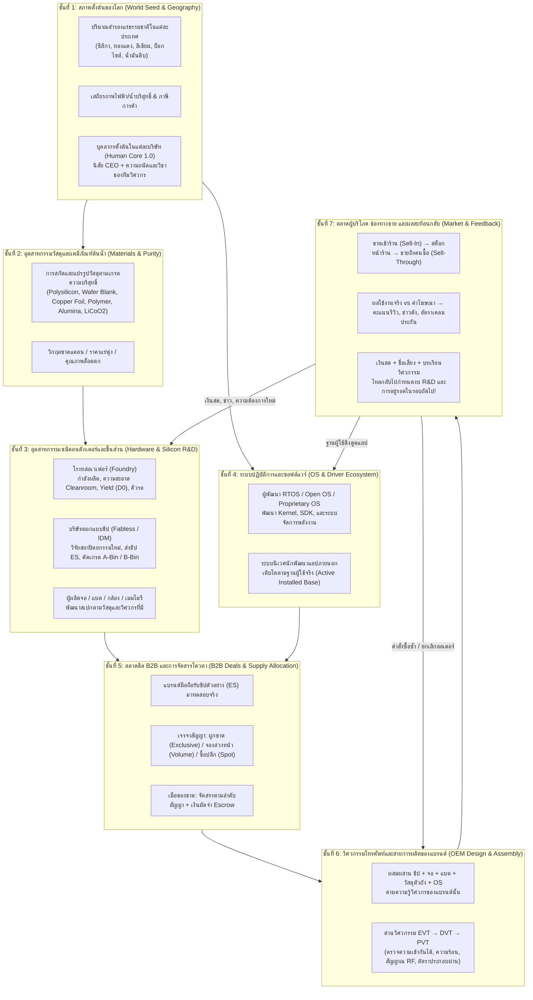
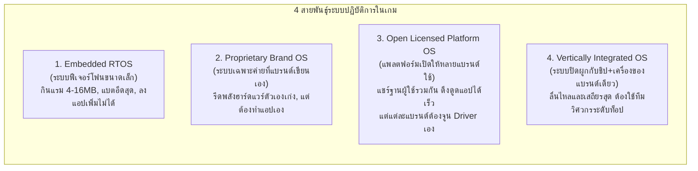
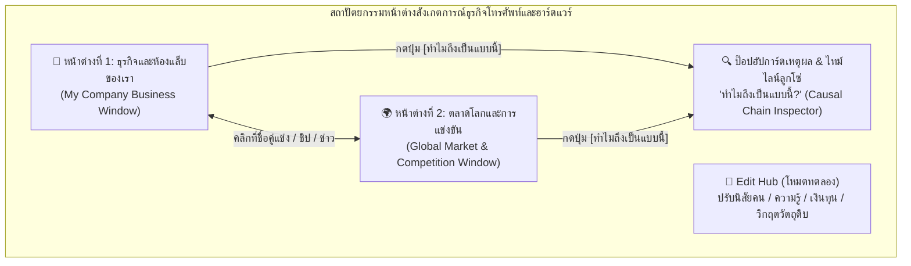

# Era 3 (v3.0.0) — พิมพ์เขียวระบบโมเดลธุรกิจโทรศัพท์ ฮาร์ดแวร์ และโลกจำลองแบบ Emergent ฉบับสมบูรณ์ (เสนอโดย Agy)

- **ผู้จัดทำข้อเสนอ:** Agy (Antigravity)
- **วันที่:** 12 พฤศจิกายน 2026
- **สถานะ:** เอกสารออกแบบสถาปัตยกรรมและโมเดลธุรกิจฉบับสมบูรณ์ (Master System Design Proposal) — **สำหรับให้เจ้าของโปรเจกต์และทีม AI ใช้เป็นฐานอ้างอิงและตัดสินใจร่วมกัน** (ยังไม่ได้แก้โค้ดรันไทม์ `v2.9.0`)
- **เอกสารที่อ่านและวิเคราะห์ประกอบครบแล้ว:**
  1. [`era3/ERA3_PHONE_BUSINESS_MODEL.md`](ERA3_PHONE_BUSINESS_MODEL.md) (แบบจำลองธุรกิจโทรศัพท์ทั้งระบบ)
  2. [`era3/ERA_3_BUSINESS_MODEL_DECISIONS.md`](ERA_3_BUSINESS_MODEL_DECISIONS.md) (การตัดสินใจเรื่องตัวเลข มาตราส่วนโลก และจุดขัดแย้งของสูตร)
  3. [`era3/ERA_3_MATERIALS_BUSINESSES_AND_UI_GUIDE.md`](ERA_3_MATERIALS_BUSINESSES_AND_UI_GUIDE.md) (แนวทางวัตถุดิบ 5 ชั้น สายประกอบ และ UI)
  4. [`era3/ERA_3_BUSINESS_MECHANICS_AND_CALCULATIONS.md`](ERA_3_BUSINESS_MECHANICS_AND_CALCULATIONS.md) (องค์ประกอบ กลไกธุรกิจ ลูปเวลา และสูตรคำนวณ 15 สูตร)
  5. [`era3/ERA_3_COEVOLUTION_ARCHITECTURE_AND_AI_BLUEPRINT.md`](ERA_3_COEVOLUTION_ARCHITECTURE_AND_AI_BLUEPRINT.md) (พิมพ์เขียวระบบนิเวศชิป–ดีล B2B–สมาร์ตโฟน)
  6. [`era3/ERA_3_FEATURE_AND_SMART_PHONES.md`](ERA_3_FEATURE_AND_SMART_PHONES.md) และ [`era3/project_status_and_ai_onboarding.md`](project_status_and_ai_onboarding.md)

---

## 0. สรุปแนวคิดแกนกลางของ Agy: "ไม่มีตารางรุ่นมือถือล่วงหน้า — โทรศัพท์ทุกเครื่องคือผลลัพธ์ปลายน้ำของห่วงโซ่คน ทุน วัสดุ ชิป และ OS ในโลกใบนั้น"

หลังจากอ่านเอกสารใหม่ทั้งหมดในโฟลเดอร์ `era3/` ผมขอสรุปมุมมองของผมตรงๆ ว่า **แนวทางที่ถูกต้องที่สุดสำหรับเกมนี้ ไม่ใช่การสร้าง "แคตตาล็อกโทรศัพท์" หรือ "ต้นไม้เทคโนโลยีตามปีปฏิทิน" แต่คือการสร้าง "เครื่องจักรจำลองห่วงโซ่อุตสาหกรรมที่มีชีวิต (Living Industrial Chain Engine)"**

ในระบบที่ผมออกแบบในเอกสารนี้:
1. **แต่ละโลก (แต่ละ Seed หรือแต่ละการทดลองใน Edit Hub) จะให้กำเนิดผลิตภัณฑ์ที่แตกต่างกันโดยสิ้นเชิงตามธรรมชาติ:**
   - **โลกที่บริษัทชิปมีวิศวกรเก่ง + แร่ซิลิคอน/ไฟฟ้าเสถียร + เงินทุนหนา:** โรงงานเวเฟอร์จะกดอัตราของเสีย (`D0`) ลงได้เร็ว บริษัทชิปวิจัยชิปสถาปัตยกรรมใหม่ที่กินไฟต่ำและแรงขึ้นได้ไว โทรศัพท์ของแบรนด์ต่างๆ ในโลกนี้จึงได้ใช้ชิปเกรดเอ (`A-Bin`) ก้าวเข้าสู่ยุคสมาร์ตโฟนเร็ว และแข่งกันที่ฟีเจอร์ระดับสูง
   - **โลกที่บริษัทชิปขาดคนเก่ง หรือเหมืองแร่/โรงงานเวเฟอร์เกิดวิกฤต:** การวิจัยชิปรุ่นใหม่จะล่มหรือล่าช้า แผ่นเวเฟอร์ที่ออกมาจะมีแต่ชิปเกรดรอง (`B-Bin`) ที่ทั้งกินไฟและร้อน โทรศัพท์ส่วนใหญ่ในโลกนี้จะกลายเป็นเครื่องสเปกต่ำ ร้อนง่าย แบตหมดไว หรือทั้งอุตสาหกรรมติดอยู่ในยุคฟีเจอร์โฟนและแข่งกันเรื่องความอึด/ราคาถูกแทน
   - **โลกที่บริษัทคู่แข่งบังเอิญมี NPC วิศวกรอัจฉริยะ:** แม้จะเป็นแบรนด์เล็กในตอนเริ่ม แต่ถ้ามีหัวหน้าวิศวกรที่เก่งเรื่องการออกแบบบอร์ดและเขียน OS เฉพาะตัว พวกเขาสามารถรีดประสิทธิภาพจากชิปธรรมดาให้ลื่นและประหยัดแบตกว่าคู่แข่งรายใหญ่ จนแย่งส่วนแบ่งตลาดและโตขึ้นมาเป็นเบอร์หนึ่งของโลกได้จริง!
2. **บริษัทภายนอกทุกแห่งคำนวณจริง 100% บนกฎเดียวกับบริษัทของเรา:**
   - บริษัทภายนอกไม่มีสิทธิ์เสกชิป เสกวัตถุดิบ หรืออัปเกรดเทคโนโลยีฟรีตามเวลา แต่ต้องใช้ **เงินสดจริง (สตางค์), ชั่วโมงทำงานของวิศวกรหลักที่มีโปรไฟล์ `human-core.js` จริง, กำลังผลิตเครื่องจักรจริง, และวัตถุดิบที่ซื้อมาจากซัพพลายเชนจริง**
3. **แยกหน้าต่างการสังเกตการณ์ออกเป็น 2 มิติที่ชัดเจนแต่เชื่อมกันทุกจุด:**
   - **`🏢 หน้าต่างธุรกิจของเรา (My Company Business Window)`** — เจาะลึกสิ่งที่เกิดขึ้นในแคมปัสและบริษัทของเราเอง (ห้องแล็บ R&D, สายการผลิต, สต็อกล็อตชิ้นส่วน, ดีลสัญญาซื้อขาย, กำไร/ขาดทุนรายรุ่น และความคิดของ NPC ในบริษัทเรา)
   - **`🌍 หน้าต่างตลาดและการแข่งขันโลก (Global Market & Competitive Window)`** — ส่องสมรภูมิตลาดโลก (เปรียบเทียบสเปก/ราคา/ยอดขายของมือถือทุกรุ่นที่วางขายอยู่ในโลกนั้น, สมรภูมิบริษัทชิปและคิวโรงงานเวเฟอร์, สงครามแย่งฐานผู้ใช้ของระบบปฏิบัติการ OS, ราคาวัตถุดิบ/ซัพพลายเชน และกระดานข่าวพร้อมปุ่มกดดูไทม์ไลน์สาเหตุ `ทำไมถึงเป็นแบบนี้`)

---

## ส่วนที่ 1: บทวิเคราะห์เอกสารใหม่ใน `era3/` และ 6 จุดที่ Agy ขอเสนอต่อยอดให้ลึกสุดขั้ว

### 1.1 สิ่งที่เอกสารใหม่ (`ERA3_PHONE_BUSINESS_MODEL.md` & `DECISIONS.md` & `MATERIALS.md`) ทำไว้ดีมากและควรล็อกทันที
1. **การแก้จุดขัดแย้งของสูตรทั้ง 6 จุด:** เช่น การแปลง `dieAreaMm2 / 100` เป็น $\text{cm}^2$ ก่อนเข้าสูตร Murphy Yield, การแยก `loadPowerW` กับ `averagePowerW` ในการคำนวณแบตเตอรี่, และการใช้สูตรความร้อนยกกำลัง $0.8$
2. **การเริ่มที่ยุค Feature Phone (130nm / เวเฟอร์ 200mm / ตลาด 14 ล้านเครื่องต่อปี):** ทำให้ตัวเลขเศรษฐกิจสมเหตุสมผล โรงงานเวเฟอร์ 1 แห่ง (กำลังผลิต 1,500 แผ่น/เดือน จุดคุ้มทุน 1,000 แผ่น) มี Utilization เริ่มต้นราว `70%` ซึ่งบีบให้เกิดการแย่งลูกค้าจริงโดยไม่ต้องเขียนสคริปต์บังคับ
3. **การปรับบทบาทบริษัทเดิมใน `world.js` แทนการสร้างทับซ้อน:** นำ `shenzhen_semi`, `tokyo_elec`, `pacific_solar`, `siam_tech`, `petro_chem_siam`, `titan_elec` มาแยกสมุดบัญชีตามบทบาทจริง และปิดทางลัดไม่ให้ `singapore_port_3pl` หรือ `world_exchange` เสกชิป/ชิ้นส่วนมือถือขึ้นมาฟรีๆ
4. **การนิยาม "สมาร์ตโฟน" ด้วยขีดความสามารถจริง ไม่ใช่ป้ายชื่อหรือวันที่:** เครื่องจะกลายเป็นสมาร์ตโฟนก็ต่อเมื่อมี `OS ที่ติดตั้งแอปภายนอกได้ + RAM ≥ 64 MB + จอ ≥ 240×320 + มีแอปในระบบนิเวศถึงเกณฑ์`

### 1.2 6 ช่องว่างสำคัญที่ Agy ออกแบบเพิ่มในเอกสารฉบับนี้ เพื่อให้ระบบลึกและเชื่อมเป็นลูกโซ่ 100%

| จุดที่ยังขาดในเอกสารเดิม | ข้อเสนอเชิงลึกของ Agy ในเอกสารนี้ |
|---|---|
| **1. กลไกการสร้างสเปกชิ้นส่วนและมือถือแบบไม่ต้องมีแคตตาล็อกล่วงหน้า (Procedural Engineering Synthesis)** | ออกแบบ **สมการสังเคราะห์พารามิเตอร์ทางวิศวกรรม** ที่คำนวณสเปกของชิป จอ แบต ตัวถัง และมือถือรุ่นใหม่จาก **ทักษะวิศวกรในโครงการ + คุณภาพเครื่องจักร + เกรดวัตถุดิบ + งบวิจัย** ทำให้แต่ละโลกได้ตัวเลขสเปก จุดเด่น และจุดอ่อนของชิ้นส่วนไม่ซ้ำกันเลย |
| **2. ความลึกของระบบวัสดุศาสตร์ (Material Physics & Supply Chain Trade-offs)** | เอกสารเดิมพูดถึงแค่พลาสติกกับอะลูมิเนียมคร่าวๆ Agy ขยายเป็น **ระบบวัสดุ 5 ส่วนหลักของตัวเครื่อง** (โครงตัวถัง, ระบบนำความร้อน, กระจก/หน้าจอ, แผงวงจร/ตะกั่วบัดกรี, และเคมีแบตเตอรี่) โดยวัสดุแต่ละชนิดส่งผลต่อ **การระบายความร้อน ($R_{th}$), ความทนทานการตกกระแทก, การกั้นคลื่นวิทยุ (RF Attenuation), น้ำหนัก, และอัตราของเสียตอนประกอบ** |
| **3. ความลึกของระบบปฏิบัติการ (OS Architecture & Driver Ecosystem)** | ขยายจากแค่ "RTOS vs แพลตฟอร์มสมาร์ตโฟน" เป็น **4 รูปแบบสถาปัตยกรรม OS** พร้อมระบบ **การจับคู่ไดรเวอร์ (BSP/Driver Compatibility Matrix)**, **อัตราการกินแรม/กินไฟพื้นหลัง (OS Overhead)**, **อัตราบั๊กแครช (Kernel Panic / Crash Rate)** และ **วงจรนักพัฒนาแอป 2 ด้าน (Two-Sided App Market)** |
| **4. สมองกลของบริษัทภายนอก (External Firm Autonomous Simulation)** | กำหนดโครงสร้างการคำนวณรายวัน/รายสัปดาห์/รายเดือนของบริษัทภายนอกทุกแห่ง ให้เดินด้วย **ข้อจำกัดของทรัพยากรจริงในมือ** (คน, เงินสด, วัตถุดิบในคลัง, คิวเครื่องจักร, และข้อมูลข่าวสารที่บริษัทนั้นรู้) |
| **5. การแยก "หน้าต่างธุรกิจของตัวเอง" กับ "หน้าต่างตลาดโลก" ให้ชัดเจน** | ออกแบบโครงหน้าจอแยกเป็น **2 หน้าต่างหลัก (`My Company Business Window` vs `Global Market & Competition Window`)** ที่เชื่อมโยงกันด้วยลิงก์คลิกตามรอยได้ทุกจุด |
| **6. เส้นทางการเติบโตของบริษัทในแคมปัสผู้เล่น (SME → Tier-2 Supplier → OEM Brand / Chipmaker)** | ออกแบบบันไดธุรกิจให้บริษัทในแคมปัส (ที่เริ่มจากทุนหลักแสน) สามารถค่อยๆ ไต่เต้าจาก **ซ่อมมือถือ/คัดเกรดมือสอง → ผลิตสายชาร์จ/ตัวถัง → รับจ้างประกอบท้ายสาย (Box-Build/Flash) → ออกแบบมือถือแบรนด์ตัวเอง หรือพัฒนาชิป/OS ขายทั่วโลก** โดยNPC ในบริษัทเราเป็นคนตัดสินใจขยายสายธุรกิจเองเมื่อทุนและคนพร้อม! |

---

## ส่วนที่ 2: โครงสร้างห่วงโซ่ลูกโซ่ 7 ชั้น — ทำไมแต่ละโลกจึงวิวัฒนาการไม่เหมือนกัน?

ในระบบนี้ ไม่มีตัวแปรไหนลอยอยู่เดี่ยวๆ ทุกอย่างไหลจากชั้นที่ 1 ลงไปถึงชั้นที่ 7 แล้วสะท้อนกลับขึ้นมาเป็นวงจรไม่รู้จบ:



### ตัวอย่างเปรียบเทียบ 4 โลกที่เกิดจากสมการเดียวกัน (แต่ผลลัพธ์ต่างกัน 100%)

| มิติที่เปรียบเทียบ | โลกที่ 1: "ยุคทองซิลิคอน" | โลกที่ 2: "วิกฤตชิปแพงและร้อน" | โลกที่ 3: "การผงาดของม้ามืด" | โลกที่ 4: "สงครามวัสดุและแบตเตอรี่" |
|---|---|---|---|---|
| **ต้นเหตุในโลกนั้น** | โรงหล่อ `shenzhen_semi` มีหัวหน้าวิศวกรกระบวนการที่เก่งมาก (`process_engineering` สูง) และไฟฟ้าเสถียร กดค่าความสกปรก $D_0$ ลงเร็ว | วิศวกรออกแบบชิปหลักของบริษัทชิปลาออกกลางคัน และโรงหล่อเจอน้ำบริสุทธิ์ปนเปื้อน ทำให้ Yield ตกเหลือ 45% | บริษัทชิปปกติ แต่แบรนด์เล็กอันดับ 4 (`Sahel`) บังเอิญมีหัวหน้าวิศวกรบอร์ด+ซอฟต์แวร์ระดับอัจฉริยะ และ CEO สายกล้าคิดต่าง | เหมืองลิเธียมและบ็อกไซต์ (อะลูมิเนียม) เกิดความขัดแย้งทางการค้า ราคาแบตและตัวถังโลหะพุ่ง 2.5 เท่า |
| **สิ่งที่เกิดกับชิปและชิ้นส่วน** | ชิปเกรด `A-Bin` ออกมาเยอะ ราคาถูก และก้าวจาก 130nm ไป 90nm และ 65nm ได้เร็ว | ชิปออกช้า ขาดตลาดหนัก มีแต่ชิปเกรดรอง `B-Bin` ที่กินไฟสูงและรั่วไหลทางความร้อน | ชิปในตลาดมีจำกัด แบรนด์ใหญ่แย่งซื้อชิปแพงกันหมดจนมัดจำบานปลาย | แบตเตอรี่ความจุสูงขาดตลาด ตัวถังอะลูมิเนียมระบายความร้อนแพงเกินงบมือถือระดับกลาง |
| **สิ่งที่เกิดกับโทรศัพท์ในตลาด** | แบรนด์ต่างๆ แข่งกันออกเครื่องจอสีสวย มัลติมีเดียครบ และเข้าสู่ยุคสมาร์ตโฟนตั้งแต่วันที่ ~240 ของเกม | แบรนด์ที่ฝืนทำรุ่นแรงด้วยชิปเกรดต่ำเจอปัญหาเครื่องร้อนจัด เคลมพุ่ง รีวิวพัง ตลาดส่วนใหญ่จึงมีแต่ฟีเจอร์โฟนสเปกประหยัด | แบรนด์อันดับ 4 ไม่แย่งชิปแพง แต่เอาชิปเกรดรองมาเขียนเฟิร์มแวร์รีดประสิทธิภาพ + ใส่ตัวถังทนทาน ขายดีถล่มทลายจนแซงแบรนด์อันดับ 2! | แบรนด์ที่ปรับตัวไวหันไปวิจัยชิปประหยัดพลังงานพิเศษ (`Ultra-Low-Power`) เพื่อให้ใช้ตัวถังพลาสติกและแบตก้อนเล็กแล้วยังอยู่ได้ 5 วัน |

---

## ส่วนที่ 3: กลไกการคำนวณของ "บริษัทภายนอก" (External Firm Autonomous Engine)

เพื่อให้บริษัทภายนอก (ทั้งโรงหล่อเวเฟอร์, บริษัทออกแบบชิป, ผู้ผลิตจอ/แบต, เจ้าของ OS, และแบรนด์มือถือคู่แข่ง) **พัฒนาตามทรัพยากรที่มีจริง** ไม่ใช่ขยับตามสคริปต์ เราต้องกำหนดให้ทุกบริษัทภายนอกในห่วงโซ่นี้มี **"สถานะภายใน 6 ก้อน (6 Internal State Pillars)"** ที่คำนวณทุกวัน/สัปดาห์/เดือน:

### 3.1 โครงสร้างสถานะภายในของบริษัทภายนอกแต่ละแห่ง
1. **บัญชีและการเงินจริง (`finance`):**
   - `cashSatang`: เงินสดคงเหลือ (เริ่มต้น = ต้นทุนคงที่ 12 เดือน)
   - `escrowLockedSatang`: เงินมัดจำที่ถูกล็อกอยู่ในสัญญาซื้อขาย
   - `warrantyReserveSatang`: เงินสำรองสำหรับจ่ายค่าเคลมประกันเครื่องที่ขายไปแล้ว
   - `monthlyFixedBurnSatang`: ค่าใช้จ่ายคงที่ต่อเดือน (เงินเดือนพนักงานทั้งหมด + ค่าบำรุงรักษาเครื่องจักร + ค่าเช่า/สาธารณูปโภคพื้นฐาน)
2. **บุคลากรหลักที่มีตัวตนจริง (`keyPersonnel`):**
   - เก็บคนสำคัญ 4–8 คนต่อบริษัท (เช่น `CEO`, `LeadChipArchitect`, `LeadProcessEngineer`, `LeadHardwareEngineer`, `LeadOsArchitect`, `SupplyChainDirector`)
   - **ทุกคนใช้โปรไฟล์ `human-core.js` แท้** (มี 14 บุคลิก, 18 ค่านิยม, 30 ความถนัด, 12 สภาพชีวิต และรายการวิชาที่รู้จริง `learnedSubjects`)
   - มี `headcountPool` สำหรับพนักงานระดับปฏิบัติการ (เช่น ช่างประกอบ 120 คน, วิศวกรทั่วไป 25 คน) เพื่อไม่ต้องจำลองการเดินในแมพของคนนอกแคมปัส แต่คิดเงินเดือนและชั่วโมงทำงานจริง!
3. **เครื่องจักรและขีดความสามารถของโรงงาน (`facilities & capabilities`):**
   - ประเภทสายการผลิตที่มีจริง (เช่น `wafer_fab_200mm_130nm`, `smt_line_gen1`, `cleanroom_class_1000`, `rf_shield_chamber`)
   - ค่าสภาพเครื่องจักร (`condition: 0..1`), ความสะอาดห้องคลีนรูม (`cleanroomQuality: 0..1`), และจำนวนแผ่นเวเฟอร์สะสมที่เคยผลิตในแต่ละโหนด (`cumulativeWafersByNode`) ซึ่งใช้คำนวณการลดลงของจุดบกพร่อง $D_0$
4. **คลังวัตถุดิบและล็อตชิ้นส่วนในมือ (`inventoryLots`):**
   - เก็บล็อตวัตถุดิบและชิ้นส่วนที่บริษัทซื้อมาไว้ในมือจริง (เช่น ซิลิคอนบริสุทธิ์, แผ่นเวเฟอร์เปล่า, ล็อตชิป `A-Bin`/`B-Bin`, ล็อตหน้าจอ, ล็อตแบตเตอรี่)
   - **กฎเหล็ก:** ถ้าไม่มีวัตถุดิบใน `inventoryLots` สายการผลิตของบริษัทภายนอกจะหยุดเดินทันที (`Stalled due to Material Shortage`) และต้องบันทึกเหตุผลลงในประวัติบริษัท!
5. **ความทรงจำและข้อมูลข่าวกรองที่บริษัทรู้ (`knownIntel & memory`):**
   - บริษัทภายนอก **ไม่เห็นข้อมูลทุกอย่างในโลก** แต่เห็นเฉพาะ:
     - สเปกและราคาของสินค้าที่วางขายแล้วในตลาด
     - ชิปตัวอย่าง (`ES`) ที่ผู้ผลิตชิปส่งมาให้ตัวเองทดสอบ
     - ข่าวที่สื่อไอทีตีพิมพ์ออกมาแล้ว
     - ประสบการณ์ความล้มเหลวของตัวเองในอดีต (เช่น *"เคยใช้ตัวถังพลาสติกกับชิปกินไฟเกิน 2.5W แล้วเคลมพุ่ง 14% → จำไว้ว่าห้ามทำซ้ำ"*)
6. **โครงการวิจัยและพัฒนาที่กำลังเดินอยู่ (`activeProjects`):**
   - ทุกโครงการ (วิจัยชิปใหม่, พัฒนาจอใหม่, เขียน OS ใหม่, ออกแบบมือถือรุ่นใหม่) ต้องสะสม **ชั่วโมงวิศวกรรมจริง (`accumulatedEngHours`)** แยกตามสาขาวิชา!

### 3.2 สมการความก้าวหน้าของการวิจัย (R&D Progress Equation) สำหรับทุกบริษัท
ในทุกๆ วัน (Daily Loop) โครงการวิจัย $p$ ของบริษัทใดๆ (ทั้งบริษัทเราและบริษัทภายนอก) จะเดินหน้าตามชั่วโมงและความสามารถจริงของวิศวกรที่ได้รับมอบหมาย:

$$\Delta \text{Progress}_{p, \text{day}} = \sum_{e \in \text{AssignedEngineers}} \left( \text{Hours}_{e} \cdot \text{SkillMatch}_{e,p} \cdot \text{AptitudeFactor}_{e,p} \cdot \text{ToolQuality}_{p} \right)$$

โดยที่:
- $\text{SkillMatch}_{e,p}$: สัดส่วนวิชาที่วิศวกร $e$ รู้จริง เทียบกับวิชาที่โครงการ $p$ ต้องการ (เช่น โครงการวิจัยชิป 90nm ต้องการวิชา `semiconductor_device_physics`, `vlsi_digital_design`, `eda_verification` ถ้าวิศวกรรู้แค่ 1 ใน 3 วิชา ค่านี้จะต่ำมาก และมีโอกาสเกิด **Design Bug** ที่ทำให้ต้องแก้หน้ากากชิปใหม่ `Respin`!)
- $\text{AptitudeFactor}_{e,p}$: คำนวณจากความถนัดใน `human-core.js` ของวิศวกรคนนั้น (เช่น `logic_computation`, `systems_thinking`, `spatial_3d`, `precision_craft`)
- $\text{ToolQuality}_{p}$: คุณภาพของเครื่องมือวิจัยและซอฟต์แวร์ (เช่น มีไลเซนส์ EDA หรือเครื่องมือวัดคลื่นความถี่ครบหรือไม่)

> **ผลลัพธ์ที่เกิดขึ้นเองตามธรรมชาติ:**
> - ถ้าบริษัทชิปมีเงินถุงเงินถัง แต่ **ไม่มีวิศวกรที่รู้วิชาออกแบบชิปขั้นสูง** ค่า $\text{SkillMatch}$ จะต่ำกว่าเกณฑ์ขั้นต่ำ โครงการจะติดคอขวดที่ด่านสถาปัตยกรรม (`Blocked: Missing VLSI Specialist`) บริษัทต้องส่งคนไปเรียนหรือดึงตัววิศวกรจากที่อื่นมาก่อน ถึงจะวิจัยต่อได้!
> - ถ้าบริษัทคู่แข่งมีวิศวกรเก่งระดับหัวกะทิ 3 คนช่วยกันทำ โครงการจะเสร็จเร็วกว่าและได้ **"โบนัสคุณภาพการออกแบบ (`Design Excellence Bonus`)"** ซึ่งทำให้ชิปที่ออกมากินไฟน้อยกว่าหรือมีขนาดพื้นที่ Die เล็กกว่าคู่แข่ง!

---

## ส่วนที่ 4: กลไกการสังเคราะห์ชิ้นส่วน วัสดุศาสตร์ และระบบปฏิบัติการ (Materials, Silicon & OS Co-Evolution)

นี่คือหัวใจที่ทำให้โทรศัพท์แต่ละรุ่นในแต่ละโลกมีความแตกต่างกันอย่างมีเหตุผลทางวิศวกรรม

### 4.1 การสังเคราะห์ชิปประมวลผล (`Procedural Chip / SoC Synthesis`)
เมื่อบริษัทออกแบบชิปวิจัยชิปรุ่นใหม่สำเร็จ สเปกของชิปรุ่นนั้นไม่ได้ดึงมาจากตารางสำเร็จรูป แต่คำนวณจาก **พารามิเตอร์ที่ทีมวิศวกรของบริษัทนั้นเลือกและทำได้จริง**:

1. **ขนาดพื้นที่ชิป (`dieAreaMm2`):**
   $$A_{\text{die}} = \left( A_{\text{baseCPU}} \cdot N_{\text{cores}} + A_{\text{GPU}} + A_{\text{Modem}} + A_{\text{ISP}} + A_{\text{IO}} \right) \cdot \left(\frac{\text{Node}_{\text{nm}}}{130}\right)^{1.75} \cdot \frac{1}{\text{LayoutEfficiency}_{\text{team}}}$$
   - ถ้าทีมวิศวกรวางเลย์เอาต์เก่ง ($\text{LayoutEfficiency}_{\text{team}} > 1.0$) ขนาดชิปจะเล็กลง → ได้จำนวนเม็ดชิปต่อแผ่นเวเฟอร์ (`Gross Dies per Wafer`) มากขึ้น → ต้นทุนต่อเม็ดถูกลงและ Yield สูงขึ้น!
2. **ความเร็วและประสิทธิภาพต่อคล็อก (`Clock GHz & IPC`):**
   - ขึ้นกับสถาปัตยกรรมแกนที่ซื้อไลเซนส์มาหรือวิจัยเอง + ความสามารถของวิศวกรผู้ออกแบบวงจรความเร็วสูง
3. **การกินไฟและความร้อน (`Idle / Average / Peak Power W`):**
   $$P_{\text{loadW}} = C_{\text{dyn}} \cdot V_{\text{dd}}^2 \cdot f_{\text{clock}} \cdot \text{LeakageFactor}_{\text{foundry}}$$
   - ถ้าโรงหล่อเวเฟอร์ควบคุมกระบวนการไม่ดี ($\text{LeakageFactor}$ สูง) หรือทีมออกแบบจัดการไฟไม่เก่ง ชิปรุ่นนั้นจะกินไฟสแตนด์บายสูงและร้อนจัดเวลาใช้งานหนัก!

---

### 4.2 ระบบวัสดุศาสตร์ 5 ส่วนหลัก (Material Science & Supply Chain Cascades)
แบรนด์โทรศัพท์ไม่ได้เลือกแค่ "ชิปอะไร" แต่ต้องเลือก **วัสดุทั้ง 5 ส่วนของตัวเครื่อง** ซึ่งผูกกับวัตถุดิบจริงในซัพพลายเชนของโลกนั้น:

| ส่วนประกอบของเครื่อง | ทางเลือกวัสดุ (พัฒนาตามยุคและของที่มีในโลก) | วัตถุดิบต้นน้ำที่ต้องใช้ | ผลกระทบทางฟิสิกส์และการผลิตจริง |
|---|---|---|---|
| **1. โครงตัวถังและฝาหลัง (`Chassis & Enclosure`)** | **A. พลาสติกมาตรฐาน (ABS/PC)** | `polymer_resin` | ราคาถูก (฿20–30), เบา, ไม่กั้นคลื่นวิทยุ (`RF Loss = 0%`), แต่ระบายความร้อนแย่ (`R_th = 5.2 °C/W`), ความหรูหราต่ำ |
| | **B. พอลิเมอร์เสริมใยแก้ว (Polycarbonate GF)** | `polymer_resin` + `silica_bauxite_ore` (ใยแก้ว) | ทนแรงกระแทกสูงมาก (`Drop Survival +35%`), เบา, ระบายความร้อนปานกลาง (`R_th = 4.5 °C/W`) เหมาะกับมือถือสายอึด |
| | **C. อะลูมิเนียมอัดรีด/ชุบผิว (Anodized Aluminum)** | `aluminum_extrusion_profile` (จาก `bauxite_ore`) | ระบายความร้อนดีเยี่ยม (`R_th = 3.1 °C/W`), สวยพรีเมียม, แพงกว่า (฿75–140), **แต่กั้นคลื่นวิทยุ (`RF Penalty`)** ต้องมีวิศวกร RF เก่งออกแบบช่องสัญญาณ ไม่งั้นสัญญาณโทรศัพท์ดรอป! |
| | **D. โครงแมกนีเซียม/สเตนเลส + ฝาหลังกระจก** | โลหะผสมเกรดสูง + กระจกนิรภัย | สวยหรูระดับเรือธง, แข็งแรง แต่หนัก, แพงมาก และถ้าตกกระแทกมีโอกาสฝาหลังแตกหากประกอบไม่แม่นยำ |
| **2. ระบบกระจายความร้อนภายใน (`Thermal Interface`)** | **A. ระบายตามธรรมชาติ (Passive Air Gap)** | ไม่มีต้นทุนเพิ่ม | ใช้ได้เฉพาะชิปฟีเจอร์โฟนที่กินไฟ $< 1.0\text{ W}$ |
| | **B. แผ่นทองแดง/ฮีตซิงก์บาง (`Copper Foil Shield`)** | `copper_coil` | ลด $R_{th}$ ลง $0.5\text{ }^\circ\text{C/W}$ ต้นทุนเพิ่ม ฿15–25 (ถ้าทองแดงโลกขาดแคลน ราคาจะพุ่งทันที) |
| | **C. แผ่นกราไฟต์สังเคราะห์ / ท่อความร้อนจิ๋ว (`Graphite Sheet / Vapor Chamber`)** | กราไฟต์บริสุทธิ์ + ทองแดง | ลด $R_{th}$ ลง $1.1 - 1.6\text{ }^\circ\text{C/W}$ จำเป็นมากสำหรับสมาร์ตโฟนที่ใช้ชิปแรงเกิน $3.5\text{ W}$ |
| **3. กระจกและโมดูลหน้าจอ (`Display & Cover Lens`)** | **A. หน้าจอพลาสติก PMMA + จอขาวดำ/สี CSTN** | `polymer_resin` + โมดูลจอพื้นฐาน | ราคาถูก กินไฟน้อยมาก มองกลางแดดพอใช้ แต่เป็นรอยขีดข่วนง่าย |
| | **B. กระจกโซดาไลม์ + จอ TFT / IPS** | `silica_bauxite_ore` (แก้ว) + โมดูลจอสี | สีสดใส ความละเอียดสูงขึ้น แต่กินไฟแบตเตอรี่มากขึ้นตามพื้นที่และจำนวนพิกเซล |
| | **C. กระจกนิรภัยชุบแข็งเคมี + จอสัมผัส Capacitive / OLED** | แก้วเกรดพิเศษ + อินเดียม (ITO) + สารอินทรีย์เปล่งแสง | รองรับมัลติทัชแม่นยำ สีดำสนิท ประหยัดไฟเมื่อแสดงสีเข้ม แต่ราคาสูงและผลิตยาก (Yield ต่ำในยุคแรก) |
| **4. แผงวงจรและเกรดการบัดกรี (`PCB & Solder Grade`)** | **A. แผงวงจร 2–4 ชั้น + ตะกั่วบัดกรีมาตรฐาน** | `pcb` + ทองแดง + ดีบุก | ราคาถูก ประกอบง่าย แต่ใส่ชิปที่มีขาเชื่อมต่อ (Pin Count) สูงระดับสมาร์ตโฟนไม่ได้ |
| | **B. แผงวงจรความหนาแน่นสูง (HDI 6–10 ชั้น) + เพสต์บัดกรีเงินไร้สารตะกั่ว** | ลามิเนตเกรดสูง + ฟอยล์ทองแดงบาง + เงินบริสุทธิ์ | รองรับชิป SoC ขนาดเล็กและ RAM ความเร็วสูง ทนความร้อนสะสม ไม่เกิดอาการตะกั่วร่อนเมื่อเครื่องร้อนจัด |
| **5. เคมีแบตเตอรี่ (`Battery Chemistry`)** | **A. ลิเธียมไอออนทรงกระบอก/ปริซึมมาตรฐาน (LiCoO2)** | `lithium_brine_ore` + `nickel_cobalt_matte` + `cathode_electrolyte` | ความหนาแน่นพลังงานมาตรฐาน (เช่น 800–1,200 mAh) ถอดเปลี่ยนแบตได้ ราคาประหยัด |
| | **B. ลิเธียมพอลิเมอร์ความหนาแน่นสูง (High-Density Li-Po)** | เคมีลิเธียมเกรดบริสุทธิ์สูง + ซองอะลูมิเนียมลามิเนต | ทำตัวเครื่องบางเฉียบได้ ความจุสูง (1,800–4,500 mAh) แต่ถ้าชิป PMIC จัดการไฟไม่ดีหรือเคมีไม่บริสุทธิ์ จะเสื่อมเร็วหรือบวมเมื่อเจอความร้อนสูง! |

> **ตัวอย่างลูกโซ่วัตถุดิบที่เกิดขึ้นเอง:**
> สมมติในโลกนั้นเกิดวิกฤตที่เหมืองทองแดงและอะลูมิเนียม ทำให้ราคา `copper_coil` และ `aluminum_extrusion_profile` พุ่งขึ้น 2 เท่า:
> 1. ต้นทุนแผงวงจร HDI, แผ่นระบายความร้อนทองแดง และตัวถังอะลูมิเนียมแพงขึ้นทันที
> 2. แบรนด์มือถือที่มีเงินทุนน้อยต้องเปลี่ยนแบบเครื่องจากตัวถังอะลูมิเนียมกลับมาใช้พลาสติก (`polymer_resin`) และตัดแผ่นทองแดงระบายความร้อนออก
> 3. พอเอาชิปรุ่นใหม่ที่กินไฟสูงมาใส่ในตัวถังพลาสติก ค่าความต้านทานความร้อน $R_{th}$ จึงพุ่งจาก $3.1$ เป็น $5.2\text{ }^\circ\text{C/W}$!
> 4. เครื่องต้นแบบในด่าน `DVT` ร้อนทะลุ $47^\circ\text{C}$ แบรนด์นั้นจึงต้องเลือกว่าจะ **(ก) ลดความเร็วคล็อกของชิปลง 25%** (ทำให้เครื่องช้าลงแต่ไม่ร้อน) หรือ **(ข) หันไปซื้อชิปรุ่นประหยัดพลังงานจากบริษัทชิปอีกค่าย** ส่งผลให้บริษัทชิปที่ทำชิปประหยัดไฟกลายเป็นผู้ชนะของโลกใบนั้น!

---

### 4.3 ระบบปฏิบัติการ (OS) ที่แตกต่างกันและแข่งขันกันเป็นระบบนิเวศ
ในโลกจริง โทรศัพท์ไม่ได้แข่งกันแค่ฮาร์ดแวร์ แต่แข่งกันที่ **ระบบปฏิบัติการ (OS) และซอฟต์แวร์** ด้วย Agy ขอเสนอให้ระบบ OS ในเกมมี **4 สายพันธุ์หลัก** ที่เกิดขึ้นและวิวัฒนาการตามการตัดสินใจของบริษัทในโลกนั้น:



#### พารามิเตอร์ที่คำนวณจริงของแต่ละ OS (`OsPlatformSpec`)
1. **`minRamMB` & `ramOverheadMB`:** ปริมาณแรมขั้นต่ำที่ต้องใช้เพื่อบูตเครื่อง และแรมที่ OS กินไปเป็นพื้นฐาน (ถ้าเครื่องมี RAM 64 MB แต่ OS กินไปแล้ว 48 MB เวลาเปิดแอปจะเกิดอาการแรมเต็มและแอปเด้ง!)
2. **`cpuEfficiencyMultiplier` (`0.70 .. 1.15`):** ประสิทธิภาพของ Kernel และ Runtime ในการจัดตารางงาน CPU (OS ที่เขียนดีจะทำให้ชิปตัวเดียวกันทำงานลื่นกว่า OS ที่เขียนแย่ถึง 20–30%)
3. **`idlePowerOverheadW`:** พลังงานที่ OS กินอยู่เบื้องหลังเวลาพักหน้าจอ (ถ้าจัดการ Background Process ไม่ดี แบตจะไหลแม้ไม่ได้หยิบมาใช้)
4. **`driverSupportMatrix`:** รายการตระกูลชิป (`socFamily`), ประเภทหน้าจอ และโมดูลกล้องที่ OS นี้มีไดรเวอร์มาตรฐานรองรับแล้ว
   - **กลไกสำคัญ:** ถ้าแบรนด์มือถือเลือกใช้ชิปรุ่นใหม่ที่เพิ่งออกจากโรงงานแล้วยังไม่มีไดรเวอร์ใน OS นั้น ทีมวิศวกรซอฟต์แวร์ของแบรนด์ต้องลงชั่วโมงเขียน **Board Support Package (BSP) & Driver** เอง!
   - ถ้าวิศวกรซอฟต์แวร์ของแบรนด์มีทักษะ `firmware_driver` ต่ำ เครื่องที่วางขายจะมีค่า **`softwareBugRate` สูง** (เครื่องค้าง, กล้องเปิดไม่ติด, สูบแบต) จนกว่าจะออกแพตช์อัปเดต (`OTA / Firmware Patch`) ตามหลัง!
5. **`appEcosystemCount` & `appQualityIndex`:** จำนวนและคุณภาพของแอปพลิเคชันบนแพลตฟอร์มนั้น ซึ่งคำนวณทุกเดือนจาก **วงจรตลาดสองด้าน (Two-Sided Network Effect):**
   $$\Delta \text{Apps}_{\text{month}} = k_{\text{dev}} \cdot \left(\frac{\text{ActiveInstalledBase}_{\text{OS}}}{100,000}\right)^{1.25} \cdot \text{SdkMaturity}_{\text{OS}} \cdot \text{MonetizationFactor} - \text{AppObsolescence}$$
   - แปลว่า: ต่อให้บริษัทซอฟต์แวร์สร้าง OS สำหรับสมาร์ตโฟนขึ้นมาสำเร็จ แต่ถ้าไม่มีแบรนด์มือถือรายไหนยอมเอาไปใส่เครื่องขาย ฐานผู้ใช้ (`ActiveInstalledBase`) ก็จะเป็นศูนย์ นักพัฒนาแอปก็จะไม่เข้ามาทำแอป และ OS นั้นก็จะตายไปเองตามธรรมชาติ!

---

## ส่วนที่ 5: โมเดลการตัดสินใจของแบรนด์และการแข่งขันในตลาด (How Companies Compete)

### 5.1 วงจรการคิดค้นรุ่นมือถือของแต่ละแบรนด์ (Autonomous Product Creation Loop)
ทุกๆ เดือน (หรือเมื่อมีเหตุการณ์สำคัญ เช่น คู่แข่งเปิดตัวรุ่นใหม่ หรือได้รับชิปตัวอย่าง `ES` ตัวใหม่) ฝ่ายวางแผนผลิตภัณฑ์และ CEO ของแต่ละแบรนด์ (ทั้งบริษัทเราและบริษัทภายนอก) จะรันอัลกอริทึม 5 ขั้นตอนนี้:

1. **ขั้นที่ 1: สแกนช่องว่างตลาดจากข้อมูลที่ตัวเองรู้ (`Market Opportunity Scan`)**
   - ดูว่าในแต่ละกลุ่มผู้ซื้อ (`โทรพื้นฐาน`, `แบตอึดทนทาน`, `วัยรุ่นมัลติมีเดีย`, `สมาร์ตกระแสหลัก`, `เรือธง`) ตอนนี้รุ่นของตัวเองมียอดขายตกหรือไม่? สต็อกหน้าร้านค้างกี่สัปดาห์? และคู่แข่งกำลังครองกลุ่มไหนอยู่?
2. **ขั้นที่ 2: กำหนดโจทย์เป้าหมาย (`Target Product Brief`) ตามนิสัย CEO และทรัพยากรบริษัท**
   - **แบรนด์ที่เงินสดเหลือน้อยหรือ CEO ระมัดระวัง:** จะตั้งโจทย์ทำรุ่นคุ้มค่า (`Cost-Optimized Refresh`) โดยใช้บอร์ดเดิม/ชิปที่ราคาถูกลงแล้ว เพื่อเน้นทำกำไรเร็วและใช้เงินลงทุน R&D ต่ำ
   - **แบรนด์ที่เงินสดหนาและ CEO ทะเยอทะยาน (`ambition` / `openness` สูง):** จะตั้งโจทย์ทำรุ่นบุกเบิกตลาดใหม่ (เช่น รุ่นเรือธงที่ใช้ชิปใหม่ล่าสุด หรือรุ่นที่ขยับไปใช้จอสีละเอียดขึ้น + OS ใหม่)
3. **ขั้นที่ 3: ค้นหาและผสมชุดชิ้นส่วนที่ "มีอยู่จริงในโลกนั้น" (`Feasible BOM & Material Synthesis`)**
   - ระบบนำชิ้นส่วนที่มีขายจริงในโลกตอนนั้น (ล็อตชิปจากบริษัทชิป 각 ค่าย, ล็อตจอ, แบตเตอรี่, วัสดุตัวถัง, และ OS) มาลองจับคู่ไม่เกิน 40 รูปแบบ (`Candidate Blueprints`)
   - **คัดออกด้วยกฎเหล็กวิศวกรรม (Hard Engineering Gates):**
     - ถ้าชิปไม่รองรับชนิด RAM หรือความละเอียดจอนั้น → **ตัดทิ้ง** (บันทึกเหตุผล: *"ชิป SN-130 ขับจอละเอียดเกิน 160×128 ไม่ไหว"*)
     - ถ้าผู้ผลิตชิปไม่มีโควตาเหลือให้สั่งซื้อทันเวลาผลิต → **ตัดทิ้ง** (บันทึกเหตุผล: *"คิวโรงงานเวเฟอร์เต็ม ต้องรอคิวอีก 55 วัน"*)
     - ถ้าบริษัทไม่มีวิศวกรที่ทำบอร์ดหรือเขียนไดรเวอร์สำหรับชุดชิ้นส่วนนั้นได้ → **ตัดทิ้ง** (บันทึกเหตุผล: *"ขาดวิศวกรที่รู้วิชา RF สำหรับตัวถังอะลูมิเนียม"*)
     - ถ้าต้องใช้เงินมัดจำและทุนหมุนเวียนเกินกว่าเงินสดที่มีหลังหักเงินสำรองอยู่รอด → **ตัดทิ้ง**
4. **ขั้นที่ 4: จำลองผลทางฟิสิกส์และให้คะแนนความคุ้มค่า (`Physics Preview & Executive Scoring`)**
   - สำหรับชุดชิ้นส่วนที่ผ่านด่านทั้งหมด วิศวกรจะคำนวณค่าคาดการณ์ของ **ความเร็วตามงานจริง, ชั่วโมงแบตเตอรี่, อุณหภูมิเครื่องขณะใช้งานหนัก, ความทนทานการตกกระแทก, ต้นทุน BOM ต่อเครื่อง, และจุดคุ้มทุน**
   - CEO เลือกชุดที่ได้คะแนนสูงสุดตามสมการบุคลิกภาพของตัวเอง แล้วเปิดโครงการเข้าสู่ด่าน **`EVT → DVT → PVT`**
5. **ขั้นที่ 5: การแก้ปัญหาเฉพาะหน้าเมื่อติดด่านวิศวกรรม (`Crisis & Bottleneck Resolution`)**
   - ถ้าระหว่างทดสอบด่าน `DVT` พบว่าเครื่องจริงร้อนเกินเพดาน หรือแบตเตอรี่ไม่อึดเท่าที่คำนวณไว้ หรือซัพพลายเออร์ส่งของไม่ครบตามสัญญา:
     - ผู้บริหารและวิศวกร NPC ต้องเลือกทางแก้เอง เช่น **(ก) เปลี่ยนวัสดุตัวถัง/เพิ่มแผ่นทองแดงระบายความร้อน**, **(ข) ลดความเร็วชิปลง (Underclock)**, **(ค) เจรจาขอใช้ชิปเกรด B ในรุ่นรองแทน**, หรือ **(ง) เลื่อนวันเปิดตัวออกไปก่อนเพื่อแก้บั๊กไดรเวอร์**

---

## ส่วนที่ 6: การออกแบบหน้าต่าง UI ฉบับสมบูรณ์ — แยก "หน้าต่างธุรกิจของตัวเอง" และ "หน้าต่างตลาดและการแข่งขันโลก"

ตามโจทย์ของคุณที่ต้องการให้มีทั้ง **"หน้าต่างธุรกิจของตัวเอง"** และ **"หน้าต่างตลาด/การแข่งขัน"** ที่ละเอียด ลึก และอ่านเข้าใจง่ายสำหรับผู้สังเกตการณ์ (Read-Only 100% ไม่มีปุ่มบังคับให้ผู้เล่นกดสั่งงานบริหารรายวัน) ผมขอออกแบบแยกเป็น **2 หน้าต่างหลักที่เชื่อมถึงกันได้ในคลิกเดียว** ดังนี้ครับ:



---

### 6.1 หน้าต่างที่ 1: `🏢 หน้าต่างธุรกิจของตัวเอง (My Company Business Window)`
หน้าต่างนี้โฟกัสที่ **บริษัทในแคมปัสของเรา** ว่าตอนนี้เรากำลังอยู่ในบทบาทไหนของห่วงโซ่มือถือ/ฮาร์ดแวร์ กำลังวิจัยอะไร ใช้วัสดุอะไร ติดคอขวดตรงไหน และทำกำไรหรือขาดทุนอย่างไร แบ่งเป็น **5 แท็บย่อย**:

| แท็บย่อยในหน้าต่างธุรกิจของเรา | แสดงข้อมูลอะไรให้ผู้เล่นเห็น |
|---|---|
| **แท็บ 1: `📋 ภาพรวมธุรกิจ & ทิศทางผู้บริหาร`** | • บทบาทปัจจุบันของบริษัทเราในอุตสาหกรรม (เช่น *รับซ่อมและคัดเกรดอะไหล่ → รับจ้างประกอบท้ายสาย → แบรนด์มือถือของตัวเอง → บริษัทออกแบบชิป*)<br/>• เงินสดคงเหลือ, เงินมัดจำในสัญญา Escrow, เงินสำรองประกันเคลม, และอายุเงินสด (Runway)<br/>• **ความคิดล่าสุดของ CEO และหัวหน้าวิศวกรในแคมปัสของเรา:** กำลังตั้งเป้าทำอะไร ทำไมถึงเลือกใช้ชิป/วัสดุ/OS นี้ และทำไมถึงปัดตกทางเลือกอื่น |
| **แท็บ 2: `🔬 ห้องแล็บออกแบบ & ด่านวิศวกรรม (R&D & EVT/DVT/PVT)`** | • โครงการพัฒนาผลิตภัณฑ์ที่กำลังเดินอยู่ในแคมปัส (แถบความคืบหน้าชั่วโมงวิศวกรรมแยกตามสาขา: บอร์ด, RF, ไดรเวอร์ OS, การระบายความร้อน)<br/>• **ผังผ่าเครื่อง (Blueprint Inspector):** แสดงชิ้นส่วนและวัสดุทั้ง 5 ส่วนที่วิศวกรของเราเลือกใส่ในรุ่นนี้ (ชิปรุ่นไหน, จออะไร, ตัวถังพลาสติกหรืออะลูมิเนียม, แผ่นระบายความร้อนแบบไหน, OS อะไร)<br/>• **ผลทดสอบจริงเทียบเกณฑ์:** เกจวัดอุณหภูมิเครื่อง (°C เทียบเพดาน 43°C), ชั่วโมงแบตเตอรี่จริง vs ที่ตั้งเป้า, ความเสถียรของไดรเวอร์ OS, และสถานะความเข้ากันได้ |
| **แท็บ 3: `🏭 สายการผลิต & สต็อกล็อตชิ้นส่วน`** | • สถานะสถานีงานในโรงงานของเรา (วางชิ้นส่วน SMT, อบบอร์ด, แฟลชเฟิร์มแวร์, ประกอบตัวถัง, ทดสอบคลื่น RF) พร้อมอัตราของดี (`Assembly Yield`) และคอขวดเครื่องจักร<br/>• ตารางล็อตชิ้นส่วนในคลัง (`w.warehouse`): มีชิปเกรด A/B กี่ชิ้น, จอกี่ชิ้น, ตัวถังวัสดุอะไร, ซื้อมาจากบริษัทไหน ล็อตที่เท่าไร และพอกับการผลิตอีกกี่วัน |
| **แท็บ 4: `🤝 สัญญาดีลฮาร์ดแวร์ & ช่องทางขาย`** | • สัญญาที่บริษัทเราทำไว้กับโลกภายนอก: ดีลสั่งซื้อชิป/จองคิวเวเฟอร์, สัญญาจ้างโรงงาน EMS ประกอบ (พร้อมจำนวนของของเราที่ฝากอยู่ที่โรงงานเขา), และใบสั่งซื้อจากร้านค้าปลีก<br/>• สถานะการส่งมอบ: ส่งตรงเวลา หรือกำลังล่าช้าเพราะซัพพลายเออร์ต้นน้ำขาดวัตถุดิบอะไร |
| **แท็บ 5: `💰 บัญชีรายรุ่น & ประกันหลังการขาย`** | • ตารางกำไร-ขาดทุนแยกตามรุ่นโทรศัพท์/ชิปที่บริษัทเราทำขาย: ต้นทุนวัสดุ (BOM) ต่อเครื่อง, ค่าประกอบ, ค่าลิขสิทธิ์ OS/IP, ราคาขายส่งเข้าร้าน, กำไรสุทธิต่อเครื่อง และความคืบหน้าสู่จุดคุ้มทุน R&D (`Break-even Progress`)<br/>• สถิติเครื่องที่อยู่ในมือลูกค้าจริง (`Active Installed Base`), อัตราเคลมประกันรายเดือน และสาเหตุหลักที่ลูกค้าส่งเคลม (เช่น *แบตเสื่อมไวจากความร้อนสะสม* หรือ *ปุ่มกดพัง*) |

#### ตัวอย่างหน้าจอ `🏢 หน้าต่างธุรกิจของเรา` (ออกแบบให้อ่านเข้าใจทันทีใน 10 วินาที)
```text
================================================================================
🏢 ธุรกิจของเรา: สยามเทค แคมปัส | บทบาท: ผู้ประกอบและแบรนด์ฟีเจอร์โฟนดาวรุ่ง
[1.ภาพรวมธุรกิจ] [2.ห้องแล็บ & รุ่นที่พัฒนา] [3.สายผลิต & คลัง] [4.สัญญาดีล] [5.บัญชีรายรุ่น]
--------------------------------------------------------------------------------
📌 ความคิดล่าสุดของ CEO (คุณธนา - สายรอบคอบ/เน้นคุณภาพ):
  "ตัดสินใจเลือกตัวถังพอลิเมอร์เสริมใยแก้ว + ชิป SiamSilicon SN-130 (A-Bin) สำหรับรุ่น 'Siam S1'
   เพราะต้นทุนอะลูมิเนียมในตลาดโลกตอนนี้พุ่งขึ้น +45% จากปัญหาเหมืองบ็อกไซต์"
                                                        [🔍 ทำไมถึงเป็นแบบนี้?]

🔬 โครงการที่กำลังพัฒนาในแคมปัส: รุ่น "Siam S1 (Rev.2)" — ด่าน DVT (ทดสอบความทนและไฟ)
  • ชิปประมวลผล:   SiamSilicon SN-130 (130nm, 104MHz)   [✔ เข้ากันได้สมบูรณ์]
  • หน้าจอ & กระจก: Lumina CSTN สี 1.8" (128x160)        [✔ ขับภาพลื่นไหล]
  • วัสดุตัวถัง:     พอลิเมอร์เสริมใยแก้ว + แผ่นทองแดงบาง     [✔ ตกไม่แตก / ระบายความร้อนทัน]
  • ระบบปฏิบัติการ:  MicroRTOS v1.4 (กินแรม 6MB / เสถียร 99.4%)
  • แบตเตอรี่วัดจริง: 6.8 วัน (โฆษณา 7.0 วัน) | อุณหภูมิสูงสุด: 35.2°C (เพดาน 43.0°C)
  • คอขวดปัจจุบัน:  ⚠ รอวิศวกร 'สมชาย' แก้จูนเสาอากาศ RF อีก 14 ชั่วโมงทำงาน
================================================================================
```

---

### 6.2 หน้าต่างที่ 2: `🌍 หน้าต่างตลาดและการแข่งขันระดับโลก (Global Market & Competition Window)`
หน้าต่างนี้คือกล้องส่องทางไกลสำหรับดู **ทั้งอุตสาหกรรมในโลกใบนั้น** ว่าแต่ละบริษัทกำลังพัฒนาไปทางไหน ใครใช้ชิปใคร ใครใช้วัสดุอะไร ใครกำลังชนะหรือใกล้เจ๊ง แบ่งเป็น **6 แท็บย่อย**:

| แท็บย่อยในหน้าต่างตลาดโลก | แสดงข้อมูลอะไรให้ผู้เล่นเห็น |
|---|---|
| **แท็บ 1: `🌐 ภาพรวมวงการ & สุขภาพโลก`** | • แผงสุขภาพอุตสาหกรรม: อัตราเดินเครื่องของโรงหล่อเวเฟอร์ (`Foundry Utilization %`), ส่วนแบ่งตลาดแบรนด์มือถือ, ดัชนีการผูกขาด (`HHI`), และจำนวนบริษัทที่เงินสดเหลือต่ำกว่า 3 เดือน<br/>• สรุปยุคเทคโนโลยีปัจจุบันของโลกใบนี้ (เช่น *"โลกนี้ยังอยู่ในยุคฟีเจอร์โฟน 130nm — มี 1 บริษัทกำลังซุ่มวิจัยชิป 90nm และ 1 บริษัทกำลังพัฒนา OS สมาร์ตโฟน"*) |
| **แท็บ 2: `📱 ตารางเปรียบเทียบมือถือทุกรุ่นในตลาด`** | • ตารางเปรียบเทียบรุ่นโทรศัพท์ทุกเครื่องที่วางขายอยู่ในโลกนั้น (กรองตามกลุ่มผู้ซื้อและประเทศได้)<br/>• เห็นชัดๆ ว่าแต่ละแบรนด์เลือก **ชิปตัวไหน, วัสดุตัวถังอะไร, OS อะไร, แบตกี่วัน, ความร้อนกี่องศา, ราคาขายปลีกเท่าไร, คะแนนรีวิวจริงเท่าไร, และมียอดขาย/ของค้างหน้าร้านกี่เครื่อง** |
| **แท็บ 3: `🔬 สมรภูมิบริษัทชิป & โรงงานเวเฟอร์`** | • รายชื่อบริษัทออกแบบชิป (`Fabless/IDM`) และโรงหล่อเวเฟอร์ (`Foundry`) ทุกแห่งในโลก<br/>• แสดงรุ่นชิปที่มีอยู่ในโลกตอนนี้, ขนาดโหนด (nm), อัตราของดี (`Yield %`), สัดส่วนชิปเกรด `A-Bin` vs `B-Bin`, ราคาต่อเม็ด, คิวรอผลิตเวเฟอร์, และแบรนด์มือถือเจ้าไหนกำลังเซ็นสัญญาผูกขาดกับชิปตัวไหน! |
| **แท็บ 4: `💿 สมรภูมิระบบปฏิบัติการ (OS & Apps)`** | • เปรียบเทียบระบบปฏิบัติการทุกตัวในโลก (`RTOS`, `Proprietary OS`, `Open Smartphone OS`)<br/>• แสดงฐานเครื่องที่ใช้งานจริง (`Active Installed Base`), จำนวนแอปในระบบนิเวศ, อัตรากินแรม/กินไฟ, ความเสถียร และรายชื่อแบรนด์ที่ใช้ OS นั้น |
| **แท็บ 5: `⛓️ ซัพพลายเชน & ราคาวัตถุดิบต้นน้ำ`** | • แผนภาพการไหลของวัตถุดิบตั้งแต่แร่ธรรมชาติ (`ซิลิกา, ทองแดง, ลิเธียม, บ็อกไซต์, น้ำมันดิบ`) → วัสดุแปรรูป → ชิ้นส่วน → โรงประกอบ<br/>• ชี้จุดที่กำลังเกิดคอขวดหรือราคาพุ่งในโลกนั้น พร้อมบอกผลกระทบลูกโซ่ว่าทำให้ชิ้นส่วนไหนแพงขึ้นและแบรนด์ไหนได้รับผลกระทบ |
| **แท็บ 6: `📰 ข่าวดังวงการไอที & ประวัติศาสตร์โลก`** | • พาดหัวข่าวที่เกิดจากเหตุการณ์จริงในซิม (ข่าวเปิดตัวชิปใหม่, ข่าวดีลผูกขาดเรือธง, ข่าวดราม่าเครื่องร้อนเกินโฆษณา, ข่าวดึงตัวหัวหน้าวิศวกร, ข่าวบริษัทล้มละลาย)<br/>• ทุกข่าวมีปุ่ม **`[🔍 ดูลูกโซ่สาเหตุ]`** ที่กางให้เห็นว่าเหตุการณ์นี้เกิดจากอะไร และส่งผลกระทบต่อใครบ้าง |

#### ตัวอย่างหน้าจอ `🌍 หน้าต่างตลาดและการแข่งขันระดับโลก` (แท็บเปรียบเทียบรุ่นและสมรภูมิชิป)
```text
================================================================================
🌍 ตลาดและการแข่งขันระดับโลก | วันที่ 215 | ตลาดรวม: 14.2 ล้านเครื่อง/ปี
[1.ภาพรวมวงการ] [2.เปรียบเทียบมือถือทุกรุ่น] [3.สมรภูมิชิป & เวเฟอร์] [4.ศึก OS] [5.ซัพพลายเชน] [6.ข่าวดัง]
--------------------------------------------------------------------------------
🏆 ตารางเปรียบเทียบโทรศัพท์ที่วางขายอยู่ในโลกนี้ (เรียงตามส่วนแบ่งยอดขายจริง Sell-Through):
--------------------------------------------------------------------------------
รุ่น (แบรนด์)          ชิปที่ใช้          วัสดุตัวถัง        OS          แบตวัดจริง  ความร้อน  ราคาปลีก  ส่วนแบ่ง  สถานะหน้าร้าน
1. Meridian M20      SN-130 (A-Bin)   พลาสติก ABS      MicroRTOS   6.4 วัน    34.8°C   ฿680     33.4%   ขายดี (สั่งเพิ่ม)
2. Kaze Style Neo    ML-90X (A-Bin)   อะลูมิเนียมชุบสี    KazeOS 1.0  3.9 วัน    41.2°C   ฿1,290   24.1%   รีวิวติเรื่องแบต
3. Siam S1 (ของเรา)  SN-130 (A-Bin)   พอลิเมอร์ใยแก้ว   MicroRTOS   6.8 วัน    35.2°C   ฿690     23.8%   กำลังแย่งอันดับ 2!
4. Sahel Tough 1     SN-130 (B-Bin)   พอลิเมอร์ใยแก้ว   MicroRTOS   7.9 วัน    33.1°C   ฿520     18.7%   ขวัญใจกลุ่มชนบท
--------------------------------------------------------------------------------
🔬 สถานะโรงงานชิปและเวเฟอร์ต้นน้ำ:
• Taiwan Wafer Fab (200mm): เดินเครื่อง 88% (คิวรอ 2.1x) | Yield 130nm = 96.8% | Yield 90nm ใหม่ = 61.5%
• MicroLogic Shenzhen: เพิ่งออกชิป 'ML-90X (90nm)' แรงขึ้น +45% แต่ยังกินไฟสูง — เซ็นดีลผูกขาดล็อตแรกกับ Kaze!
                                                        [🔍 ดูไทม์ไลน์ลูกโซ่ของดีลนี้]
================================================================================
```

---

## ส่วนที่ 7: โครงสร้างสถาปัตยกรรมโค้ดและโครงสร้างข้อมูล (`w.phoneIndustry`)

เพื่อให้ทีมพัฒนา (หรือ AI ตัวอื่นที่รับช่วงต่อ) นำไปเขียนโค้ดต่อบนฐาน `v2.9.0` ได้อย่างสะอาด ไม่กระทบ `human-core.js` และไม่พังระบบเดิมทั้ง 203 ชุดทดสอบ ผมขอเสนอโครงสร้างโมดูลและข้อมูลดังนี้ครับ:

### 7.1 การแบ่งไฟล์โมดูลใน `COMPANY_SOURCE/js/`
ไม่เทโค้ดทั้งหมดลงใน `sim.js` หรือ `world.js` แต่แยกเป็นโมดูลชัดเจนและเชื่อมต่อผ่าน `sim.js` เฉพาะจุดตัดเวลา:
1. **`js/semiconductor.js`** — ดูแลการวิจัยชิป (`ChipSpec`), การคำนวณแผ่นเวเฟอร์ของ Foundry (`Gross Dies`, `Murphy Yield`, การเรียนรู้ `D0`), การคัดเกรด `A-Bin`/`B-Bin`, การส่งชิปตัวอย่าง `ES` และตลาดดีลชิป B2B
2. **`js/handset.js`** — ดูแลการสังเคราะห์รุ่นโทรศัพท์ (`HandsetModelSpec`), ระบบวัสดุตัวถังและฟิสิกส์ความร้อน/แบตเตอรี่/สัญญาณ RF, ตัวตรวจความเข้ากันได้ (`Compatibility Gate`), ด่าน `EVT/DVT/PVT` และสายการประกอบ
3. **`js/os_platform.js`** — ดูแลระบบปฏิบัติการทั้ง 4 สายพันธุ์, ตารางไดรเวอร์ (`BSP Matrix`), ความเสถียร/บั๊ก และวงจรนักพัฒนาแอป
4. **`js/phone_market.js`** — ดูแลบริษัทภายนอกในห่วงโซ่มือถือ (`ExternalFirmEngine`), ช่องทางร้านค้าปลีก (`Sell-In` / `Sell-Through`), การเลือกซื้อของผู้บริโภค 5 กลุ่ม (`Multinomial Logit`), การเคลมประกัน และการสร้างข่าวที่มี `sourceEventId`
5. **`js/debug.js` & `js/api.js`** — เพิ่ม Snapshot Read-Only สำหรับ **หน้าต่างธุรกิจของเรา** และ **หน้าต่างตลาดและการแข่งขันโลก** พร้อมปุ่มเปิดการ์ดเหตุผล `ทำไมถึงเป็นแบบนี้`

### 7.2 โครงสร้างก้อนข้อมูล `w.phoneIndustry` (เซฟและโหลดได้ 100% ไม่มีฟังก์ชันปน)

```json
{
  "version": 1,
  "lastUpdatedDay": 215,
  "techEnvelope": {
    "unlockedNodesNm": [130, 90],
    "smartphoneEraReached": false,
    "firstSmartphoneModelId": null
  },
  "firms": {
    "shenzhen_semi": {
      "firmId": "shenzhen_semi",
      "roles": ["foundry", "fabless"],
      "cashSatang": 4200000000,
      "escrowLockedSatang": 350000000,
      "warrantyReserveSatang": 0,
      "monthlyFixedBurnSatang": 2100000000,
      "facilities": {
        "waferNodeNm": 130,
        "waferSizeMm": 200,
        "monthlyCapacityWafers": 1500,
        "cleanroomQuality": 0.92,
        "toolCondition": 0.89,
        "cumulativeWafersByNode": { "130": 14200, "90": 450 }
      },
      "keyPersonnelIds": ["ext_npc_sz_ceo", "ext_npc_sz_proc1", "ext_npc_sz_arch1"],
      "activeProjectIds": ["proj_chip_90nm_r2"],
      "knownIntelIds": ["intel_mkt_day215", "intel_kaze_deal"]
    }
  },
  "externalPeople": {
    "ext_npc_sz_proc1": {
      "id": "ext_npc_sz_proc1",
      "name": "หลิน เหว่ย",
      "firmId": "shenzhen_semi",
      "role": "LeadProcessEngineer",
      "salarySatang": 14500000,
      "profile": { "...โปรไฟล์จาก human-core.js แท้..." },
      "learnedSubjects": ["semiconductor_device_physics", "cleanroom_yield_control"]
    }
  },
  "chipSpecs": {},
  "displaySpecs": {},
  "chassisMaterialSpecs": {},
  "osSpecs": {},
  "handsetModels": {},
  "lots": {
    "waferLots": [],
    "componentLots": [],
    "phoneLots": [],
    "installedCohorts": []
  },
  "contracts": [],
  "projects": [],
  "channelState": {},
  "news": [],
  "decisionChronicle": []
}
```

---

## ส่วนที่ 8: เส้นทางการเติบโตของบริษัทผู้เล่นในแคมปัส (จากธุรกิจเล็กทุนหลักแสน สู่ยักษ์ใหญ่มือถือ/ชิป)

เพื่อให้สอดคล้องกับข้อเท็จจริงที่ว่า **การเปิดแบรนด์มือถือตั้งแต่วันแรกต้องใช้ทุนอย่างน้อย 5–6 ล้านบาท** แต่บริษัทในแคมปัสตอนเริ่มเกมมีทุนเพียงหลักแสนบาท ระบบจึงออกแบบ **"บันได 4 ขั้นของธุรกิจในแคมปัส"** ที่ NPC ผู้บริหารของเราสามารถไต่เต้าขึ้นไปได้เองตามทุนและความรู้ที่สะสมได้:

1. **ขั้นที่ 1: ธุรกิจซ่อม คัดเกรดเครื่องมือสอง และทำอุปกรณ์เสริม (ทุนเริ่มต้น ฿100k – ฿500k)**
   - รับเครื่องเสีย/เครื่องเคลมจากตลาดมาซ่อมเปลี่ยนจอ/เปลี่ยนแบต, ทำสายชาร์จ/อะแดปเตอร์ หรือฉีดพลาสติกตัวถังส่งขายให้โรงงานประกอบ
   - ช่างและวิศวกรในแคมปัสได้สะสมชั่วโมงความรู้เรื่องบอร์ดมือถือ แบตเตอรี่ และการตรวจสอบคุณภาพจริง
2. **ขั้นที่ 2: รับจ้างประกอบท้ายสาย และทดสอบคลื่น/เฟิร์มแวร์ (Box-Build / Flashing / RF Test — ทุน ฿600k – ฿2.5M)**
   - แบรนด์มือถือภายนอกส่งบอร์ดที่วางชิปเสร็จแล้วมาให้โรงงานในแคมปัสของเราประกอบเข้ากับจอ แบตเตอรี่ ตัวถัง แฟลชระบบปฏิบัติการ และทดสอบคลื่นวิทยุ
   - บริษัทเราได้เห็นไส้ในของมือถือแบรนด์ต่างๆ และสร้างความสัมพันธ์ทางการค้ากับซัพพลายเออร์ชิ้นส่วน
3. **ขั้นที่ 3: ออกแบบและเปิดตัวโทรศัพท์แบรนด์ของตัวเอง (OEM Handset Brand — ทุน ฿5M+)**
   - เมื่อบริษัทสะสมกำไรจนมีเงินสดสำรองเกินเกณฑ์ และมีวิศวกรฮาร์ดแวร์/เฟิร์มแวร์ครบ CEO ของเราสามารถตัดสินใจเปิดโครงการออกแบบโทรศัพท์รุ่นแรกของบริษัท (โดยช่วงแรกอาจจ้าง `siam_tech` หรือ EMS วางชิ้นส่วน SMT ให้ แล้วนำกลับมาประกอบขั้นสุดท้ายและติดแบรนด์ตัวเองขายแข่งในตลาด!)
4. **ขั้นที่ 4: บูรณาการแนวตั้ง — พัฒนา OS ของตัวเอง หรือออกแบบชิปประมวลผลเอง (Custom Silicon & OS — ทุน ฿30M+)**
   - เมื่อแบรนด์ของเราเติบโตจนมียอดขายหลักล้านเครื่องต่อปี ผู้บริหารสายทะเยอทะยานและมีทีมวิศวกรระดับสูงสามารถตั้งแผนกวิจัยชิป (`In-house SoC Design`) หรือแผนกพัฒนาระบบปฏิบัติการของตัวเอง เพื่อสร้างความได้เปรียบที่คู่แข่งเลียนแบบไม่ได้!

---

## ส่วนที่ 9: ลำดับการลงมือสร้างจริง (Phased Implementation Roadmap ที่ Agy แนะนำ)

เพื่อให้ทีมพัฒนาส่งมอบงานได้อย่างมั่นคง ตรวจสอบได้ทุกก้าว และเห็นผลลัพธ์ของ "โลกที่ต่างกันเอง" ตั้งแต่วงจรแรก แนะนำให้แบ่งการลงมือเขียนโค้ดเป็น **5 ขั้นตอน (Milestones)** ดังนี้:

| ขั้นตอน | สิ่งที่สร้างและส่งมอบ | เกณฑ์พิสูจน์ความสำเร็จ (Acceptance Proof) |
|---|---|---|
| **ขั้นที่ 1: ปิดทางลัดของเดิม + วางโครง `w.phoneIndustry` และบริษัทภายนอกที่คำนวณจริง** | • แยก `microchip` เดิมไม่ให้ปนกับชิปมือถือ และเอาสิทธิ์ผลิตชิปออกจากท่าเรือ/คลังกลาง<br/>• สร้าง `ExternalFirmEngine` ให้บริษัทในห่วงโซ่มือถือมีเงินสด คนสำคัญ (Human Core) เครื่องจักร และสต็อกจริง | รัน `scaleAudit` และ `conservationAudit` ผ่าน 100%; สินค้าเก่า 42 รายการยังผลิตได้ปกติ |
| **ขั้นที่ 2: วงจรชิป เวเฟอร์ วัสดุ และดีล B2B แบบ Emergent** | • สร้างระบบวิจัยชิป (`Procedural Chip Synthesis`), โรงหล่อเวเฟอร์ (`Murphy Yield` + `D0 Learning` + `A/B Binning`) และระบบวัสดุตัวถัง/ระบายความร้อน<br/>• สร้างระบบส่งชิปตัวอย่าง `ES` และสัญญาจองโควตาชิป | ทดลองรัน 2 โลกที่มีทักษะวิศวกรโรงงานต่างกัน → ได้ชิปคนละสเปก คนละ Yield และคนละราคาโดยไม่มีตารางล่วงหน้า |
| **ขั้นที่ 3: แบรนด์มือถือสร้างรุ่นเอง + ระบบ OS + ตลาดผู้บริโภค 5 กลุ่ม** | • สร้างอัลกอริทึมที่แบรนด์เลือกชิ้นส่วน/วัสดุ/OS เอง ผ่านด่าน `EVT/DVT/PVT` ขายเข้าร้าน (`Sell-In`) และผู้บริโภคเลือกซื้อ (`Sell-Through`)<br/>• สร้างระบบวิวัฒนาการจาก Feature Phone สู่ Smartphone เมื่อเงื่อนไขครบเอง | ปล่อยโลกเดินเอง 180 วันเกมโดยไม่แตะ → มีรุ่นมือถือเกิดขึ้นเอง มีแบรนด์ที่ได้กำไรและแบรนด์ที่ของค้าง/เจ๊งได้จริง และมีข่าวที่ผูกกับ `sourceEventId` ครบทุกชิ้น |
| **ขั้นที่ 4: หน้าต่างธุรกิจของเรา + หน้าต่างตลาดโลก + การ์ดเหตุผล** | • สร้าง UI ทั้ง 2 หน้าต่าง (`🏢 ธุรกิจของเรา` 5 แท็บ และ `🌍 ตลาดและการแข่งขันโลก` 6 แท็บ) พร้อมปุ่ม `[🔍 ทำไมถึงเป็นแบบนี้?]` และเครื่องมือทดลองใน Edit Hub | เปิดดูทุกแท็บได้ทั้งบนมือถือ (380px) และเดสก์ท็อปโดยไม่ทำให้สถานะโลกหรือ RNG เปลี่ยน; อ่านเข้าใจเหตุผลการตัดสินใจของทุกบริษัทเป็นภาษาไทย |
| **ขั้นที่ 5: บันไดการเติบโตของแคมปัสผู้เล่น + การดึงตัวคนสำคัญข้ามบริษัท** | • เชื่อมสายการประกอบและห้องแล็บในแคมปัสของเราเข้ากับห่วงโซ่มือถือครบทั้ง 4 ขั้นบันได<br/>• เปิดระบบดึงตัววิศวกรหลัก (`Poaching & Counter-Offer`) ระหว่างแคมปัสและบริษัทภายนอก | ทดลองดึงตัวหัวหน้าวิศวกรชิปหรือวิศวกร OS จากบริษัทคู่แข่ง → โครงการของคู่แข่งช้าลงจริง และบริษัทเราได้รับโปรไฟล์และวิชาความรู้คนนั้นมาครบถ้วน |

---

## บันทึกการส่งมอบเอกสารนี้
- **ผู้เขียน:** Agy (Antigravity) — ออกแบบและสังเคราะห์จากโจทย์ของเจ้าของโปรเจกต์ร่วมกับเอกสารทั้งหมดใน `era3/`
- **สถานะโค้ด:** เอกสารนี้เป็นพิมพ์เขียวสถาปัตยกรรมและโมเดลธุรกิจฉบับสมบูรณ์ ยังไม่ได้แก้ไขซอร์สโค้ดใน `COMPANY_SOURCE/` และไม่ได้แตะต้อง `AGENTS.md`, `COMPANY_SOURCE/js/human-core.js`, หรือ `CORE_LOCK.json`
