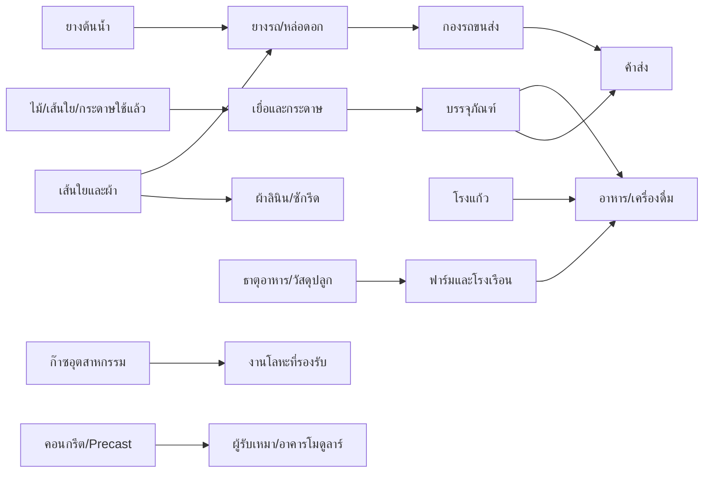

# ข้อเสนอให้ Gemini: ธุรกิจต้นน้ำเพิ่มเติม 7 สาย พร้อมวัตถุดิบและซัพพลายเชน

> ข้อเสนอประกอบแพตช์เพิ่มประเภทธุรกิจ · 11 พฤศจิกายน 2026
>
> ยังไม่ได้พัฒนาในเกม ไม่ใช่ข้อกำหนดว่าต้องทำครบทั้งหมด Gemini มีอิสระเลือก ปรับ รวม ตัด และสร้างทางเลือกที่ดีกว่าได้ โดยรักษากฎเหล็กและตรวจซอร์สจริงก่อนเพิ่ม ID

> **คำสั่งผู้ใช้เพิ่มเติม:** การเรียกธุรกิจในบทนี้ว่า “ต้นน้ำ” ไม่ได้ทำให้ผลผลิตทุกชนิดเป็นทรัพยากรธรรมชาติเริ่มต้น ให้ใช้กฎต้นน้ำใน [AGENTS.md](../../AGENTS.md) และสถานะ implementation ใน [project status](../../project_status_and_ai_onboarding.md) เหนือการจัด Tier หรือสูตรตัวอย่างที่ขัดกัน

## 1. เหตุผลและฐานเดิม

บท 19–21 เสนอธุรกิจขนส่ง ซอฟต์แวร์ และบริการอีก 10 แบบ เอกสารนี้เพิ่ม **ผู้ผลิตต้นน้ำ/กลางน้ำที่ขายให้ธุรกิจเหล่านั้น** เพื่อไม่ให้การเพิ่มประเภทธุรกิจจบที่ปุ่มซื้ออาคารกับรายได้รายวัน

ซอร์สที่ตรวจมี `natural_latex`, `silica_bauxite_ore`, `timber_bamboo_log`, `raw_cane`, `polymer_resin`, `metal_sheet`, `pack_carton`, `glass_bottle` รวมถึงสินทรัพย์และห่วงโซ่บางส่วนอยู่แล้ว เช่น `forestry_pulp_mill` และ `chain_forestry_pulp_packaging` ดังนั้นรายการต่อไปนี้เป็น **การขยายเป็นธุรกิจที่ดำเนินการได้จริง** ไม่อ้างว่าวัสดุหรือแนวคิดต้นน้ำทุกอย่างเป็นของใหม่

ID ที่ไม่ระบุว่า “มีแล้ว” เป็นข้อเสนอ ต้องทำ material/asset/skill registry audit ก่อนพัฒนา หากชื่อคล้ายกันให้เทียบหน่วย คุณภาพ และหน้าที่ก่อนรวม ห้ามเปลี่ยนความหมาย key เดิมเงียบ ๆ

## 2. ผู้ผลิตและกระจายก๊าซอุตสาหกรรม

**สินค้า/ลูกค้า:** ไนโตรเจนเกรดอุตสาหกรรมให้โรงอาหาร/บรรจุภัณฑ์ที่รองรับ ออกซิเจนและอาร์กอนให้โรงงานโลหะตามกระบวนการที่กำหนด ไม่อ้างเป็นก๊าซการแพทย์หรือใช้กับอาหารได้ทุกเกรด

**ต้องมี:** อาคารผลิต/บรรจุ พื้นที่เก็บตามความเข้ากันได้ เครื่องแยกอากาศหรือซื้อก๊าซ bulk มาบรรจุ เครื่องอัด ทีมเดินระบบ QC และคนขนส่งที่ผ่านคุณสมบัติ

| ทรัพยากรเสนอ | ชนิด/แหล่งที่มา | การใช้หรือผลผลิต |
| :--- | :--- | :--- |
| `ambient_air_nm3` | intake ที่วัดปริมาณ/คุณภาพ | วัตถุดิบเข้า ไม่ใช่สต็อกซื้อฟรีที่ขายได้ทันที |
| `industrial_gas_bulk_nm3` | ซื้อจากผู้ผลิตภายนอก แยกชนิดก๊าซ | ทางเริ่มแบบสถานีบรรจุ |
| `nitrogen_nm3`, `oxygen_nm3`, `argon_nm3` | ผลผลิตแยกเกรด/ชนิด | ขายตามปริมาตรมาตรฐานและคุณภาพ |
| `gas_cylinder_asset`, `valve_kit` | ถังใช้ซ้ำ/อะไหล่ | เช่าหรือฝากถัง เปลี่ยนอะไหล่เมื่อซ่อมจริง |
| `compressor_kwh`, `cooling_water_m3` | utility | ต้นทุนการแยก อัด และรักษาสภาพ |

**ซัพพลายเชน:** ผู้ผลิตก๊าซ bulk/air intake → แยกหรือรับซื้อ → ตรวจองค์ประกอบ → อัด/บรรจุ → เก็บแยกชนิด → จัดเที่ยวขนส่ง → ลูกค้าใช้ → รับถังคืน/ตรวจสภาพ

**กลไกใหม่:** หน่วยปริมาตรมาตรฐาน ความบริสุทธิ์ lot ถังเปล่า/เต็ม owner และวันตรวจถัง รถกับพื้นที่เก็บต้องรองรับชนิดสินค้า ถังใช้แล้วไม่ได้หายไปพร้อมก๊าซ

**ผลลัพธ์/รายได้:** ค่าก๊าซ ค่าขนส่ง และค่าเช่าถังตามสัญญาที่แยกกัน ลูกค้าได้ก๊าซพร้อมใช้จริง มีถังหมุนเวียนและต้นทุน utility ต่อเนื่อง

**เริ่มเล็ก/ขยาย:** ซื้อ bulk มาบรรจุหนึ่งชนิด → กองถังและลูกค้าประจำ → ลงทุนผลิตเองเมื่อ demand คุ้ม ห้ามเปิดโรงแยกใหญ่โดยไม่มีตลาด

**สิ่งต้องระวัง:** เปรียบเทียบปริมาตรก๊าซบนฐานเดียวกัน ไม่บวกก๊าซคนละชนิดเป็นสต็อกเดียว กำหนดสมดุลมวลสาร/การสูญเสียให้สอดคล้อง ไม่ได้ผลิตอาร์กอนปริมาณมากเกินองค์ประกอบอากาศโดยไร้เหตุผล

## 3. โรงงานยางรถและศูนย์หล่อดอกยาง

**สินค้า/ลูกค้า:** ยางรถบรรทุกใหม่ งานหล่อดอกที่โครงยางผ่านตรวจ และผลิตภัณฑ์ยางอุตสาหกรรมให้กองรถ/โรงงาน ไม่เรียกยางใช้แล้วทุกเส้นว่าเหมาะหล่อดอก

**ต้องมี:** พื้นที่รับโครงยาง เครื่องผสม/ขึ้นรูป/อบตามแบบจำลอง เครื่องตรวจ ช่าง QC และฝ่ายขาย อาจเริ่มเป็นศูนย์หล่อดอกโดยซื้อ compound สำเร็จรูปก่อน

| ทรัพยากรเสนอ | แหล่งต้นน้ำ | ปลายทาง |
| :--- | :--- | :--- |
| `natural_latex` (มีแล้ว) → `dry_rubber_kg` | ผู้ขายยาง/สินทรัพย์สวนยาง | วัตถุดิบยางแห้งที่ระบุเกรด |
| `synthetic_rubber_kg`, `carbon_black_kg` | ผู้ผลิตปิโตรเคมีภายนอก | compound ตามสูตรจำลองที่มีเวอร์ชัน |
| `steel_cord_kg`, `tire_fabric_m2` | ผู้ผลิตลวดเหล็ก/สิ่งทอ | โครงเสริมแรง ไม่ใช้ขดลวดทองแดงแทน |
| `tire_casing_used`, `tread_strip_kg` | กองรถ/ผู้ผลิตยาง | งานหล่อดอกเฉพาะโครงที่ผ่าน |
| `truck_tire`, `rubber_scrap_kg` | ผลผลิต/ของเสีย | เชื่อมรายการยางในบท 19 ไม่ตั้งยางรถซ้ำหลาย key |

**ซัพพลายเชน:** น้ำยาง → แปรเป็นยางแห้งหรือซื้อ compound → เตรียมโครง/ส่วนประกอบ → ขึ้นรูป/อบ → ตรวจรับ → ขาย/ติดตั้ง → ใช้งานเสื่อม → ตรวจโครงยางสำหรับหล่อดอกหรือส่งรีไซเคิล

**กลไกใหม่:** compatibility รุ่นรถ น้ำหนักบรรทุก ยางแต่ละเส้นกับรอบอายุโครง งานถอด/ติดตั้ง และการรับประกัน การหล่อดอกไม่คืนอายุโครงเป็นศูนย์

**ผลลัพธ์:** ยางที่ตรวจผ่าน รายได้สินค้า/งานบริการ ระยะอายุและความเสี่ยงกองรถเปลี่ยนตามคุณภาพจริง ของเสียไปธุรกิจรีไซเคิลโดยไม่เสกวัตถุดิบกลับครบทุกครั้ง

**เริ่มเล็ก/ขยาย:** หล่อดอก → สัญญาดูแลยางกองรถ → ผลิตยางใหม่เฉพาะขนาด → หลายกลุ่มอุตสาหกรรม ตัวเลขสมรรถนะต้องทดลองและใช้ข้อกำหนดความปลอดภัยเป็น hard constraint

## 4. โรงเยื่อ กระดาษอุตสาหกรรม และบรรจุภัณฑ์

**จุดต่อยอด:** เกมมีป่า/เยื่อและกล่องแล้ว แต่ยังควรแยกโรงเยื่อ โรงกระดาษ และโรงแปลงกระดาษเป็นบทบาทธุรกิจที่วัด input/output ได้ ระวังสูตรเดิมที่รวมชนิดวัสดุกว้าง ไม่อ้างว่าตรงอุตสาหกรรมจริงทั้งหมด

**สินค้า/ลูกค้า:** กระดาษม้วนให้ผู้ผลิตกล่อง กระดาษขึ้นรูป/ถาดเยื่อให้โรงอาหารและขนส่ง แผ่นลูกฟูกให้โรงแพ็กเกจจิ้งในบท 12

**ต้องมี:** ลานไม้/เศษกระดาษ เครื่องเตรียมเยื่อ เครื่องขึ้นแผ่น/อบ คลังแห้ง ระบบน้ำ/บำบัด คนควบคุมเครื่องและ QC ความชื้น/ความแข็งแรง

**ทรัพยากร:** ใช้ `timber_bamboo_log`/`raw_cane` เดิมเฉพาะเมื่อทำ mapping ส่วนที่ใช้ได้ชัดเจน เพิ่ม `bagasse_fiber_kg`, `recovered_paper_kg`, `pulp_dry_kg`, `paper_roll_kg`, `corrugated_sheet_m2`, `paper_sludge_kg`, น้ำและพลังงาน สารช่วยกระบวนการเป็น input ซื้อภายนอกที่กำหนดเกรด ไม่ให้ `natural_latex` กลายเป็นเยื่อไม้โดยอัตโนมัติเพราะชื่อเดิมรวม “เส้นใย”

**ซัพพลายเชน:** ป่า/โรงอ้อย/กระดาษใช้แล้ว → เตรียม/คัดเส้นใย → เยื่อ → ขึ้นแผ่น/อบ → ม้วน → แปลงเป็นแผ่นหรือกล่อง `pack_carton` เดิม → ลูกค้าอาหาร/ค้าส่ง/ขนส่ง

**กลไกใหม่:** moisture และน้ำหนักแห้ง ความหนา/เกรดอาหาร ความแข็งแรง และ lot; สินค้ากระดาษเปียกเสียหายได้ น้ำ/กากต้องไปบำบัดหรือกำจัด

**ผลลัพธ์:** เยื่อ/กระดาษ/กล่องที่ขาย B2B ได้ มีคอขวดเครื่องอบและ stock ที่ใช้จริง การลดต้นทุนกล่องต้องมาจากต้นทุนผลิต ไม่ใช่โบนัสลดทั้งบริษัทลอย ๆ

**เริ่มเล็ก/ขยาย:** ซื้อกระดาษม้วนมาแปลง → ผลิตกระดาษจากเยื่อซื้อ → โรงเยื่อครบวงจร ไม่บังคับเริ่มทุกขั้น การรับซื้อกระดาษรีไซเคิลต้องควบคุมสิ่งปนเปื้อนและเกรด

## 5. โรงแก้วบรรจุภัณฑ์และหมุนเวียนขวด

**สินค้า/ลูกค้า:** ขวดแก้ว กระปุก และงานล้าง/ตรวจขวดใช้ซ้ำ ให้เครื่องดื่ม อาหาร และเครื่องสำอางตามเกรดที่รับรอง

**ต้องมี:** เตา เครื่องขึ้นรูป/อบคลายเค้น แม่พิมพ์ QC พื้นที่เก็บแตกหัก และพลังงานต่อเนื่อง ทางเริ่มเล็กคือซื้อขวดเปล่ามาตรวจ/ตกแต่งหรือบริการขวดหมุนเวียน

**ทรัพยากร:** `glass_bottle` มีแล้วให้ใช้หรือกำหนด revision แทนสร้างขวดซ้ำ เสนอ `glass_sand_kg`, `soda_ash_kg`, `limestone_kg`, `clean_cullet_kg`, `glass_mold_asset`, `bottle_cap`, `bottle_wash_detergent` กับ utility ของเตา `silica_bauxite_ore` เดิมเป็นแร่รวม ต้องมีงานคัด/ทำเกรดก่อนใช้แทนทรายแก้ว ห้ามใส่เข้าได้ทันทีทุก lot

**ซัพพลายเชน:** เหมือง/ผู้ค้าวัตถุดิบ + เศษแก้วสะอาด → ตรวจ/จัด batch → หลอม → ขึ้นรูป → อบคลายเค้น → ตรวจรอยร้าว/ขนาด → บรรจุขาย → รับขวดคืนตามระบบมัดจำ → ล้างใช้ซ้ำหรือบดกลับเป็น cullet

**กลไกใหม่:** แม่พิมพ์แต่ละขนาด การเปลี่ยนรุ่นเตา/ไลน์ คอขวด/ฝาปิดที่เข้ากัน และเส้นทางขวดใช้ซ้ำแยกจากเส้นทางเศษแก้วหลอมใหม่

**ผลลัพธ์:** บรรจุภัณฑ์ที่ส่งโรงเครื่องดื่มได้จริง เศษแก้วที่มีที่มา เงินมัดจำขวดที่ต้องคืน และความเสียหายขนส่ง ขวดหลอมแล้วไม่สามารถคืนมัดจำของขวดเดิมซ้ำได้

**เริ่มเล็ก/ขยาย:** ขวดหมุนเวียน/ตกแต่ง → ผลิตขวดมาตรฐาน → ขวดสั่งแม่พิมพ์เฉพาะ ใช้สัดส่วนผสมเชิงเกมที่ตรวจมวล/พลังงาน ไม่อ้างเป็นสูตรเตาโรงงานจริง

## 6. สิ่งทอต้นน้ำ: ปั่นด้าย ทอผ้า และฟินิชชิง

**สินค้า/ลูกค้า:** เส้นด้าย ผ้าสำหรับชุดพนักงาน ผ้าโรงแรม และผ้าเสริมแรงให้ผู้ผลิตยาง ต่อยอดร้านสกรีน/ชุดผ้าเดิมด้วยการเพิ่มต้นน้ำ

**ต้องมี:** เครื่องปั่น/ทอ สถานีตกแต่งผ้า คลังแห้ง ทีมเครื่องจักร QC และระบบบำบัดเมื่อทำงานเปียก ไม่บังคับรวมการย้อมทุกโรงงาน

**ทรัพยากร:** `cotton_fiber_kg`, `polyester_staple_kg`, `yarn_kg`, `woven_fabric_m2`, `textile_dye_kg`, `finishing_agent_kg`, น้ำ/ไฟ และ `fabric_offcut_kg` เป็นข้อเสนอใหม่; ถ้าจะเชื่อม `polymer_resin` เดิมกับเส้นใยต้องมี supplier/กระบวนการแปรรูปที่เหมาะ ไม่แปลงเม็ดพลาสติกเป็นผ้าทันที

**ซัพพลายเชน:** เกษตร/ผู้ผลิตเส้นใย → ปั่นด้าย → ทอ/ถัก → ย้อม/ตกแต่งเมื่อจำเป็น → ตรวจสี/ความแข็งแรง/การหด → ขายผ้า → ชุดพนักงาน/ผ้าลินิน/สิ่งทออุตสาหกรรม

**กลไกใหม่:** ความกว้างผ้ากับน้ำหนักต่อพื้นที่ การแปลงกก.เป็นตร.ม.ด้วย spec แต่ละชนิด สีต่าง lot อาจต่าง และงานเปลี่ยนสีมีเวลา/น้ำล้าง

**ผลลัพธ์:** เส้นด้าย/ผ้าเป็นสินค้ากลาง ขายให้หลายธุรกิจได้ และมีเศษที่นำไปรีไซเคิลได้เฉพาะประเภทที่รองรับ ผ้าเสริมแรงยางไม่เท่ากับผ้าเช็ดตัวเพียงเพราะเป็น textile เหมือนกัน

**เริ่มเล็ก/ขยาย:** ซื้อด้ายมาทอ → ตกแต่ง/ย้อม → ปั่นด้าย → เส้นใยเทคนิค ต้องทดลองขายก่อนเพิ่ม capacity ทุกขั้น

## 7. คอนกรีตผสมเสร็จและชิ้นส่วนก่อสร้างสำเร็จรูป

**สินค้า/ลูกค้า:** คอนกรีตตามเกรด พื้น/แผ่น/ชิ้นส่วน precast ให้ผู้รับเหมาและผู้สร้างอาคารโมดูลาร์ในบท 11 ไม่สร้างระบบก่อสร้างใหม่ซ้ำทั้งชุด

**ต้องมี:** ลานวัสดุ โรงผสม ไซโล เครื่องชั่ง รถผสมหรือผู้รับขนเฉพาะ แม่พิมพ์/ลานบ่มสำหรับ precast คนควบคุมเครื่อง QC และสัญญากำหนดเวลาส่ง

**ทรัพยากร:** `cement_binder_kg`, `aggregate_kg`, `construction_sand_kg`, `process_water_liter`, `admixture_kg`, `rebar_kg`, `precast_mold_asset` เสนอใหม่ โดยเริ่มซื้อซีเมนต์จากซัพพลายเออร์ ไม่ต้องสร้างเตาปูนในแพตช์เดียว เหล็กเส้นไม่ใช้ `metal_sheet` แทนโดยไม่มีกระบวนการ

**ซัพพลายเชน:** ผู้ผลิตซีเมนต์/เหมืองหิน/เหล็ก → รับ/ชั่ง → ออก batch ตาม spec → ผสม → ส่งให้ทันช่วงใช้งาน หรือเทแม่พิมพ์ → บ่ม/ตรวจ → ส่งชิ้นส่วนที่ผ่านให้ลูกค้า

**กลไกใหม่:** วัตถุที่มีหน้าต่างเวลาใช้งาน สภาพอากาศ/เวลาบ่ม รถต้องรองรับปริมาตรและกำหนดส่ง การทดสอบ batch มีตัวอย่างใช้สิ้นเปลือง

**ผลลัพธ์:** ปริมาตรคอนกรีตหรือชิ้นส่วนที่รับมอบได้จริง รายได้/ลูกหนี้ และของเสียหากส่งช้า ห้ามแปลงของที่แข็งตัวแล้วกลับเป็นซีเมนต์ใหม่ครบปริมาณ

**เริ่มเล็ก/ขยาย:** precast ขนาดเล็กจากซีเมนต์ซื้อ → โรงผสมพร้อมรถ → ชิ้นส่วนเฉพาะโครงการ สัญญาต้องระบุว่า QC ก่อนส่งหรือการรับมอบใดปล่อยบิลได้

## 8. ผสมธาตุอาหารพืชและวัสดุปลูกตามสเปก

**สินค้า/ลูกค้า:** ปุ๋ยผสมเชิงเกม วัสดุปลูก และสารละลายธาตุอาหารที่มี QC ให้ฟาร์ม/โรงเรือนในบท 11 เป็นธุรกิจผลิต input เกษตร ไม่ใช่การขยายฟาร์มอย่างเดียว

**ต้องมี:** พื้นที่เก็บแยกประเภท เครื่องชั่ง/ผสม/แพ็ก แล็บ QC ผู้ควบคุมและคลังที่เหมาะกับวัสดุ เริ่มจากสารอาหารที่ซื้อสำเร็จ ไม่จำลองโรงสังเคราะห์เคมีอันตราย

**ทรัพยากร:** `nitrogen_nutrient_kg`, `phosphate_nutrient_kg`, `potassium_nutrient_kg`, `micronutrient_mix_kg`, `cocopeat_kg`, `compost_mature_kg`, `fertilizer_bag`; เป็นเกรดวัตถุดิบที่ซื้อมาจาก supplier ที่ตรวจแล้ว แยกน้ำหนักสินค้าออกจากปริมาณธาตุอาหารออกฤทธิ์

**ซัพพลายเชน:** ผู้ผลิตธาตุอาหาร/ผู้ทำปุ๋ยหมัก/สวนมะพร้าว → รับและตรวจ → เลือกสูตรตามความต้องการพืช/คำสั่งซื้อ → ผสมตาม recipe ที่อนุมัติในเกม → ตรวจความสม่ำเสมอ → แพ็ก/ติด lot → ส่งฟาร์ม → ประเมินผลจากการใช้จริง

**กลไกใหม่:** nutrient profile, ความเข้ากันได้ของวัตถุดิบ อายุเก็บ ความชื้น และอัตราใช้ที่มีเพดาน ผลผลิตฟาร์มขึ้นกับหลายปัจจัย ไม่ได้เพิ่มไม่จำกัดจากการใส่ปุ๋ยซ้ำ

**ผลลัพธ์:** ถุง/ล็อตพร้อมขาย สูตรที่มีเวอร์ชัน ประวัติ QC และการเพิ่มความพร้อมธาตุอาหารในฟาร์มเมื่อใช้จริง ไม่สร้างโบนัสเก็บเกี่ยวตั้งแต่ซื้อโรงงานปุ๋ย

**เริ่มเล็ก/ขยาย:** วัสดุปลูก → ผสม/แพ็กปุ๋ยจากวัตถุดิบซื้อ → สูตรเฉพาะลูกค้าประจำ ผลการใช้ต่ำอาจมาจากน้ำ/สภาพแวดล้อม ต้องแยกเหตุผลจากคุณภาพปุ๋ย

## 9. กฎซัพพลายเชนที่ต้องออกแบบให้ครบ

1. ทุก material ใหม่ต้องมีชื่อไทย ประเภท/หน่วย สเปก แหล่งซื้อ lead time ราคาเสนอ เงื่อนไขขั้นต่ำ และทางใช้/ขายจริงอย่างน้อยหนึ่งเส้น ไม่ทิ้งเป็นรายการที่ไม่มีใครต้องการ
2. ทุก recipe มี input/output เวลาคน/เครื่อง utility, yield, QC, ของเสีย และความจุที่สอดคล้องกัน ตัวเลขเป็นการจำลอง ไม่อ้างเป็นคู่มือผลิตในโลกจริง
3. เลือกหน่วยฐานให้ชัด: กก., ลิตร, Nm³, ชิ้น, ตร.ม., kWh ใช้ปริมาณแบบ fixed-point หรือ rationals เมื่อเหมาะ ตรวจการปัดเศษและ residual ไม่ให้วนแปรรูปแล้วเพิ่มทรัพยากร
4. วัสดุ T0 ต้องมีที่มา เช่น ซื้อ เก็บเกี่ยว หรือรับจากสิ่งแวดล้อมที่วัดและมีข้อจำกัด ไม่เสกจากสูตรว่าง การได้วัตถุดิบจาก asset ต้องมีค่าใช้จ่าย/กำลังผลิตตามเหตุผลของเกม
5. ต้องมีทาง make-or-buy: ธุรกิจปลายทางเปิดได้โดยซื้อ input ไม่ต้องสร้างครบทุกโรงต้นน้ำ และต้องมี fallback supplier ที่สมเหตุสมผลเพื่อป้องกัน dependency deadlock
6. QC ไม่ผ่านไป rework ลดเกรด หรือทิ้งตามกระบวนการจริง ไม่หายจาก audit หรือกลายเป็นของดีฟรี ของเสียที่ขายได้ยังต้องมีผู้ซื้อและค่าขน/แปรรูป
7. แยกคืนเงินมัดจำถัง/ขวดจากรายได้ แยก asset ใช้ซ้ำจาก consumable และแยกยอดขายภายในกลุ่มออกจากรายได้รวมภายนอก
8. เพิ่ม buyers/suppliers/routes เฉพาะที่จำเป็น กำหนดเครดิต กำลังซื้อ และ lead time โดยไม่ให้ NPC นอกบริษัทมีเงินหรือสินค้าไม่จำกัดเพื่อพยุงตลาดตลอดไป

## 10. แผนภาพเครือข่ายที่เสนอ

ลูกศรแสดงความสัมพันธ์ทางธุรกิจ ไม่ใช่ dependency ที่ต้องมีครบก่อนเริ่มเล่น ให้มีการซื้อภายนอกและเริ่มขอบเขตเล็กเสมอ

## 11. สิ่งที่ฝากให้ Gemini ตัดสินใจเอง

เลือกธุรกิจที่เสริมวงจรแพตช์หลักได้จริง เช่น ขนส่งเชื่อมยาง/หล่อดอก และแอปเชื่อมการจัดรถ ไม่ต้องเพิ่มทุกสายพร้อมกัน หากความคุ้มค่า การเข้าถึงอาคาร สูตร หรือหน่วยของข้อมูลเดิมยังไม่ดีพอ ให้ออกแบบใหม่เฉพาะส่วนที่เกี่ยวข้อง พร้อมเหตุผลและผลทดสอบ โดยไม่แก้ core หรือเปลี่ยนพฤติกรรมฐานอย่างเงียบ ๆ

ระบุในรายงานปลายแพตช์ว่า **ทำแล้ว / ออกแบบไว้ / เลื่อนไว้** แยกกัน และต้องมีอย่างน้อยหนึ่งวงจรที่ตรวจ end-to-end สำหรับธุรกิจใหม่แต่ละประเภทที่ประกาศว่าใช้งานได้จริง

[สารบัญไอเดีย](README.md) · [ขนส่ง](19_ธุรกิจขนส่งด้วยกองรถ_ทรัพยากร_ขั้นตอน_และผลลัพธ์.md) · [ซอฟต์แวร์/แอป](20_ธุรกิจซอฟต์แวร์และแอป_ทรัพยากร_ขั้นตอน_และผลลัพธ์.md) · [บริการอีก 10 แบบ](21_โมเดลธุรกิจบริการใหม่_10_ประเภท_ทรัพยากร_ขั้นตอน_และผลลัพธ์.md)
