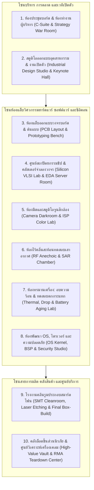

# Spin-off System & Gameplay Specification: ผังแคมปัส ชีวิต NPC ห้องแล็บวิศวกรรม หน้าจอ UI และโครงสร้างโค้ดฉบับพร้อมสร้างจริง

- **ใช้คู่กับ:** [`SPINOFF_MASTER_DESIGN_AND_CODEX_BLUEPRINT.md`](SPINOFF_MASTER_DESIGN_AND_CODEX_BLUEPRINT.md)
- **วัตถุประสงค์ของเอกสารนี้:** ทำให้ไอเดียเกม Spin-off **"เป็นรูปเป็นร่าง (Concrete & Executable)"** ครบทุกมิติ ตั้งแต่ภาพบนหน้าจอที่ผู้เล่นเห็น, ผังอาคารและห้องแล็บที่ NPC เดินทำงานจริง, อาชีพและความคิดของพนักงาน, ระบบงานเปิดตัว/ข่าวหลุด/นักรีวิว ไปจนถึงโครงสร้างไฟล์โค้ดสำหรับให้ Codex และทีม AI ลงมือสร้างได้ทันที

---

## สารบัญ
1. [ภาพรวมรูปแบบการเล่นและผังแคมปัส 10 โซน (Spatial Campus & Specialized Labs)](#1-ภาพรวมรูปแบบการเล่นและผังแคมปัส-10-โซน)
2. [ชีวิตคนหลังจอ: 14 สายอาชีพเฉพาะทางและดราม่าในที่ทำงาน (NPC Roles & Living Drama)](#2-ชีวิตคนหลังจอ-14-สายอาชีพเฉพาะทางและดราม่าในที่ทำงาน)
3. [วงจรชีวิตของโทรศัพท์ 1 รุ่น: ตั้งแต่กระดานไวท์บอร์ด ถึงมือลูกค้าและดราม่าโซเชียล](#3-วงจรชีวิตของโทรศัพท์-1-รุ่น-ตั้งแต่กระดานไวท์บอร์ด-ถึงมือลูกค้าและดราม่าโซเชียล)
4. [การออกแบบหน้าจอ UI ทั้ง 6 หน้าต่างหลักของเกม Spin-off (Observer UI Wireframes)](#4-การออกแบบหน้าจอ-ui-ทั้ง-6-หน้าต่างหลักของเกม-spin-off)
5. [โครงสร้างไฟล์โปรเจกต์และการนำเอนจินเดิมมาต่อยอด (Codebase Architecture & Reuse Map)](#5-โครงสร้างไฟล์โปรเจกต์และการนำเอนจินเดิมมาต่อยอด)
6. [แผนการสร้างทีละเฟสจนจบเกม (Phased Vertical-Slice Implementation Plan)](#6-แผนการสร้างทีละเฟสจนจบเกม)

---

## 1. ภาพรวมรูปแบบการเล่นและผังแคมปัส 10 โซน (Spatial Campus & Specialized Labs)

ในเกม Spin-off นี้ ผู้เล่นจะได้เฝ้าดู **แคมปัสของบริษัทสมาร์ตโฟนและเทคโนโลยี** ที่ค่อยๆ ขยายตัวจาก **"ตึกแถวห้องเดียวที่รับเครื่องจีนมาติดสติ๊กเกอร์ขาย"** จนกลายเป็น **"อาณาจักรเทคโนโลยีระดับโลกที่มีตึกวิจัยชิป โรงงานคลีนรูม และฮอลล์จัดงานเปิดตัวของตัวเอง"**

NPC ทุกคนไม่ได้ยืนเฉยๆ แต่จะเดินไปทำงานตามสถานีและห้องแล็บจริงทั้ง **10 โซนหลัก** ดังนี้:



### รายละเอียดการทำงานจริงของ NPC ในแต่ละโซน

| โซน / ห้องปฏิบัติการ | อุปกรณ์/เครื่องจักรในห้อง | สิ่งที่ NPC เดินเข้าไปทำจริง | ถ้าขาดห้องนี้ หรือเครื่องเสีย/ไฟดับ จะเกิดอะไรขึ้น? |
|---|---|---|---|
| **1. ห้องประชุมบอร์ด (`Strategy War Room`)** | กระดานวิเคราะห์ตลาด, จอแสดงงบการเงินและโควตาซัพพลายเชน | CEO, CFO, CTO, VP Marketing เดินมาประชุมตัดสินใจเปิดรุ่นใหม่, ถกเถียงเรื่อง **Make-or-Buy ชิป**, และอนุมัติดีลผูกขาดชิ้นส่วน | บริษัทตัดสินใจปรับแผนล่าช้าเมื่อคู่แข่งออกรุ่นใหม่ตัดหน้า |
| **2. สตูดิโอดีไซน์ & ฮอลล์เปิดตัว (`ID Studio & Keynote Hall`)** | เครื่องกัดต้นแบบ CNC, เครื่องพิมพ์ 3D, เวทีซ้อมพรีเซนต์ | ดีไซเนอร์ขึ้นรูปทรงตัวเครื่อง เลือกวัสดุ (ไทเทเนียม/อะลูมิเนียม/เซรามิก/พลาสติก); ก่อนวันเปิดตัว CEO จะเดินมาซ้อมพูด Keynote บนเวที! | ตัวเครื่องหนาหนักไม่สมดุล; งานเปิดตัวติดขัดหรือพรีเซนต์ไม่น่าประทับใจ |
| **3. แล็บบอร์ดและต้นแบบ (`PCB & Dev-Board Lab`)** | กล้องจุลทรรศน์บัดกรี, ออสซิลโลสโคป, แท่นวางบอร์ดเปลือย (`Breadboard`) | วิศวกรฮาร์ดแวร์นำชิปตัวอย่าง (`Engineering Sample - ES`) มาวางบนบอร์ดเปลือย วัดไฟเลี้ยงและตรวจว่าบูตติดหรือไม่ (ด่าน `EVT`) | ไม่สามารถสร้างเครื่องต้นแบบจากชิปรุ่นใหม่ได้ |
| **4. ศูนย์ออกแบบชิป & ห้องเซิร์ฟเวอร์ (`Silicon VLSI & EDA Cluster`)** | เวิร์กสเตชันออกแบบชิป, ตู้เซิร์ฟเวอร์รันจำลองวงจร RTL / FPGA Emulation | สถาปนิกชิปเขียนโค้ด RTL, วางผังทรานซิสเตอร์, และสั่งรันจำลองการทำงานของชิปข้ามคืนก่อนส่ง `Tape-out` | **ถ้าแอร์ห้องเซิร์ฟเวอร์เสียหรือไฟตก:** การจำลองวงจรค้าง หลุดบั๊กซิลิคอนไปสู่โรงหล่อจนต้องเสียเงินทำ `Respin`! |
| **5. ห้องมืดทดสอบกล้อง (`Camera Darkroom & ISP Lab`)** | แผงชาร์ตสีมาตรฐาน 24 ช่อง, หุ่นจำลองถ่ายภาพบุคคลในแสงเทียน/ย้อนแสง | วิศวกรภาพถ่ายและนักวิทยาศาสตร์สี (`Color Scientist`) เดินมาถ่ายภาพทดสอบนับพันใบเพื่อจูนอัลกอริทึม HDR, Night Mode และสีผิวมนุษย์ | แม้จะซื้อเซนเซอร์กล้อง 200MP ราคาแพงมาใส่ แต่ภาพที่ถ่ายจริงจะสีเพี้ยน มืด หรือชัตเตอร์แล็ก! |
| **6. ห้องไร้คลื่นสะท้อน (`RF Anechoic Chamber`)** | ห้องบุโฟมดูดซับคลื่นแม่เหล็กไฟฟ้ารอบทิศทาง, แขนกลหมุนวัดสัญญาณ 3 มิติ | วิศวกร RF นำเครื่องต้นแบบที่ใส่ตัวถังโลหะมาวัดการกั้นคลื่นสัญญาณ (`Antenna Attenuation`) และค่าการแผ่รังสี (`SAR`) | เครื่องไม่ผ่านมาตรฐาน กสทช./FCC หรือเกิดดราม่า **"จับเครื่องท่านี้แล้วสัญญาณดับ (#Antennagate)"**! |
| **7. ห้องทรมานเครื่อง (`Thermal & Reliability Lab`)** | ตู้อบความร้อนชื้น, เครื่องปล่อยมือถือตกพื้นหินอ่อน 1,000 ครั้ง, แท่นงอเครื่อง | วิศวกร QA นำเครื่องด่าน `DVT` มาวิ่งโหลดหนักในอุณหภูมิ $40^\circ\text{C}$ และทดสอบตกกระแทกเพื่อหาจุดเปราะบางของจอและบอร์ด | ความเสี่ยงเครื่องงอ/จอแตก/แบตเสื่อมพุ่งสูงโดยที่ผู้บริหารไม่รู้ตัวก่อนวางขาย |
| **8. สตูดิโอพัฒนาระบบ (`OS, BSP & Driver Studio`)** | โต๊ะโปรแกรมเมอร์พร้อมแผงมือถือเสียบสายเทสต์อัตโนมัติ (`Device Farm`) | วิศวกรเคอร์เนลและไดรเวอร์เขียนโค้ดเชื่อมชิปเข้ากับ OS, แก้บั๊กแอปเด้ง, และทำแพตช์อัปเดตระยะยาว (`OTA Updates`) | เครื่องกินแบตสแตนด์บายสูง, จอสัมผัสหน่วง, หรืออัปเดตข้ามเวอร์ชันแล้วเครื่องค้าง (`Bootloop`) |
| **9. โรงงานคลีนรูม (`Cleanroom SMT & Assembly`)** | เครื่องวางชิ้นส่วนความเร็วสูง (`Pick & Place`), เตาอบ Reflow, เครื่องยิงเลเซอร์ฝาหลัง | พนักงานฝ่ายผลิตสวมชุดคลีนรูมเดินคุมสายพาน ประกอบเครื่องล็อตขายจริง (`PVT` & `Mass Production`) | ถ้าไม่สร้างโรงงานเอง ต้องจ้างโรงงาน EMS ภายนอกทั้งหมด (เสียค่าจ้างต่อเครื่องและเสี่ยงภาพหลุด) |
| **10. คลังนิรภัย & ศูนย์ผ่าเครื่องเคลม (`Vault & RMA Lab`)** | ตู้ควบคุมความชื้นเก็บเวเฟอร์/ชิป, โต๊ะผ่าวิเคราะห์เครื่องเสียที่ลูกค้าส่งคืน | ช่างเทคนิคแกะเครื่องที่ลูกค้าส่งเคลมประกัน เพื่อหาต้นตอว่าเสียเพราะชิปร้อน ตะกั่วร่อน หรือแบตเตอรี่เสื่อม แล้วส่งรายงานกลับไปให้ห้องแล็บแก้ในรุ่นถัดไป! | บริษัทเสียเงินค่าเคลมประกันเรื้อรังโดยไม่รู้สาเหตุที่แท้จริง |

---

## 2. ชีวิตคนหลังจอ: 14 สายอาชีพเฉพาะทางและดราม่าในที่ทำงาน (NPC Roles & Living Drama)

เพื่อให้การเฝ้าดู NPC สนุกและอินเหมือนดูซีรีส์ Silicon Valley ผสม Halt and Catch Fire ระบบจะต่อยอดจาก `human-core.js` เดิม โดยกำหนด **14 บทบาทอาชีพเฉพาะทางของวงการสมาร์ตโฟน** ที่มีความต้องการ ความกดดัน และความขัดแย้งในตัวเอง:

### 2.1 ตารางบทบาทและความขัดแย้งตามธรรมชาติของ NPC

| ตำแหน่ง | วิชาและความถนัดหลักที่ใช้ | เป้าหมายส่วนตัวในงาน | มักจะทะเลาะหรือขัดแย้งกับใคร? |
|---|---|---|---|
| **1. `CEO (Chief Executive Officer)`** | วิสัยทัศน์, การตัดสินใจเชิงกลยุทธ์ | พาบริษัทครองส่วนแบ่งตลาด หรือสร้างผลิตภัณฑ์ระดับตำนาน | ขัดแย้งกับ CFO เมื่ออยากทุ่มเงินทำชิปเอง หรือขัดแย้งกับ CTO เมื่อสั่งเร่งวันเปิดตัว |
| **2. `CFO (Chief Financial Officer)`** | บัญชี, การบริหารความเสี่ยงและสภาพคล่อง | รักษาเงินสดสำรอง (`Runway`), คุมต้นทุน BOM, ป้องกันบริษัทเจ๊ง | คอยเบรกโปรเจกต์ชิปทำเองหรือวัสดุราคาแพงของ CTO และหัวหน้าดีไซน์ |
| **3. `Chief Silicon Architect (หัวหน้าสถาปนิกชิป)`** | `vlsi_design`, `computer_architecture`, `logic_computation` | ออกแบบชิป SoC ของบริษัทที่ชนะชิปตลาดทั้งความแรงและการประหยัดไฟ | เครียดจัดเมื่อโรงหล่อส่งเวเฟอร์มาแล้วยีลด์ต่ำ หรือเมื่อถูกบอร์ดตัดงบซื้อเครื่องมือ EDA |
| **4. `Lead Industrial Designer (หัวหน้าฝ่ายออกแบบตัวเครื่อง)`** | `industrial_design`, `spatial_3d`, สุนทรียศาสตร์ | ออกแบบมือถือที่บางเฉียบ สวยไร้รอยต่อ และใช้วัสดุพรีเมียม | **คู่กัดตลอดกาลของวิศวกรความร้อนและแบตเตอรี่!** (ดีไซน์อยากได้เครื่องบาง 6.5 มม. แต่วิศวกรบอกใส่แบตไม่พอและระบายความร้อนไม่ได้) |
| **5. `Thermal & Mechanical Lead (หัวหน้าวิศวกรความร้อนและโครงสร้าง)`** | `thermodynamics`, `materials_engineering` | คุมอุณหภูมิผิวเครื่องไม่ให้เกิน $43^\circ\text{C}$ และทำให้โครงเครื่องตกไม่หัก | ทะเลาะกับฝ่ายดีไซน์เรื่องพื้นที่วางท่อระบายความร้อน และทะเลาะกับทีมชิปที่ทำชิปกินไฟเกินสเปก |
| **6. `Camera & ISP Color Scientist (หัวหน้าทีมกล้องและวิทยาศาสตร์สี)`** | `optics`, `image_signal_processing`, `color_science` | ทำให้ภาพถ่ายจากมือถือของบริษัทติดอันดับ 1 ในการรีวิวระดับโลก | หงุดหงิดเมื่อฝ่ายจัดซื้อแอบลดเกรดชิ้นเลนส์เพื่อประหยัดงบเครื่องละ 40 บาท! |
| **7. `RF & Baseband Engineer (วิศวกรคลื่นวิทยุและเสาอากาศ)`** | `rf_engineering`, `telecom_protocols` | ทำให้มือถือจับสัญญาณได้แน่นทุกท่าจับ และผ่านใบรับรองค่ายมือถือ | ปวดหัวทุกครั้งที่ฝ่ายดีไซน์เปลี่ยนฝาหลังเป็นโลหะทึบโดยไม่เว้นร่องพลาสติกให้เสาอากาศ |
| **8. `OS Kernel & BSP Lead (หัวหน้าทีมเคอร์เนลและไดรเวอร์)`** | `os_kernel`, `embedded_firmware`, `systems_thinking` | รีดความลื่นไหลของระบบ, ลดการกินแรม และทำให้อัปเดตไม่มีบั๊ก | มักจะโวยวายเมื่อทีมการตลาดสั่งให้ยัดฟีเจอร์โฆษณาหรือแอปขยะ (`Bloatware`) เข้ามาในรอมจนเครื่องอืด! |
| **9. `Ecosystem & Developer Relations (ผู้ดูแลนักพัฒนาแอป)`** | การเจรจา, ซอฟต์แวร์ SDK | ดึงดูดให้นักพัฒนาภายนอกทำแอปและเกมที่รองรับชิป/OS ของบริษัท | ท้อแท้ถ้าฐานผู้ใช้ของบริษัทยังน้อยจนไปคุยกับค่ายเกมไหนก็ไม่มีใครยอมปรับแต่งเกมให้ |
| **10. `Supply Chain & Foundry Negotiator (นักเจรจาซัพพลายเชนและโรงหล่อ)`** | การเจรจาต่อรอง, การวิเคราะห์ตลาด | จองโควตาเวเฟอร์ หน้าจอ และหน่วยความจำในราคาที่ดีที่สุดและส่งตรงเวลา | รับศึกหนักเมื่อเกิดวิกฤตชิปขาดตลาดและต้องไปแย่งคิวโรงหล่อกับบริษัทยักษ์ใหญ่ |
| **11. `VP of Marketing & Keynote Director (หัวหน้าการตลาดและงานเปิดตัว)`** | จิตวิทยาผู้บริโภค, การสื่อสาร | สร้างกระแสไวรัล, จัดงาน Keynote ให้คนดูตื่นเต้น, ตั้งชื่อรุ่นและราคาขาย | ชอบโฆษณาสเปกเกินจริง (เช่น เคลมแบต 2 วัน) จนทีมวิศวกรและฝ่ายบริการลูกค้าต้องตามเช็ดล้างดราม่า |
| **12. `Channel & Carrier Sales Director (ผู้อำนวยการฝ่ายขายร้านค้าและค่ายมือถือ)`** | การขาย B2B, การบริหารสต็อกหน้าร้าน | ดันยอดสั่งซื้อเข้าร้าน (`Sell-in`) และทำดีลโปรพ่วงซิมกับค่ายมือถือ | เครียดเมื่อของเก่าค้างหน้าร้านแล้วตัวแทนจำหน่ายขู่จะเลิกสั่งรุ่นถัดไป |
| **13. `QA & Reliability Specialist (วิศวกรควบคุมคุณภาพและผ่าเครื่อง)`** | ความละเอียดรอบคอบ (`conscientiousness`), การตรวจสอบ | ค้นหาจุดตายของเครื่องก่อนวางขาย และวิเคราะห์เครื่องเคลม | ถ้าเจอบั๊กร้ายแรงก่อนวันเปิดตัว 7 วัน จะต้องกล้าเดินไปบอก CEO ให้เลื่อนวันขาย! |
| **14. `Cleanroom SMT Technician (ช่างเทคนิคสายพานประกอบ)`** | `smt_assembly`, `precision_craft` | เดินเครื่องวางชิ้นส่วนและประกอบตัวเครื่องให้ได้อัตราของดี (`Yield`) สูงสุด | เมื่อยล้าและทำของเสียพุ่งสูงหากถูกบังคับทำโอทีหนักช่วงเร่งผลิตก่อนวันวางจำหน่าย |

---

## 3. วงจรชีวิตของโทรศัพท์ 1 รุ่น: ตั้งแต่กระดานไวท์บอร์ด ถึงมือลูกค้าและดราม่าโซเชียล

เพื่อให้เห็นภาพว่าเกมเดินอย่างไรเมื่อปล่อยให้ NPC ทำงานเอง นี่คือ **7 ฉากต่อเนื่อง (7-Stage Product Lifecycle)** ของโทรศัพท์หนึ่งรุ่น:

1. **ฉากที่ 1: ห้องประชุมวางแผน (`Concept & The Silicon Crossroads`)**
   - บอร์ดบริหารดูยอดขายรุ่นเก่า ดูเงินสดในธนาคาร และดูแคตตาล็อกชิปของโลกภายนอกที่เพิ่งเปิดตัว
   - ถกเถียงและตัดสินใจว่าจะสร้างรุ่นอะไร (เช่น รุ่นประหยัดกู้วิกฤตเงินสด, รุ่นกลางเน้นกล้อง, หรือรุ่นเรือธงท้าชนเจ้าตลาด) พร้อมตัดสินใจว่าจะ **ซื้อชิปตลาด** หรือ **ใช้ชิปที่ห้องแล็บของตัวเองพัฒนา**
2. **ฉากที่ 2: การสร้างต้นแบบและการปะทะกันในห้องแล็บ (`EVT & Lab Clashes`)**
   - วิศวกรเอาบอร์ดมาประกอบเข้ากับจอและตัวถังที่ฝ่ายดีไซน์ออกแบบ
   - เกิดเหตุการณ์จริงในแล็บ เช่น *"ชิปรุ่นใหม่กินไฟพีค 6.5W เมื่อใส่ในตัวถังบาง 7.1 มม. ของฝ่ายดีไซน์ เครื่องร้อนแตะ 49°C ใน 4 นาที!"*
   - NPC ต้องประชุมย่อยเพื่อแก้ปัญหา: จะยอมเพิ่มความหนาเครื่องอีก 0.8 มม. เพื่อใส่แผ่นระบายความร้อน Vapor Chamber หรือจะสั่งลดความเร็วคล็อกของชิปลง 15%?
3. **ฉากที่ 3: การทดสอบความทนทาน การจูนกล้อง และการรั่วไหลของข่าว (`DVT, Tuning & Tech Leaks`)**
   - ทีมกล้องเข้าห้องมืดจูนสีภาพ; ทีม RF เข้าห้องไร้คลื่นสะท้อน; ทีม QA เอาเครื่องไปเทสต์ตกกระแทก
   - หากส่งไปเทสต์กับโรงงานภายนอก อาจมีข่าวหลุดไปขึ้นหน้าเว็บสื่อไอทีว่า *"หลุดภาพเรนเดอร์และผลทดสอบ Geekbench ของมือถือรุ่นใหม่!"* ซึ่งส่งผลต่อยอดขายรุ่นเก่าที่กำลังขายอยู่หน้าร้านทันที
4. **ฉากที่ 4: การเดินสายพานผลิตจริงและหุบเหวเงินสด (`PVT, Mass Production & Cash Crunch`)**
   - สั่งซื้อชิ้นส่วนล็อตใหญ่ (หักเงินสดจ่ายมัดจำ) และเริ่มเดินสายพานผลิตสะสมสต็อกสำหรับวันวางขาย (`Launch Inventory`)
   - ถ้าอัตราประกอบผ่าน (`Assembly Yield`) ต่ำเพราะใช้ตัวถังเซรามิกที่แตกง่าย จำนวนเครื่องในวันเปิดตัวจะมีไม่พอขาย (`Launch Shortage`)!
5. **ฉากที่ 5: วันถ่ายทอดสดงานเปิดตัว (`The Live Keynote Event`)**
   - ถึงวันเปิดตัว CEO เดินขึ้นเวทีประกาศสเปก จุดขาย และราคาของแต่ละความจุ (`128GB / 256GB / 512GB`)
   - ผู้ชมและสื่อไอทีประเมินความน่าตื่นเต้นเทียบกับคู่แข่งในตลาด saat นั้น เกิดเป็นยอดจองล่วงหน้า (`Pre-orders`) และใบสั่งซื้อจากร้านค้าปลีก
6. **ฉากที่ 6: วันแกะกล่องรีวิวและคลื่นความจริง (`Review Embargo Lift & Teardown Day`)**
   - นักรีวิวไอทีปล่อยผลทดสอบจริงเทียบกับคำโฆษณาบนเวที!
   - ถ้าเครื่องทำได้จริงตามที่คุยไว้ (แบตอึดจริง กล้องสวยจริง ชิปเย็นจริง) $\rightarrow$ ได้ป้าย **"Editor's Choice"** ยอดขายหน้าร้าน (`Sell-through`) พุ่งทะยาน
   - ถ้าโฆษณาเกินจริง หรือมีจุดบกพร่องที่หลุดรอดไป (เช่น เครื่องงอง่าย, จอเขียว, ร้อนจนถ่ายวิดีโอ 4K แล้วตัด) $\rightarrow$ เกิดดราม่าไวรัล ยอดขายชะงัก และหุ้น/ชื่อเสียงแบรนด์ร่วง
7. **ฉากที่ 7: ชีวิตหลังการขาย การอัปเดต OS และตลาดมือสอง (`Post-Launch, OTA Patches & Legacy`)**
   - เครื่องที่อยู่ในมือผู้ใช้จะสร้างรายได้เสริมจากบริการ/App Store (ถ้าใช้ OS ของตัวเอง) หรือสร้างภาระค่าซ่อมเคลมประกัน (ถ้าอัตราเสียสูง)
   - ทีมซอฟต์แวร์สามารถปล่อยอัปเดต (`OTA Firmware Update`) เพื่อแก้บั๊กความร้อนหรือเพิ่มความลื่นไหลหลังวางขายได้ ซึ่งช่วยกู้ชื่อเสียงแบรนด์กลับมาได้จริง!

---

## 4. การออกแบบหน้าจอ UI ทั้ง 6 หน้าต่างหลักของเกม Spin-off (Observer UI Wireframes)

เพื่อให้ผู้เล่นมองเห็นทุกความเชื่อมโยงได้ง่ายและสนุก เกม Spin-off จะมี **แผงควบคุมหลัก 6 หน้าต่าง** ที่เปิดดูได้ตลอดเวลาโดยไม่หยุดหรือรบกวนเวลาจำลอง:

| หน้าต่าง | หน้าที่หลัก | จุดเด่นที่ทำให้ผู้เล่นดูเพลิน |
|---|---|---|
| **1. `🏢 แคมปัส & ห้องแล็บมีชีวิต (Live Campus & Lab View)`** | มุมมองแผนที่แคมปัส 10 โซน เห็นพนักงานเดินถือบอร์ด เข้าห้องมืด เข้าห้องทดสอบคลื่น และนั่งประชุมกัน | คลิกที่หัว NPC คนไหนก็ได้เพื่อดูว่าเขากำลังแก้บั๊กอะไร เครียดแค่ไหน และคิดยังไงกับโปรเจกต์ปัจจุบัน |
| **2. `🛠️ ผ่าเครื่อง & ห้องวิศวกรรม (Teardown & Blueprint Studio)`** | แสดงภาพผ่าเครื่อง 3 ชั้น (ตัวถังภายนอก $\rightarrow$ แผงวงจรและชิป $\rightarrow$ ระบบระบายความร้อนและแบตเตอรี่) ของมือถือที่บริษัทกำลังทำหรือวางขายอยู่ | เปรียบเทียบ **"สเปกที่โฆษณา vs ผลวัดทางฟิสิกส์จริง"** พร้อมกราฟความร้อนและกราฟเฟรมเรตขณะวิ่งโหลดหนัก |
| **3. `🧠 ห้องประชุมบอร์ด & ทางแยกซิลิคอน (Boardroom & Make-or-Buy Hub)`** | แสดงตารางเปรียบเทียบ **Make vs Co-Develop vs Buy** ทั้ง 7 แกนเทคโนโลยี พร้อมบันทึกคำพูดถกเถียงของ CEO, CFO, CTO และจุดคุ้มทุน $Q_{\text{breakeven}}$ | เห็นชัดเจนว่าทำไมบอร์ดถึงตัดสินใจซื้อชิปตลาดในรุ่นนี้ หรือทำไมถึงกล้าอนุมัติงบพันล้านทำชิปเองในรุ่นหน้า! |
| **4. `🎤 เวทีเปิดตัว & กระแสโซเชียล (Keynote Stage, Leaks & Tech Media)`** | หน้าจอถ่ายทอดสดงานเปิดตัว, คะแนนรีวิวจากยูทูบเบอร์สายผ่าเครื่อง/สายทรมานเครื่อง, ข่าวหลุดจากโรงงาน และคอมเมนต์ชาวเน็ต | ดูดราม่าวงการไอทีแบบเรียลไทม์ พร้อมปุ่ม `[🔍 ตามรอยต้นตอ]` ว่าดราม่านี้เกิดจากชิ้นส่วนไหนหรือการตัดสินใจของใคร |
| **5. `🌍 สมรภูมิโลก: ชิป โรงหล่อ และคู่แข่ง (Global Silicon & Market War)`** | ตารางเปรียบเทียบมือถือทุกรุ่นในโลก, คิวโรงหล่อเวเฟอร์ (TSMC/Foundry Queue), ตลาดชิปพ่อค้า และส่วนแบ่งระบบปฏิบัติการ OS | เห็นวิวัฒนาการของโลกภายนอกว่าตอนนี้โลกไปถึงโหนดกี่นาโนเมตรแล้ว และแบรนด์ไหนกำลังจะครองโลกหรือกำลังจะล้มละลาย |
| **6. `🧪 ห้องทดลองพระเจ้า (God-Mode Edit Hub)`** | เครื่องมือสำหรับผู้เล่นในการปรับแต่งเงื่อนไขโลกเพื่อทดลองสมมติฐาน | เปลี่ยนนิสัย CEO, เสกวิศวกรอัจฉริยะ, จำลองเหตุการณ์ไฟดับโรงหล่อเวเฟอร์, หรือสั่งแบนการค้า แล้วนั่งดูผลกระทบลูกโซ่! |

---

## 5. โครงสร้างไฟล์โปรเจกต์และการนำเอนจินเดิมมาต่อยอด (Codebase Architecture & Reuse Map)

หากเริ่มสร้างโปรเจกต์ Spin-off นี้ เราสามารถ **นำรากฐานที่แข็งแกร่งที่สุดของ `COMPANY_SOURCE` มาใช้ต่อได้ทันที** โดยไม่ต้องเขียนใหม่จากศูนย์ แล้วเปลี่ยนชั้นธุรกิจให้โฟกัสที่อุตสาหกรรมสมาร์ตโฟนและซิลิคอน 100%:

### 5.1 สิ่งที่นำมาจาก `COMPANY_SOURCE` ได้ทันที (Reuse & Preserve)
1. **`js/human-core.js` และ `CORE_LOCK.json` (คงเดิม 100% ห้ามแก้แฮช):**
   - ใช้ระบบ 14 บุคลิกภาพ, 18 ค่านิยม, 30 ความถนัด และ 12 สภาพชีวิต มาขับเคลื่อนวิศวกรชิป, ดีไซเนอร์, นักวิทยาศาสตร์สีกล้อง และผู้บริหาร C-Suite ได้ทันที!
2. **ระบบบัญชีสตางค์จำนวนเต็ม (`Integer Satang Ledger & Escrow`) และระบบเซฟ (`js/save.js`):**
   - นำระบบสมุดบัญชีคู่, เงินมัดจำ Escrow, และตัวตรวจสอบความสมดุล (`Conservation Audit`) มาใช้คุมการเงินของบริษัทและตลาดโลก
3. **ระบบการเดินในแคมปัสและการเรนเดอร์ (`Canvas 2D Engine` & `Watchlist / Observability`):**
   - นำระบบการเดิน 4 ทิศทาง, การซูมจอมือถือ/เดสก์ท็อป, ระบบติดดาวติดตามตัวละคร (`Watchlist`), และการ์ดเหตุผล มาปรับผังห้องเป็นแล็บสมาร์ตโฟน 10 โซน

### 5.2 โครงสร้างโมดูลใหม่สำหรับโปรเจกต์ Spin-off (`SPINOFF_SOURCE/js/`)

```text
SPINOFF_SOURCE/
├── index.html
├── css/
│   └── spinoff.css                 # ธีม Dark-Tech Studio & Interactive Teardown UI
├── js/
│   ├── human-core.js               # แกนมนุษย์ที่ล็อกถาวร (SHA-256 เดิม 100%)
│   ├── spinoff-data.js             # ข้อมูลตั้งต้น: 10 โซนห้องแล็บ, 14 อาชีพ, วิชาเฉพาะทาง, วัสดุ และโหนดเวเฟอร์
│   ├── silicon-foundry.js          # เครื่องจักรคำนวณชิป (Die Area, Murphy Yield, D0 Learning, Binning, Tape-out & Respin)
│   ├── handset-physics.js          # เครื่องจักรฟิสิกส์มือถือ (Thermal R_th, Throttling, Battery Aging, Camera ISP, RF SAR)
│   ├── os-ecosystem.js             # ระบบปฏิบัติการ Kernel/BSP, App Store 2-Sided Market, และ OTA Firmware Updates
│   ├── make-or-buy-board.js        # สมองกลบอร์ดบริหาร C-Suite: คำนวณจุดคุ้มทุน 7 แกนเทคโนโลยี และการถกเถียงตามนิสัย
│   ├── launch-and-media.js         # ระบบข่าวหลุด (Leaks), Osborne Effect, งานเปิดตัว Keynote, นักรีวิว Teardown และโซเชียล
│   ├── external-tech-world.js      # โลกภายนอกคู่ขนาน: บริษัทชิปตลาด, โรงหล่อเวเฟอร์, ค่ายมือถือ และแบรนด์คู่แข่ง
│   ├── spinoff-sim.js              # ลูปเวลาหลัก (5 นาทีในแล็บ / รายวัน / รายสัปดาห์ / รายไตรมาส) และระบบตรวจ Audit
│   ├── spinoff-api.js              # Read-Only Snapshot API และคำสั่งทดลอง Edit Hub
│   └── spinoff-ui.js               # เรนเดอร์แคมปัส 10 โซน + หน้าต่างสังเกตการณ์ทั้ง 6 หน้าต่าง
└── test/
    ├── silicon-make-or-buy.test.cjs
    ├── thermal-battery-camera.test.cjs
    └── emergent-world-divergence.test.cjs
```

---

## 6. แผนการสร้างทีละเฟสจนจบเกม (Phased Vertical-Slice Implementation Plan)

เพื่อให้ Codex และทีมพัฒนาสามารถสร้างเกม Spin-off นี้ให้เห็นผลจริงและเล่นสนุกตั้งแต่วันแรก แนะนำให้แบ่งเป็น **4 เฟสพัฒนา (Milestones)** ดังนี้:

1. **เฟสที่ 1: ห้องแล็บสมาร์ตโฟน เครื่องจักรฟิสิกส์ และบันไดขั้นที่ 0–2 (`The Indie Handset Studio`)**
   - สร้างแคมปัสเริ่มต้น, ระบบซื้อบอร์ด/ชิปตลาดมาประกอบมือถือ, ระบบคำนวณความร้อน/แบตเตอรี่/กล้อง/RF จริง, และหน้าต่างผ่าเครื่อง (`Teardown View`)
2. **เฟสที่ 2: สมองกลบอร์ดบริหาร และทางแยก "ทำชิปเอง vs ซื้อชิปตลาด" (`The Silicon Crossroads & Foundry Loop`)**
   - เปิดระบบห้องประชุม C-Suite ถกเถียงเรื่องจุดคุ้มทุน $Q_{\text{breakeven}}$, ระบบวิจัยชิปรอง (`Custom ISP/PMIC`) และชิปหลัก (`Custom SoC`), ระบบ `Tape-out / Respin` และการจองคิวโรงหล่อเวเฟอร์
3. **เฟสที่ 3: งานเปิดตัว Keynote, ข่าวหลุด, นักรีวิวผ่าเครื่อง และสงครามค่ายมือถือ (`Keynote, Leaks & Market Drama`)**
   - เพิ่มระบบถ่ายทอดสดงานเปิดตัว, ปรากฏการณ์ `Osborne Effect` จากภาพหลุด, นักรีวิวทดสอบทรมานเครื่อง (`#Bendgate` / `#Antennagate`), และการเจรจาโปรพ่วงซิมกับค่ายมือถือ
4. **เฟสที่ 4: สงครามระบบปฏิบัติการ (OS Wars), การซื้อตัววิศวกรข้ามค่าย และวิกฤตภูมิรัฐศาสตร์ (`Full Tech Empire`)**
   - เปิดระบบพัฒนา OS และ App Store ของตัวเอง, การล่าหัววิศวกรระดับหัวกะทิพร้อมคดีฟ้องร้องความลับทางการค้า, และเหตุการณ์วิกฤตซัพพลายเชนระดับโลกครบวงจร
