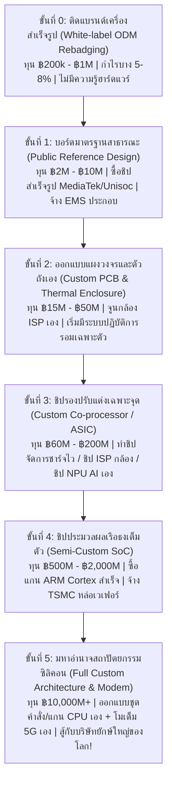
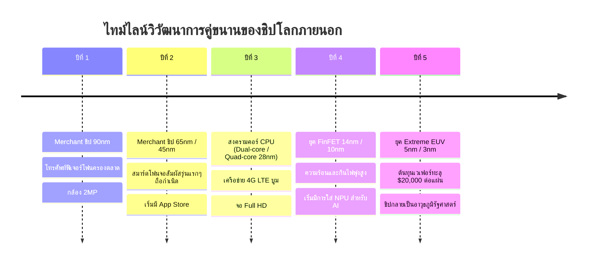

# Spin-off Project Blueprint: Silicon & Handset Empire (พิมพ์เขียวเกมมหาศึกสมาร์ตโฟนและจักรวรรดิซิลิคอน)

> **เอกสารออกแบบวิสัยทัศน์ สถาปัตยกรรม และโมเดลธุรกิจฉบับสมบูรณ์สำหรับเกม Spin-off**  
> *จัดทำขึ้นเพื่อให้เจ้าของโปรเจกต์ และทีมงาน AI (โดยเฉพาะ Codex, Claude, ChatGPT, Gemini) ใช้เป็นฐานข้อมูลอ้างอิงเชิงลึก ความเป็นไปได้ทางวิศวกรรม ฟิสิกส์ และเศรษฐศาสตร์อุตสาหกรรม โดยไม่เอาใจแบบผิวเผิน แต่เน้นความจริงระดับโลกอุตสาหกรรมฮาร์ดแวร์จริง*

---

## สารบัญโครงสร้างเอกสาร
1. [วิสัยทัศน์และคอนเซปต์ของ Spin-off (Core Vision & Game Pitch)](#1-วิสัยทัศน์และคอนเซปต์ของ-spin-off)
2. [บันไดการเติบโต 6 ขั้น: จากร้านรีแบรนด์ห้องแถว สู่มหาอำนาจซิลิคอน (Progression Ladder)](#2-บันไดการเติบโต-6-ขั้น-จากร้านรีแบรนด์ห้องแถว-สู่มหาอำนาจซิลิคอน)
3. [กลไกการตัดสินใจ "ทำชิปเอง vs ซื้อชิปคนอื่น" (The Make-or-Buy Silicon Engine)](#3-กลไกการตัดสินใจ-ทำชิปเอง-vs-ซื้อชิปคนอื่น)
4. [กับดักและมิติทางธุรกิจที่ซ่อนอยู่ (Hidden Industrial Traps & Dilemmas)](#4-กับดักและมิติทางธุรกิจที่ซ่อนอยู่)
5. [สมองกลและการถกเถียงของ NPC ในบอร์ดบริหาร (Autonomous Boardroom Battles)](#5-สมองกลและการถกเถียงของ-npc-ในบอร์ดบริหาร)
6. [การพัฒนาของโลกภายนอกที่คู่ขนาน (Living External World & Merchant Silicon)](#6-การพัฒนาของโลกภายนอกที่คู่ขนาน)
7. [สถาปัตยกรรมระบบ โครงสร้างข้อมูล และชุดสูตรคำนวณ (Architecture & Mathematical Models)](#7-สถาปัตยกรรมระบบ-โครงสร้างข้อมูล-และชุดสูตรคำนวณ)
8. [คู่มือส่งต่อสำหรับ Codex และคำแนะนำทางเทคนิค (Handoff Note for Codex)](#8-คู่มือส่งต่อสำหรับ-codex-และคำแนะนำทางเทคนิค)

---

## 1. วิสัยทัศน์และคอนเซปต์ของ Spin-off

### 1.1 ปรัชญาของเกม: "The Uncanny Phone Industry Simulation"
ในเกมทั่วไป การสร้างโทรศัพท์มักถูกทำให้เรียบง่ายจนน่าเบื่อ: แค่กดเลือก CPU เลเวล 5 + จอเลเวล 4 + แรม 8GB แล้วตั้งราคาขาย ได้เงินกำไรมาอัปเกรดต่อ  
**แต่นั่นไม่ใช่สิ่งที่เกิดขึ้นในโลกจริงเลยแม้แต่น้อย!**

ในโลกความเป็นจริง:
- การที่บริษัทหนึ่งจะตัดสินใจสร้าง **"ชิปของตัวเอง (In-house Custom Silicon)"** เหมือน Apple A/M-Series, Google Tensor, หรือ Huawei Kirin คือ **การเดิมพันความอยู่รอดของทั้งบริษัท (Bet-the-Company Gamble)**
- ชิปหนึ่งตัวต้องใช้เงินค่าหน้ากาก (Photomask) หลายพันล้านบาท ต้องใช้เวลาล่วงหน้า 2–3 ปี ถ้าคำนวณยอดขายผิด หรือมีบั๊กในวงจรเพียงจุดเดียว บริษัทอาจล้มละลายทันที
- ในขณะเดียวกัน ตลาดชิปพ่อค้าภายนอก (Merchant Silicon เช่น Qualcomm Snapdragon, MediaTek Dimensity) ไม่เคยหยุดรอ! พวกเขาปล่อยชิปรุ่นใหม่ทุก 12 เดือนด้วยงบวิจัยปีละหลายหมื่นล้านบาท
- และที่สำคัญที่สุด: **โทรศัพท์หนึ่งเครื่องไม่ได้มีแค่ชิป** แต่มีโมเด็ม 5G ที่ติดหล่มสิทธิบัตร, จอแสดงผลที่โรงงานเลือกส่งเกรดบีให้แบรนด์เล็ก, เซนเซอร์กล้องที่ต้องใช้เวลาจูนสีภาพเป็นปี, แบตเตอรี่ที่เสี่ยงบวมระเบิดเมื่อชาร์จไว, และดราม่าในโซเชียลที่พร้อมจะทำลายชื่อเสียงแบรนด์ในชั่วข้ามคืน!

### 1.2 บทบาทของผู้เล่น: "The Omniscient Observer & Puppet Master"
- ผู้เล่นไม่ได้เป็นคนคลิกอนุมัติเอกสารประจำวัน
- ผู้เล่นคือ **ผู้ถือหุ้นใหญ่ / บอร์ดเฝ้าดูสูงสุด (Observer)** ที่นั่งดู NPC ในบริษัท (CEO, CFO, CTO, หัวหน้าทีมชิป, วิศวกรกล้อง, ฝ่ายจัดซื้อ) ดำเนินชีวิต ตัดสินใจ ทำงานหนัก เถียงกันจนหน้าดำหน้าแดง และเติบโตไปด้วยกัน
- ผู้เล่นสามารถใช้ **Edit Hub (ห้องทดลองชะตากรรม)** เพื่อเสกเงิน, เปลี่ยนนิสัยผู้บริหาร, จุดชนวนสงครามการค้า, หรือแกล้งให้โรงหล่อเวเฟอร์ไฟดับ แล้วเฝ้าดูว่าระบบนิเวศจะปรับตัวและเอาตัวรอดอย่างไร

---

## 2. บันไดการเติบโต 6 ขั้น: จากร้านรีแบรนด์ห้องแถว สู่มหาอำนาจซิลิคอน

เพื่อให้สมจริงจนน่าขนลุก บริษัทของผู้เล่น **ไม่มีทางสร้างชิปเองได้ตั้งแต่วันแรก** ทุนเริ่มต้นเพียงไม่กี่แสนบาทไม่พอกระทั่งจ่ายค่าไลเซนส์ซอฟต์แวร์ออกแบบชิป (EDA) ด้วยซ้ำ บริษัทต้องไต่เต้าผ่าน **6 ลำดับชั้นวิวัฒนาการ**:



### ขั้นที่ 0: เครื่องสำเร็จรูปติดป้าย (White-Label ODM Rebadging)
- **สภาพบริษัท:** มีออฟฟิศห้องแถว พนักงาน 3–5 คน ไม่มีวิศวกร มีแต่ฝ่ายขายและการตลาด
- **การทำงาน:** บินไปงานแฟร์ฮาร์ดแวร์ เลือกซื้อมือถือต้นแบบสำเร็จรูป (Turnkey ODM) จากผู้ผลิตในต่างประเทศ สั่งสกรีนโลโก้ สั่งพิมพ์กล่องภาษาไทย ติดฟิล์ม และส่งขายตามร้านตู้/ตลาดนัด
- **ความจริงที่ต้องเจอ:** สเปกต่ำ, ซอฟต์แวร์ไม่มีการอัปเดตแพตช์, กำไรบางเฉียบ (เครื่องละ ฿150–300), ถ้าเครื่องมีปัญหาต้องส่งซ่อมแบบเหมาล็อต แต่เป็นทางเดียวที่สอนให้บริษัทสะสมทุนก้อนแรกและเข้าใจระบบตัวแทนจำหน่าย

### ขั้นที่ 1: ซื้อบอร์ดอ้างอิงและชิปตลาด (Public Reference Design & Merchant Silicon)
- **สภาพบริษัท:** เริ่มจ้างวิศวกรอิเล็กทรอนิกส์ 2–3 คน และโปรแกรมเมอร์แอนดรอยด์ 2 คน
- **การทำงาน:** ซื้อชุดดีไซน์อ้างอิง (Public Reference Board) จากผู้ผลิตชิปตลาดระดับประหยัด (เช่น MediaTek หรือ Unisoc) ซื้อชิ้นส่วนจอ/แบตเตอรี่มาตรฐานตามสเปกชีต แล้วส่งไฟล์ให้โรงงานรับจ้างประกอบ (EMS) ผลิตให้
- **ความจริงที่ต้องเจอ:** ได้เครื่องที่มีคุณภาพมาตรฐานขึ้น แต่หน้าตาและไส้ในแทบจะเหมือนกับคู่แข่งระดับล่างอีก 20 แบรนด์ในตลาด ต้องแข่งกันที่การทำราคา การแถมเคส หรือการตลาดล้วนๆ

### ขั้นที่ 2: วงจรพิมพ์เฉพาะค่ายและเอกลักษณ์ฮาร์ดแวร์ (Custom PCB & In-house Tuning)
- **สภาพบริษัท:** มีแล็บทดสอบ มีเครื่องมือวัดคลื่นความถี่ (RF Chamber) มีช่างเทคนิคและวิศวกร 20–50 คน
- **การทำงาน:** เริ่มออกแบบลายวงจรแผงวงจรหลัก (Custom Motherboard PCB) เอง, ออกแบบระบบกระจายความร้อนด้วยแผ่นกราไฟต์และท่อความร้อน (Vapor Chamber), เลือกเซนเซอร์กล้องจาก Sony และส่งทีมวิศวกรไปนั่งจูนอัลกอริทึมชิปประมวลผลภาพ (ISP Tuning) เพื่อให้ได้โทนสีผิวที่ถูกใจคนท้องถิ่น
- **ความจริงที่ต้องเจอ:** แบรนด์เริ่มมีตัวตนชัดเจน ผู้ใช้เริ่มจดจำได้ว่า "แบรนด์นี้กล้องสวย" หรือ "แบรนด์นี้เครื่องบางเฉียบไม่ร้อน" ยอดขายเริ่มแตะระดับแสนเครื่องต่อปี

### ขั้นที่ 3: ก้าวแรกสู่ซิลิคอน: ชิปรองเฉพาะทาง (Custom Co-processor / Companion Silicon)
- **จุดเปลี่ยนสำคัญ:** การทำ SoC เต็มตัวมันเสี่ยงเกินไป บริษัทที่ฉลาดในโลกจริง (เช่น Xiaomi Surge P1/C1, OPPO MariSilicon X, Google Titan M, Vivo V1/V2) จะเริ่มจากการทำ **"ชิปตัวเล็กที่เป็นเอกลักษณ์ของตัวเอง"** ก่อน:
  - *ชิปจัดการพลังงานและชาร์จไว (Custom PMIC):* อัดไฟ 120W-200W โดยเครื่องไม่ร้อนและแบตไม่บวม แบรนด์อื่นทำไม่ได้
  - *ชิปประมวลผลภาพถ่ายกลางคืน (Custom Imaging NPU/ISP):* ประมวลผลภาพ Raw แบบเรียลไทม์ ทำให้ภาพถ่ายกลางคืนสว่างใสเหนือกว่ามือถือทั่วไป
- **ประโยชน์:** ใช้เงินค่าหน้ากาก (Mask) แค่ $2M–$5M (แทนที่จะเป็น $50M), ได้สะสมทีมวิศวกรออกแบบวงจรรวม (IC Designers) ชุดแรก และทดลองทำงานร่วมกับโรงหล่อเวเฟอร์จริง

### ขั้นที่ 4: ชิปประมวลผลหลักกึ่งปรับแต่ง (Semi-Custom Flagship SoC)
- **สภาพบริษัท:** มีเงินสดสำรองหลักพันล้านบาท มียอดขายมือถือเกิน 5–10 ล้านเครื่องต่อปี
- **การทำงาน:** ซื้อสิทธิ์แกนประมวลผลมาตรฐานจาก ARM (Cortex-X, Cortex-A) และ GPU Mali/Immortalis แล้วให้ทีมสถาปนิกภายในออกแบบโครงข่ายเชื่อมต่อ (NoC), ตัวควบคุมเมมโมรี (Memory Controller) และใส่ชิป NPU ของตัวเองเข้าไป กลายเป็น SoC ตัวแรกของบริษัท (เช่น ตระกูล Exynos รุ่นแรกๆ หรือ Kirin รุ่นแรกๆ)
- **การผลิต:** จองคิวโรงหล่อระดับโลก (TSMC / Samsung Foundry) ที่โหนดทันสมัย (เช่น 5nm หรือ 4nm)

### ขั้นที่ 5: มหาอำนาจสถาปัตยกรรมซิลิคอนและโมเด็ม (Full Custom Architecture & Cellular Baseband)
- **ขั้นสูงสุดระดับประวัติศาสตร์:** ออกแบบชุดคำสั่งและไมโครสถาปัตยกรรมของแกน CPU เองตั้งแต่ศูนย์ (Custom Microarchitecture เหมือน Apple Firestorm/Avalanche หรือ Qualcomm Oryon)
- **ความยากระดับนรก:** การสร้างโมเด็มสื่อสาร 5G/6G ของตัวเอง (Cellular Baseband) ที่ต้องผ่านการทดสอบคลื่นสัญญาณวิทยุกว่า 10,000 คลื่นกับค่ายมือถือ 200 ค่ายทั่วโลก ซึ่งมีสิทธิบัตรกักขังอยู่นับแสนฉบับ!

---

## 3. กลไกการตัดสินใจ: "ทำชิปเอง vs ซื้อชิปคนอื่น" (The Make-or-Buy Silicon Engine)

นี่คือระบบจำลองสมองกลที่ NPC ระดับผู้บริหาร (CEO, CFO, CTO) จะหยิบยกขึ้นมาคำนวณและถกเถียงกันทุกไตรมาส:

```
                            ┌───────────────────────────────────────────────┐
                            │    สมการตัดสินใจเลือกชิป (Make vs Buy Score)  │
                            └──────────────────────┬────────────────────────┘
                                                   │
                  ┌────────────────────────────────┴────────────────────────────────┐
                  ▼                                                                 ▼
      ┌─────────────────────────┐                                       ┌─────────────────────────┐
      │  ทางเลือกที่ 1: ซื้อชิปคนอื่น │                                       │   ทางเลือกที่ 2: ทำชิปเอง    │
      │  (Qualcomm / MediaTek)  │                                       │   (In-house Custom SoC) │
      └───────────┬─────────────┘                                       └───────────┬─────────────┘
                  │                                                                 │
    • ต้นทุนคงที่วิจัย (NRE): $0                                        • ต้นทุนคงที่วิจัย (NRE): $50M - $120M
    • ราคาซื้อต่อเม็ด: $150 - $180                                      • ต้นทุนหล่อต่อเม็ด: $45 - $60
    • เวลาส่งมอบ: 3 - 6 เดือน                                           • เวลาพัฒนาจนได้ของ: 18 - 24 เดือน
    • ความต่างทางสเปก: 0% (เหมือนคู่แข่ง)                                • ความต่างทางสเปก: +25% ถึง +40%
    • ความเสี่ยง: โดนตัดโควตา / ชิปร้อน                                   • ความเสี่ยง: Tape-Out พัง / เจ๊งจมทุน
```

### 3.1 การเปรียบเทียบจุดคุ้มทุนทางเศรษฐศาสตร์ (The Break-Even Volume Equation)

สมมติผู้บริหารเปรียบเทียบระหว่าง:
- **ชิปตลาด (Merchant Silicon):** ราคาซื้อชิ้นละ $P_{\text{buy}} = \$160$ ต่อเม็ด, ต้นทุน NRE = $\$0$
- **ชิปทำเอง (Custom Silicon):** ค่า NRE รวมหน้ากากและคน $F_{\text{NRE}} = \$80,000,000$ (ประมาณ 2,800 ล้านบาท), ต้นทุนค่าเวเฟอร์และแพ็กเกจจิงต่อเม็ด $V_{\text{make}} = \$50$

จุดคุ้มทุนเชิงปริมาณ ($Q_{\text{breakeven}}$) คำนวณจาก:
$$Q_{\text{breakeven}} = \frac{F_{\text{NRE}}}{P_{\text{buy}} - V_{\text{make}}} = \frac{\$80,000,000}{\$160 - \$50} = \frac{\$80,000,000}{\$110} \approx 727,273 \text{ เครื่อง}$$

> **ความจริงที่ซ่อนอยู่ (The Realistic Catch):**
> ตัวเลข $727,000$ เครื่องดูเหมือนไม่ยากใช่ไหมครับ? **แต่ในโลกจริงไม่ใช่แค่นั้น!**
> 1. นั่นคือกรณีที่ชิปทำเอง **มีประสิทธิภาพและความเสถียรเท่ากับชิปตลาด**
> 2. ถ้าชิปทำเองพัฒนาล่าช้าไป 6 เดือน ชิปตลาดของคู่แข่งจะขยับไปรุ่นถัดไปที่แรงกว่าเดิม 20% ทำให้ชิปทำเองของเรากลายเป็นของล้าสมัยทันทีที่เปิดตัว!
> 3. ถ้ามียอดขายตกเหลือแค่ $300,000$ เครื่อง ต้นทุนต่อเม็ดที่แท้จริงจะกลายเป็น:
>    $$\text{Actual Cost} = \$50 + \frac{\$80,000,000}{300,000} = \$50 + \$266.67 = \$316.67 \text{ ต่อเม็ด!}$$
>    แพงกว่าซื้อชิปตลาดเกือบเท่าตัว และจะดูดเงินสดจนบริษัทล้มละลายทันที!

---

## 4. กับดักและมิติทางธุรกิจที่ซ่อนอยู่ (Hidden Industrial Traps & Dilemmas)
*สิ่งที่เกมทั่วไปไม่เคยบอก แต่เกิดขึ้นจริงในประวัติศาสตร์อุตสาหกรรมไอที*

### 4.1 ฝันร้ายของการหล่อชิปผิดพลาด (The Tape-Out Failure & Respin Nightmare)
- ในขั้นตอนสุดท้ายของการออกแบบชิป บริษัทต้องส่งไฟล์แบบวงจร (GDSII) ไปให้โรงหล่อทำหน้ากากและผลิตชิปทดสอบชุดแรก เรียกว่า **Tape-Out**
- ถ้าทีมวิศวกรปล่อยให้มีบั๊กหลุดรอดไปในวงจรฮาร์ดแวร์ (เช่น สัญญาณนาฬิกาแข่งกัน Clock Glitch, หรือไฟฟ้าสถิตรั่ว) ชิปที่ได้มาอาจเปิดไม่ติด หรือเปิดติดแต่ทำงานผิดพลาด
- บริษัทต้องทำกระบวนการที่เรียกว่า **"Respin"** คือแก้แบบวงจรและสั่งทำหน้ากาก Photomask ชุดใหม่:
  - เสียเงินเพิ่มอีก **$15,000,000 – $40,000,000** ทันที
  - เสียเวลาเลื่อนกำหนดการเปิดตัวโทรศัพท์ไปอีก **6–9 เดือน**
  - คู่แข่งฉวยโอกาสเปิดตัวตัดหน้า สต็อกชิ้นส่วนจอและบอร์ดที่สั่งมารอไว้เริ่มตกรุ่นและเสื่อมราคา!

### 4.2 สงครามการแย่งโควตาโรงหล่อ (The TSMC / Foundry Capacity Squeeze)
- โรงหล่อชิปที่ทันสมัยที่สุดในโลก (เช่น โหนด 3nm หรือ 2nm) มีกำลังผลิตจำกัดมาก
- ลูกค้ารายใหญ่ที่สุด (เช่น แบรนด์ยักษ์ใหญ่ระดับโลก) มักจะใช้เงินสดมหาศาล **เหมาจองสายการผลิตล่วงหน้าไปแล้ว 80-100% ของโรงงาน!**
- บริษัทขนาดเล็กหรือสตาร์ตอัป ต่อให้มีแบบชิปที่ยอดเยี่ยมแค่ไหน ก็ต้องรอคิว หรือต้องยอมถอยไปใช้โหนดที่เก่ากว่า 1 รุ่น (เช่น คู่แข่งใช้ 3nm เราต้องใช้ 4nm) ซึ่งทำให้กินไฟมากกว่า 15-20% อย่างหลีกเลี่ยงไม่ได้

### 4.3 กับดักสิทธิบัตรโมเด็มสื่อสาร (The Cellular Patent Cliff)
- การสร้าง CPU และ GPU สามารถทำได้โดยซื้อไลเซนส์สถาปัตยกรรม
- แต่ **ชิปโมเด็ม 4G / 5G** เต็มไปด้วยสิทธิบัตรจำเป็นตามมาตรฐาน (Standard Essential Patents - SEPs) ที่ถูกถือครองโดยเจ้าพ่อโทรคมนาคม (Qualcomm, Nokia, Ericsson, InterDigital)
- ถ้าแบรนด์ของเราทำชิปโมเด็มเองโดยไม่ทำสัญญาจ่ายค่าไลเซนส์ (FRAND Royalty):
  - บริษัทจะถูกยื่นฟ้องต่อศาลทรัพย์สินทางปัญญาทันที
  - ศาลอาจออกคำสั่งห้ามนำเข้าและห้ามวางจำหน่ายโทรศัพท์ในตลาดยุโรปและอเมริกา (Injunction Order)
  - บริษัทต้องยอมจ่ายค่าสิทธิบัตรเฉลี่ย **3–5% ของราคาขายเครื่องทั้งเครื่อง** (ไม่ใช่แค่ราคาชิป!) ให้กับเจ้าของสิทธิบัตรอยู่ดี

### 4.4 การเมืองเรื่องหน้าจอ (The Display Allocation & Binning Bias)
- ผู้ผลิตหน้าจอ OLED ชั้นนำมีเพียงไม่กี่ราย
- เมื่อเทคโนโลยีหน้าจอใหม่ออกมา (เช่น จอ LTPO 1-120Hz หรือจอขอบบางพิเศษ):
  - แบรนด์ใหญ่จะได้รับสิทธิ์เลือกล็อตหน้าจอเกรดสูงสุด (Uniformity 99%, ไม่มีจุดเดดพิกเซล)
  - แบรนด์สตาร์ตอัปมักจะได้ล็อตที่มีความสม่ำเสมอของสีต่ำกว่า หรือมีอัตราความสว่างสูงสุดต่ำกว่าเล็กน้อย ทำให้เครื่องต้นแบบในแล็บรีวิวของสื่อไอทีได้คะแนนความสว่างกลางแดดน้อยกว่าคู่แข่ง

---

## 5. สมองกลและการถกเถียงของ NPC ในบอร์ดบริหาร (Autonomous Boardroom Battles)

ในเกมนี้ การตัดสินใจสำคัญจะเกิดขึ้นใน **ห้องประชุมบอร์ดบริหาร (The C-Suite Boardroom)** โดย NPC แต่ละคนมีบุคลิก ค่าสเตตัส และเป้าหมายส่วนตัวที่ขัดแย้งกันอย่างสมจริง:

### ตัวอย่างการจำลองการถกเถียง: "เราควรทุ่มเงินทำชิป SoC ของเราเองหรือไม่?"

```text
[บันทึกการประชุมบอร์ดบริหาร: สยามโฟน คอร์ปอเรชัน | เงินสดคงเหลือ: ฿3,200,000,000 | ยอดขายปีล่าสุด: 4.8M เครื่อง]

• CTO (ดร. กานต์ - สถาปนิกซิลิคอนผู้มีความทะเยอทะยานสูง):
  "ถ้าเรายังซื้อชิป Snapdragon ต่อไป เราไม่มีทางเอาชนะแบรนด์เบอร์หนึ่งได้เลย! เราจ่ายค่าชิปปีละกว่า 
   2 หมื่นล้านบาทให้คนอื่น ทั้งๆ ที่เราเอาเงินก้อนนั้นมาสร้างทีมชิปของเราเองได้ เราจะมีชิปที่ปรับจูนเข้ากับ
   กล้องและระบบ OS ของเราได้อย่างสมบูรณ์แบบ แฟนคลับจะยกย่องเราเป็นผู้นำนวัตกรรมตัวจริง!"

• CFO (คุณวิภา - นักการเงินสายอนุรักษนิยม ป้องกันความเสี่ยง):
  "แต่ ดร. กานต์ ลืมคิดไปหรือเปล่าคะว่า ค่าหน้ากากโหนด 4nm บวกค่าซอฟต์แวร์ Synopsys และเงินเดือนทีมออกแบบ
   มันกินเงินสดล่วงหน้าทันที 2,800 ล้านบาท! นั่นคือ 85% ของเงินสดทั้งหมดที่เรามีในธนาคาร! 
   ถ้ายอดขายรุ่นหน้าสะดุดเพราะเศรษฐกิจ หรือโรงหล่อส่งของช้าไปแค่ 2 เดือน บริษัทเราจะไม่มีเงินจ่ายเงินเดือนพนักงาน
   และต้องยื่นล้มละลายทันทีนะคะ ดิฉันขอคัดค้านเด็ดขาดค่ะ!"

• VP of Marketing (คุณภัทร - นักการตลาดสายกระแสนิยม):
  "ผมเห็นใจทั้งสองท่านนะ แต่ความจริงคือ ลูกค้า 80% ไม่รู้ด้วยซ้ำว่าข้างในเป็นชิปอะไร! 
   สิ่งที่เขาดูในติ๊กต็อกคือ 'กล้องถ่ายหน้าเนียนไหม' กับ 'ตัวเครื่องมีสีชมพูใหม่ไหม' 
   ทำไมเราไม่เอาเงิน 2,800 ล้านนั้น ไปจ้างศิลปินระดับโลกมาเป็นพรีเซนเตอร์ และจัดโปรโมชันลดแลกแจกแถมล่ะครับ?
   ยอดขายพุ่งขึ้นเห็นๆ โดยไม่ต้องเสี่ยงตายกับแล็บชิปเลย!"

• CEO (คุณธีรเดช - การตัดสินใจขึ้นอยู่กับบุคลิกเฉพาะตัว):
  [อัลกอริทึมประเมิน]:
   - ถ้านิสัย Risk-Averse สูง -> เลือกซื้อชิปตลาดต่อ แต่เพิ่มงบดีไซน์ภายนอก
   - ถ้านิสัย Ambitious สูง + สภาพการเงินพอมีทางกู้ -> อนุมัติ "โครงการชิปรอง (Custom ISP)" เป็นก้าวแรกก่อน!
```

---

## 6. การพัฒนาของโลกภายนอกที่คู่ขนาน (Living External World & Merchant Silicon)

โลกภายนอกไม่ใช่ภาพนิ่งที่รอให้ผู้เล่นไปแตะ แต่เป็น **ระบบนิเวศที่มีชีวิตและเคลื่อนไหวอยู่ตลอดเวลา**:



1. **วัฏจักรการปล่อยชิปของคู่แข่งภายนอก:**
   - ทุกๆ 12 เดือน บริษัทชิปยักษ์ใหญ่ภายนอก (Qualcomm/MediaTek จำลอง) จะจัดงานเปิดตัวชิปรุ่นใหม่
   - ชิปรุ่นใหม่จะมีคะแนนประสิทธิภาพต่อพลังงาน (Perf/Watt) เพิ่มขึ้นเฉลี่ย 15–25% เสมอ
   - ถ้าชิปที่บริษัทเราพัฒนาเองใช้เวลาทำนานเกินไป ตอนที่เสร็จออกมาอาจจะถูกชิปรุ่นกลางราคาถูกของโลกภายนอกแซงหน้าไปแล้ว!
2. **วิกฤตการณ์โลกที่เกิดขึ้นแบบสุ่มแต่มีเหตุผล (Emergent World Events):**
   - *แผ่นดินไหวในไต้หวัน:* โรงหล่อชิปเสียหาย สายพานหยุดชะงัก 4 สัปดาห์ ราคาเวเฟอร์ทั่วโลกพุ่งขึ้น 30% ทันที
   - *วิกฤตขาดแคลนสารเคมี:* โรงงานผลิตกรดไฮโดรฟลูออริกเกิดไฟไหม้ ส่งผลให้การล้างแผ่นเวเฟอร์สะดุด
   - *สงครามการค้าและการสั่งแบน (Entity List Ban):* ประเทศมหาอำนาจสั่งห้ามไม่ให้ส่งออกสถาปัตยกรรมชุดคำสั่งหรือซอฟต์แวร์ EDA ให้กับบริษัทในบางประเทศ บีบให้บริษัทเหล่านั้นต้องดิ้นรนสร้างเครื่องมือและสถาปัตยกรรมทางเลือกขึ้นมาเอง

---

## 7. สถาปัตยกรรมระบบ โครงสร้างข้อมูล และชุดสูตรคำนวณ (Architecture & Mathematical Models)

เพื่อให้ AI หรือทีมพัฒนาสามารถนำไปเขียนโค้ดได้จริง นี่คือชุดสมการและโครงสร้างข้อมูลที่แนะนำสำหรับ Spin-off:

### 7.1 สมการคำนวณความร้อนและอาการลดความเร็ว (Thermal Equilibrium & Throttling)

$$\Delta T_{\text{junction}} = P_{\text{dissipated}} \times \left( \theta_{\text{jc}} + \theta_{\text{cs}} + \theta_{\text{sa}} \right)$$

$$T_{\text{skin}} = T_{\text{ambient}} + P_{\text{dissipated}} \times R_{\text{th,chassis}}$$

$$\text{ThrottleRatio} = \text{clamp}\left( \left( \frac{T_{\text{skin\_limit}} - T_{\text{ambient}}}{T_{\text{skin\_unconstrained}} - T_{\text{ambient}}} \right)^{0.8}, 0.30, 1.00 \right)$$

- $P_{\text{dissipated}}$: กำลังไฟฟ้าที่ชิปสูญเสียเป็นความร้อนขณะทำงานหนัก (Watts)
- $R_{\text{th,chassis}}$: ความต้านทานความร้อนของโครงสร้างตัวถังและวัสดุ ($^\circ\text{C/W}$)
  - ตัวถังพลาสติก ABS: $5.2^\circ\text{C/W}$
  - โครงอะลูมิเนียม + แผ่นกราไฟต์: $3.1^\circ\text{C/W}$
  - โครงอะลูมิเนียม + แผ่นระบายความร้อน Vapor Chamber: $2.2^\circ\text{C/W}$
- ถ้า $T_{\text{skin}}$ พุ่งเกิน $45^\circ\text{C}$ (ระดับที่ถือแล้วเริ่มร้อนมือ) ชิปจะถูกสั่งลดตัวคูณ $\text{ThrottleRatio}$ ลง ทำให้ความเร็วตกและเฟรมเรตตกทันที

### 7.2 สมการคำนวณอัตราของดีบนเวเฟอร์ (Murphy's Wafer Yield with Learning Curve)

$$Y = \left( \frac{1 - e^{-A_{\text{die}} \times D_0}}{A_{\text{die}} \times D_0} \right)^2$$

$$D_0(t) = D_{\text{target}} + (D_{\text{initial}} - D_{\text{target}}) \times e^{-\frac{W_{\text{cumulative}}}{k_{\text{learning}}}}$$

- $A_{\text{die}}$: ขนาดพื้นที่ชิป ($\text{cm}^2$, คำนวณจาก $\text{dieAreaMm2} / 100$)
- $D_0$: ความหนาแน่นของจุดบกพร่องต่อตารางเซนติเมตร ($\text{defects/cm}^2$)
- $W_{\text{cumulative}}$: จำนวนแผ่นเวเฟอร์ที่โรงงานได้ผลิตสะสม ยิ่งผลิตเยอะ $D_0$ จะยิ่งลดลงเรื่อยๆ (Learning Curve) ทำให้ชิปรุ่นเดียวกันยิ่งผลิตนานไป ยิ่งราคาถูกลงและได้ของดีเยอะขึ้น!

### 7.3 โครงสร้างข้อมูลระดับโมดูล (`spinoff_phone_schema.json`)

```json
{
  "firm": {
    "id": "siam_mobile",
    "tier": "tier_2_custom_pcb",
    "cashSatang": 4500000000,
    "reputation": 68.5,
    "strategy": {
      "siliconApproach": "merchant_qualcomm",
      "evaluatingCustomSilicon": true,
      "customSiliconFeasibility": {
        "nreSatang": 280000000000,
        "estimatedUnitCostSatang": 175000,
        "merchantUnitCostSatang": 560000,
        "breakevenVolume": 727273,
        "projectedSalesVolume": 450000,
        "recommendation": "declined_insufficient_volume"
      }
    },
    "keyTalent": [
      {
        "id": "eng_lead_01",
        "name": "ดร. กานต์",
        "role": "ChiefSiliconArchitect",
        "specialty": "vlsi_microarchitecture",
        "morale": 62,
        "poachingRisk": 0.38,
        "salarySatang": 35000000
      }
    ]
  }
}
```

---

## 8. คู่มือส่งต่อสำหรับ Codex และคำแนะนำทางเทคนิค (Handoff Note for Codex)

> **ถึงเพื่อน AI / Codex ที่จะมาร่วมงานต่อ:**  
> เจ้าของโปรเจกต์ต้องการให้ Spin-off นี้มีความลึกสมจริงระดับ **"เห็นไส้ในของอุตสาหกรรมเทคโนโลยีที่แท้จริง"** มีประเด็นสำคัญที่คุณสามารถหยิบไปขยายผลต่อได้ทันที:

1. **อย่าสร้างระบบแบบเส้นตรง (Avoid Linear Progression Trees):**
   - อย่าให้การวิจัยชิปเป็นแค่แถบหลอดสีฟ้าที่รอเวลาเต็ม
   - ให้มีโอกาสเกิด **Silicon Bugs, Respin, การเจรจาสัญญา Escrow, และการแย่งคิวโรงหล่อ TSMC**
2. **โมเดลการตัดสินใจของ NPC ต้องอิงแรงจูงใจจริง (Behavioral Microeconomics):**
   - CEO ที่บ้าบิ่นจะกล้าเสี่ยงทุ่มเงินทำชิปเองแม้เสี่ยงเจ๊ง
   - CFO ที่ระมัดระวังจะดึงดันให้ใช้ชิปตลาดเพื่อรักษาเงินสด
   - การที่บริษัทจะเปลี่ยนผ่านจาก "ซื้อเขา" ไป "ทำเอง" ต้องเกิดจากจุดคุ้มทุนทางปริมาณ ($Q_{\text{breakeven}}$) และความพร้อมของทีมวิศวกรจริง
3. **รักษาความสมบูรณ์ของ Human Core และกฎเหล็กของระบบ:**
   - ใช้ระบบบุคลิกภาพ ค่านิยม และความถนัดของ `human-core.js` เดิม เพื่อกำหนดการตอบสนอง การหมดไฟ และการลาออกของวิศวกร
   - ผู้เล่นเป็นผู้สังเกตการณ์ที่ดูการดำเนินชีวิตของ NPC และใช้ Edit Hub ทดลองตั้งสมมติฐาน

---

*เอกสารฉบับนี้ถูกสร้างขึ้นเพื่อเป็นรากฐานของโครงการ Spin-off หากต้องการให้เริ่มลงมือเขียนโครงสร้างโค้ด รันการทดสอบเบื้องต้น หรือปรับโฟกัสในจุดใดเป็นพิเศษ สามารถแจ้งได้ทันทีครับ!*
